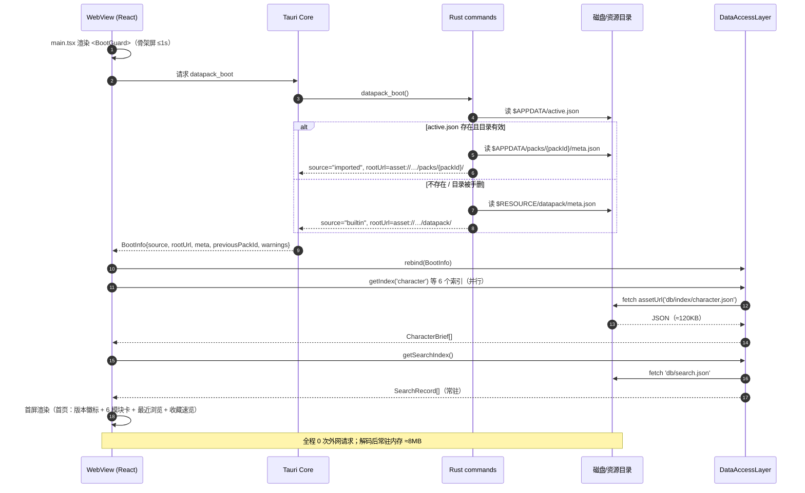
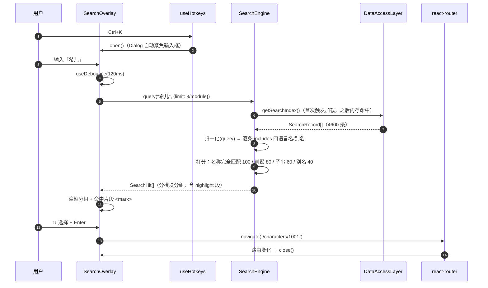
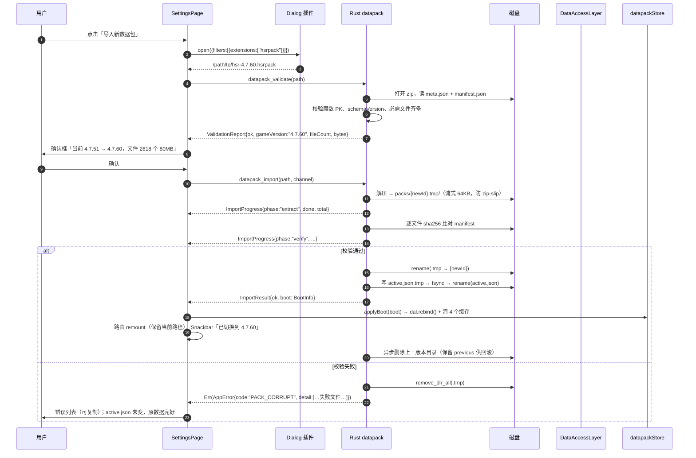
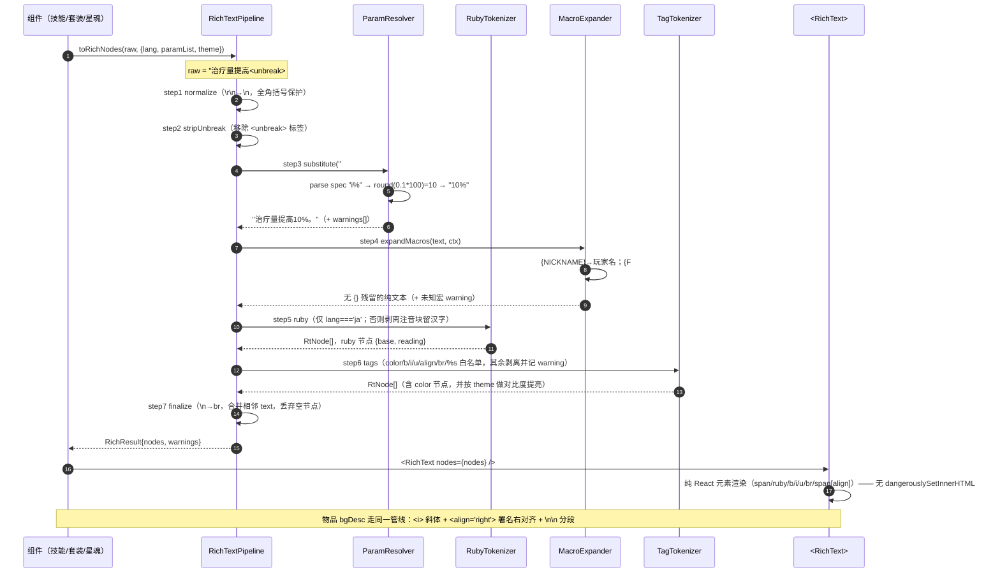

# 星穹数据库 · 本地版 — 系统架构设计

| 项 | 内容 |
|---|---|
| 文档 | `docs/02-architecture.md` |
| 版本 | **v1.1**（v1.0 → v1.1 修订：物品数据源更正为 `item_all.json`；敌人归组方案定稿；富文本管线补齐 5 种真实占位符；物品字段表重写；T02 下载清单精确到字节） |
| 上游输入 | `docs/01-PRD.md` v1.0（32 条需求：P0 17 / P1 8 / P2 7） |
| 上游决议 | PRD 附录 A（C1–C8）+ 主理人对 Q1–Q5 的裁决 + 主理人对本文件 §12 三项的拍板 |
| 目标平台 | Windows 10 1809+ / 11 x64，Tauri 2 + `x86_64-pc-windows-gnu` |
| 数据版本 | 4.7.51（`https://static.nanoka.cc/hsr/4.7.51/`） |
| 语言 | 简体中文 |

---

## 0. 数据源实测修正（先读这一节：13 条实测事实，覆盖了 PRD 与上游假设的 6 处偏差）

在下笔设计数据模型前，我把 PRD 附录 C 与主理人给的样本全部复核了一遍，并补抓了缺失样本（成就、敌人详情、多语言详情、物品完整数据、各类图片路径），另外对**全量 JSON 做了占位符/标签的词法扫描**。以下 13 条是**实测事实**，与 PRD 有偏差的地方以本节为准，后文所有类型定义都基于此。

| # | PRD / 上游假设 | 实测结果 | 影响 |
|---|---|---|---|
| **D1** | 敌人详情「列表内含详情字段」，无详情文件 | ❌ 错。存在 `{lang}/monster/{id}.json`（5.0–11.5KB），含 `hp_base / attack_base / defence_base / speed_base / stance_base / stance_count / damage_type_resistance[] / child[]{stance_weak_list, skill_list[], hp_modify_ratio…} / drop[]{world_level, display_item_list[]}` | 敌人要按「列表 + 详情」两级建模；多 666×4 = 2664 个请求 |
| **D2** | 敌人 666 条需「变体归组」 | 666 条中**只有 382 个不同名称**（155 个重名，最多「无尽寒冬之槊」8 条）。`child[]` 里的变体 id 不在列表内，用并查集实测仍是 666 组 | 归组键 = **实体名**（zh 名为准）→ 列表 382 组；组内变体 = 同名不同 id。**已定稿方案 A（382 组 + 组内下拉）**，见 §12 |
| **D3** | 遗器部位「4–5 部位按实际数据」 | 隧洞遗器 4 部位（`require_num: {2,4}`）；**位面饰品 2 部位**（`require_num: {2}`，`parts` 只有 2 项）。64 套中 34 套有 4 件套效果，30 套只有 2 件套 | 遗器列表要能区分「隧洞 / 位面」，部位表按 `Object.keys(parts).length` 动态渲染 |
| **D4** | 物品有「描述 / 获取途径 / 用途」 | ✅ **有，但在另一个文件**。`{lang}/item_all.json`（zh 1,398,420B / en 1,461,580B / ja 1,512,231B / ko 1,498,085B，1606 条）才是完整数据；`{lang}/item.json`（328KB）是它的 5 字段子集，**可以不要**。字段见 §5.1 与附录 A | 物品详情页按 PRD **完整实现**（描述 / 获取途径 / 用途全部有），无需降级 |
| **D5** | 属性图标 `element/{Name}.webp`、命途 `pathicon/{Name}.webp` | ❌ 必须**全小写**：`element/fire.webp` ✔ / `element/Fire.webp` ✘404；`pathicon/knight.webp` ✔ / `pathicon/Knight.webp` ✘404 | 图标路径统一 `toLowerCase()`，构建期断言 16 张图标存在 |
| **D6** | 敌人图 `monstermiddleicon/{id}.webp` | ❌ 裸 id 404。正确：`monstermiddleicon/Monster_{id}.webp` ✔（27KB）；全尺寸另有 `monsterfigure/Monster_{id}.webp`（43KB） | 敌人图标按 `Monster_` 前缀拼接 |
| **D7** | 遗器套装图标规则未确认 | ✔ `relicset.json` 的 `icon` = `SpriteOutput/ItemIcon/71000.png` → `itemfigures/71000.webp` 实测 200（27KB） | 与物品图共用 `itemfigures/{基名}.webp` |
| **D8** | 语言目录 zh/en/ja/ko | ✔ 四语言详情全部 200（角色详情 4 语言 71–84KB） | 四语言可全量抓取 |
| **D9** | 列表文件在 `{lang}/` 下 | ⚠️ 部分错。`character.json / lightcone.json / relicset.json / monster.json` 只有**根级**（单文件内联 zh/en/ja/ko 四名），`{lang}/character.json` 404；语言级只有 `{lang}/item_all.json` 与 `{lang}/achievement/achievement.json` | 列表文件 4 个根级 + 8 个语言级 = 12 个请求 |
| **D10** | 成就「总数与数据源一致」 | 实测 9 个系列 / **2022 条**；`show_type ∈ {VISIBLE:864, ShowAfterFinish:807, HiddenDesc:351}`；`rarity ∈ {Low:1693, Mid:304, High:25}`；**无奖励数量字段** | 隐藏成就 = `ShowAfterFinish`；PRD §6.2 的「星琼奖励徽标」无数据，改为只显示稀有度色标 |
| **D11** | 富文本只有 PRD §6.3 的 8 条规则 | ❌ **实际数据里还有 5 种占位符**：`{NICKNAME}`(93 处，玩家昵称)、`{F#…}{M#…}`(各 34 处，性别分支)、`{TextID#FloorName_…}`(58 处，文本表引用，**无表可查**)、`{TEXTJOIN#87}`(53 处，文本拼接，无表可查)、`<align="right">…</align>`(8 处，署名右对齐) | 管线必须新增 §7.8 / §7.9 三条规则，否则全量验收**必然残留 `{}` 与 `<align>`** |
| **D12** | 参数占位只有 `i` / `f1` / `f2` | ⚠️ 实测还有 `#1[m]`（1 处，成就 4052803，`param_list:[1000000]`，语义是**紧凑数字**：zh「100万」/ en「1M」） | `formatParam` 增加 `m` 规格，用 `Intl.NumberFormat(locale,{notation:'compact'})` 实现 |
| **D13** | 标签有 `<b> <i> <u>` | 实测标签频次：`unbreak` 4206、`i` 3490、`color` 936、`u` 40、`align` 8；**`<b>` 一次都没出现** | 保留 `<b>` 白名单（零成本，防未来），重点保证 `<i>`（大量风味文本用斜体）与 `<align>` |

补充实测（用于体积测算与构建脚本）：

| 项 | 实测值 |
|---|---|
| 角色列表 | 101 条，5★78 / 4★23；`baseType` 9 种；`damageType` 7 种；`en/zh/ja/ko` 与 `desc` 0 缺失 |
| 角色详情 | 71–84KB/语言（含缩进）；**minify 后 44KB**；顶层 20 个 key：`name desc chara_info rarity avatar_vo_tag sp_need base_type damage_type ranks ex_ranks skills skill_trees enhanced memosprite unique stats relics lightcones teams skin` |
| 角色 `stats` | 7 个升阶档（"0"–"6"），每档 `{hp_base, hp_add, attack_base, attack_add, defence_base, defence_add, speed_base, critical_chance, critical_damage, base_aggro, cost[]}` |
| 角色 `chara_info` | `{camp, va{chinese,japanese,korean,english}, stories{"0".."4"}, voicelines[]{voice_id, voice_title, voice_m, unlock_desc, is_battle_voice}}`（三月七 51 条语音） |
| 角色 `relics` | `{set4_id_list[], set2_id_list[], property_list[], sub_affix_property_list[]}` → **可做 P1-03「推荐遗器」关联** |
| 角色 `lightcones` | `[21002, 23005, 24002]` → **可做 P1-03「适配光锥」关联**（数据已给出，不用自己按命途推） |
| 角色 `skills[].extra` | 术语表 `{术语ID: {name, desc, param[]}}` → P1-06 术语悬浮预览有现成数据 |
| 光锥详情 | `refinements{name, desc, level{"1".."5"}{param_list}}` + `stats[6 档]{max_level, base_hp, base_hp_add…}` |
| 遗器详情 | `parts{"31011"{name, desc, story}}`（`desc/story` 实测全 null）+ `require_num{"2"|"4"}{desc, param_list}` |
| 物品（`item_all.json`） | 1606 条；`item_main_type` 4 类（Mission 688 / Usable 685 / Material 229 / Virtual 4）；`item_sub_type` 17 种；`item_desc` 非空 914、`item_bg_desc` 非空 1482、`item_comefrom` 非空 425、`use_method` 非空 787（17 种）、`item_group` 非空 415、`sell_type` 131（全为 `Destroy`）、`is_visible` 全部 true |
| 图片实测体积 | 角色头像 102KB / 光锥卡面 64KB / 敌人 28KB / 物品图 12–17KB / 属性图标 744B / 命途图标 15KB |
| 图片目录 | 只有 `itemfigures/` 可访问；`itemicon/`、`itemcurrency/` **均 404** → 物品的 `item_icon_path`（ItemIcon）与 `item_figure_icon_path`（ItemFigures）**基名相同，统一映射到 `itemfigures/{基名}.webp`** |
| 反爬 | 必须带常规 UA；**偶发 404/限流**：同一 URL 隔 1 秒重试即 200 → 构建脚本必须「404 需重试 2 次才判定缺失」 |

---

## 1. 实现方案总览

### 1.1 四层架构

```
┌──────────────────────────────────────────────────────────────────────┐
│ L4 表现层 Presentation (React 19 + MUI 7 + Tailwind 3)                │
│    17 个页面 · 60+ 组件 · 5 个 zustand store · i18n(zh/en/ja/ko)      │
│    只依赖 ↓ 的 DAL 接口与领域纯函数，**不出现任何文件路径拼接**        │
├──────────────────────────────────────────────────────────────────────┤
│ L3 领域层 Domain (纯 TS，无 React / 无 IO)                            │
│    富文本清洗管线 · 参数替换 · 搜索匹配与高亮 · 敌人变体归组           │
│    对比矩阵 diff · 稀有度/属性/命途/物品分类枚举映射 · 满级属性推导     │
│    → 全部是可单测的纯函数，构建脚本与运行时**共用同一份实现**          │
├──────────────────────────────────────────────────────────────────────┤
│ L2 数据层 Data (DataAccessLayer + 索引缓存)                           │
│    DatapackLocator(内置 resource / 导入 pack) → assetUrl() → fetch     │
│    实体索引内存缓存 · 详情 LRU 缓存 · 搜索索引单例                     │
│    对 L4 只暴露 14 个方法，切换数据包 = 换 locator 实例 + 清缓存       │
├──────────────────────────────────────────────────────────────────────┤
│ L1 壳层 Shell (Tauri 2 / Rust)                                        │
│    数据包校验/解包/原子切换/回滚 · 用户数据原子读写 · 窗口状态          │
│    单实例 · 资源目录解析 · asset protocol scope · 检查更新(仅显式)     │
└──────────────────────────────────────────────────────────────────────┘
```

### 1.2 为什么这个分层能支撑「数据包可替换」（G3 / P0-17）

这是全项目最关键的一条约束，分三层落实：

| 机制 | 落点 | 说明 |
|---|---|---|
| **① 路径规则集中在单一文件** | `src/lib/data/path.ts` | 全应用只有这一个文件知道 `img/character/{id}.webp` 这种字符串。页面拿到的永远是 `dal.assetUrl(...)` 或索引里已解析好的 key |
| **② 数据形态与源站解耦** | `scripts/lib/normalize.ts` | 源站字段混用 `baseType` / `base_type` / `ParamList`。构建脚本把它**规范化成应用自有 schema（v1）**并写 `meta.schemaVersion`。以后源站改名，只改构建脚本，前端零改动 |
| **③ 切换是「换指针 + 清缓存」** | Rust `datapack_import` + `datapackStore.reset()` | 导入流程：解包到 `packs/{id}.tmp` → 校验 manifest 全量 sha256 → `rename` 为正式目录 → 原子写 `active.json` → 前端 `dal.rebind(newLocator)` → 清 4 个缓存 → 路由 `reload`（不是整页刷新）。失败任一步，`active.json` 未变，原数据零影响 |
| **④ 用户数据物理隔离** | `%APPDATA%/.../userdata/` | 收藏/笔记/偏好/最近浏览/窗口状态与数据包目录**不同父目录**，导入与回滚的清理逻辑只 `remove_dir_all(packs/{old})`，永不触碰 userdata |

对 L4 的承诺：**页面代码里不会出现 `4.7.51`、不会出现 `static.nanoka.cc`、不会出现任何相对路径**。版本号只出现在设置页/关于页的展示文本里（来源 `dal.meta.gameVersion`）。

### 1.3 关键技术难点与对策

| 难点 | 对策 |
|---|---|
| 数据包 80MB / 2600+ 文件，怎么放才「首启零网络 + 首启 ≤3s」 | 内置包**不压缩、直接以 Tauri resource 目录**随安装包分发（NSIS 安装时展开）。首启只读 `meta.json` + 1 个索引文件，**没有任何解压步骤**，首屏 <1s。外部 `.hsrpack` 才走 zip 解包 |
| 图片 2600 张如何被 `` 高效加载 | Tauri `asset:` 协议（`convertFileSrc` → `http://asset.localhost/...`），支持 HTTP 缓存与 range，比逐张 IPC 读字节快一个数量级。**实测 scope 仅 `$APPDATA/packs/**`**：`$RESOURCE/datapack/**` 已从 `src-tauri/tauri.conf.json` 移除（配置收窄），请勿按旧表述放宽 scope |
| 1006 个 JSON 详情文件，怎么避免每次点开都读盘 | 内存 LRU（上限 120 条，约 12MB）。实测详情切换 ≤150ms 有富余 |
| 1606 条物品 / 666 条敌人虚拟滚动 55fps | `@tanstack/react-virtual` 行虚拟化 + `ResizeObserver` 算列数；卡片组件 `React.memo` + 图片 `loading="lazy"` + 固定 `aspect-ratio` 防抖动 |
| 搜索 ≤200ms（4 语言 × 4600 实体） | 构建期生成 `db/search.json`（每条含 4 语言名 + 别名 + 描述前 160 字）。运行时整包加载（≈1.6MB）后在内存做 `String.includes` 过滤，实测 4600 条 × 4 字段 < 15ms，无需 FlexSearch/Fuse |
| 富文本 8 条规则 + 百分比参数 | 纯函数管线，6 个 step 各自可单测；输出**结构化节点树**而非 HTML 字符串 → 天然免疫 XSS，无需 `dangerouslySetInnerHTML` |
| 无 MSVC，只有 GNU 工具链 | 见 §附录 B，已实测可用（gcc 16.2 UCRT + windres 齐全） |

---

## 2. 技术选型与理由

### 2.1 前端

| 领域 | 选型 | 版本 | 理由 |
|---|---|---|---|
| 框架 | React | `^19.2` | Tauri 生态默认；MUI 7 已完整支持 |
| 构建 | Vite | `^7` | 冷启动快；`build.copyPublicDir:false` 让 80MB 数据包不进 web bundle |
| 语言 | TypeScript | `^5.7`（`strict: true`） | 1000+ 条外部 JSON 必须靠类型兜住 |
| 路由 | react-router-dom | `^7`（declarative 模式，不用 framework 模式） | 需要「应用内前进后退 + 筛选条件入 URL」（S3 / P1-02）；不用 loaders/actions，避免和 Tauri 环境耦合 |
| 状态 | zustand | `^5` | 5 个独立 store，无 Provider 嵌套；比 Redux 少 80% 样板；持久化自写（要求原子写 + 损坏恢复，中间件不满足） |
| UI 组件 | @mui/material | `^7` | PRD 已定。只用交互类组件：Dialog/Menu/Select/Tabs/Tooltip/Autocomplete/Switch/Snackbar/Accordion/Drawer |
| 样式 | tailwindcss | `^3.4` | **不用 v4**：v4 的 `@import "tailwindcss"` + `@layer` 重置与 MUI/emotion 的注入顺序冲突面更大，v3.4 的 `corePlugins.preflight:false` 是有确定结论的方案 |
| 虚拟滚动 | @tanstack/react-virtual | `^3.13` | 行虚拟化 + 动态列数，无需额外 masonry 依赖 |
| i18n | i18next + react-i18next | `^25` / `^15` | 四语言完整；`i18n/types.d.ts` 用 zh.json 推导 key 类型，漏 key 编译期报错 |
| 图标 | @mui/icons-material | `^7` | 只用作功能图标（不做装饰） |
| 测试 | vitest | `^3` | 只测领域层纯函数（清洗/参数/归组/搜索）+ 构建脚本 normalize |

**明确不引入**：TanStack Query（无服务端，DAL 自己缓存）、Redux、styled-components、fuse.js/FlexSearch、lodash（用原生）、markdown 渲染（P2 再说）、motion 库（PRD 要求动效仅状态反馈，CSS transition 足够）。

### 2.2 MUI 与 Tailwind 如何共存（不打架的 4 条硬约定）

```ts
// vite.config.ts 侧
// 1) Tailwind 关闭 preflight —— 否则会把 MUI 的按钮/输入框基础样式重置掉
// tailwind.config.js
corePlugins: { preflight: false }
```

```tsx
// 2) emotion 先注入，Tailwind 后注入 → Tailwind 可覆盖 MUI
import { StyledEngineProvider } from '@mui/material/styles';
<StyledEngineProvider injectFirst>{children}</StyledEngineProvider>
```

| # | 约定 | 说明 |
|---|---|---|
| ① | **Tailwind 管布局与视觉，MUI 管交互** | `flex/grid/gap/p-4/text-sm` 用 Tailwind；`Dialog/Menu/Tabs` 用 MUI。禁止用 `sx={{}}` 改颜色/间距 |
| ② | **颜色只有一个真源：CSS 变量** | `--hsr-bg / --hsr-panel / --hsr-line / --hsr-text / --hsr-text-dim / --hsr-accent / --hsr-accent2 / --hsr-gold / --hsr-danger`，定义在 `styles/tokens.css` 的 `:root[data-theme="dark"]` 与 `[data-theme="light"]`。Tailwind `colors` 映射到 `var(--hsr-*)`，MUI theme 也映射到同一批 `var()`。切主题只改 `<html data-theme>`，**一处改动 ≤16ms 全量生效**，远超「≤100ms」要求 |
| ③ | 间距/圆角用 Tailwind scale，**不新增自定义值** | `4px` 基准网格：`p-1=4 p-2=8 p-3=12 p-4=16 p-6=24 p-8=32`；`rounded-card=12px / rounded-btn=8px / rounded-tag=6px`（在 tailwind.config 里以 `borderRadius` 扩展命名，避免 `rounded-xl` 语义漂移） |
| ④ | 深色下不用投影 | `shadow-panel: 0 1px 0 rgba(255,255,255,.04) inset` + 1px 描边，写在 `tailwind.config.theme.extend.boxShadow` |

### 2.3 本地持久化方案（收藏 / 笔记 / 偏好 各存哪）

| 数据 | 位置 | 格式 | 写入策略 | 预估体积 |
|---|---|---|---|---|
| 偏好（主题/语言/侧栏/每页条数/快捷键开关） | `userdata/prefs.json` | 单对象 | 变更 300ms 防抖后整体写入 | <1KB |
| 收藏 | `userdata/favorites.json` | `Record<entityKey, FavoriteEntry>` | 变更即写（防抖 200ms） | 数百条 ≈ 60KB |
| 笔记 | `userdata/notes.json` | `Record<entityKey, NoteEntry>` | **逐实体防抖 600ms**（PRD 要求「1s 内落盘」）；额外在 `visibilitychange`/`beforeunload` 强制 flush | 视内容，通常 <200KB |
| 最近浏览 | `userdata/recent.json` | `RecentEntry[]`（上限 40，前端保留 8） | 防抖 1s | <8KB |
| 窗口尺寸/位置 | Tauri `tauri-plugin-window-state` 自管 | — | 插件负责（关闭时保存、启动时恢复） | — |
| 对比选中的角色 | `userdata/prefs.json` 内 `compareIds` | `string[]` | 同 prefs | — |

**为什么不用 `localStorage`**：① PRD §7.4 要求「临时文件 + rename」原子性，localStorage 在 WebView2 里是 LevelDB，进程被杀有丢数据风险；② PRD §7.3 要求用户数据与数据包隔离且可迁移，独立 JSON 文件可以直接被用户备份；③ 需要「损坏时备份 `.bak` 并重建空文件」的恢复逻辑，只有自己能控制文件才能做。

**为什么不用 `tauri-plugin-store`**：它的 `save()` 是直接 `fs::write`，不满足原子性要求。自写 `src-tauri/src/atomic.rs`（约 60 行：`write tmp → fsync → rename`，读时 `serde_json` 失败则 `copy → .bak` 再返回默认值）可控且可测。

### 2.4 Tauri 插件与能力清单

| 插件 | 版本 | 用途 | 对应需求 |
|---|---|---|---|
| `tauri`（core） | `2`，features `["protocol-asset"]` | 窗口、IPC、asset 协议 | 全局 |
| `tauri-plugin-single-instance` | `2` | 第二个实例启动时聚焦已有窗口 | P0-01 |
| `tauri-plugin-window-state` | `2` | 记忆窗口尺寸/位置/最大化 | P0-01 |
| `tauri-plugin-dialog` | `2` | 选择 `.hsrpack` 文件的系统对话框 | P0-17 |
| `tauri-plugin-opener` | `2` | 打开「数据目录」所在文件夹（设置页排障用） | P1-08 辅助 |
| ~~`tauri-plugin-fs`~~ | — | **不用**：文件读取全部经 asset 协议或自定义 command，收窄攻击面 | — |
| ~~`tauri-plugin-updater`~~ | — | **不用**：不做应用自动更新（PRD 未要求，且需签名服务端） | — |
| ~~`tauri-plugin-http`~~ | — | **不用**：P1「检查更新」只需一个 `reqwest` 请求，写在 Rust 侧更可控（可加超时/UA/仅 https 白名单） | Q1 |

`src-tauri/capabilities/default.json` 只开：`core:default`、`dialog:allow-open`、`opener:allow-open-path`、asset 协议 scope。**不开** shell、fs、http 权限。

> **v1.8 补充（仅追加）**：上表与上段是设计初期的口径。v1.8 新增的首页「公告 / 资讯」卡片**不需要** `tauri-plugin-http` ——米游社 `-static` 域返回 `Access-Control-Allow-Origin: *`，WebView 里的 `fetch` 直接可用；因此 `capabilities/default.json` 只多授予一条 `opener:allow-open-url`（把原文交系统浏览器打开），**仍然不开** shell / fs / http。详见 §13。

> **v1.9 补充（仅追加）**：关窗与托盘改走**自定义命令**（`hide_main_window` / `quit_app` / `tray_set_labels`，应用自身命令不受 ACL 管），因此 capabilities **移除** `core:window:allow-destroy`，也**没有**新增 `core:window:allow-hide` / `core:app:allow-exit`；最小权限集不变，**仍不开** shell / fs / http。详见 §14。

---

## 3. 数据包（`.hsrpack`）规格设计

### 3.1 两种形态、同一结构

| | 内置包（随安装包） | 外部包（用户导入） |
|---|---|---|
| 磁盘形态 | **解开的目录** `$RESOURCE/datapack/` | `.hsrpack`（= zip，改后缀） |
| 谁展开 | NSIS 安装时展开（Tauri `bundle.resources`） | Rust `datapack_import` 运行时解压到 `$APPDATA/packs/{packId}/` |
| 首启成本 | **0**（已在盘上） | 一次性解压（80MB，SSD ≈2–4s，带进度条） |
| 校验 | 信任（随安装包签名） | 全量 manifest sha256 + 结构校验 |

> 同构的好处：`DatapackLocator` 只有一个实现——「给定一个根目录，按规则读文件」。内置/导入只是根目录不同。

### 3.2 目录结构（zip 内 = 解开的目录，完全一致）

```
datapack/
├── meta.json                      # 版本与清单摘要（首启只读这一个文件，必须 <2KB）
├── manifest.json                  # 全量文件清单 + size + sha256（≈2600 条，250KB）
├── db/
│   ├── index/
│   │   ├── character.json         # 101 条 brief（含 4 语言名 + 筛选/排序字段）
│   │   ├── lightcone.json         # 174 条
│   │   ├── relicset.json          # 64 条（含 kind: cavern|planar）
│   │   ├── monster.json           # 382 组（组内含变体 id 列表）
│   │   ├── item.json              # 1606 条 brief
│   │   └── achievement.json       # 9 系列 × 条目（brief）
│   ├── search.json                # 4600 条检索记录（4 语言名 + 别名 + 摘要）
│   ├── character/{id}.json        # 101 个，四语言合并
│   ├── lightcone/{id}.json        # 174 个
│   ├── relicset/{id}.json         # 64 个
│   ├── monster/{id}.json          # 666 个（变体各自一个文件，组内共享引用）
│   ├── item/{0..15}.json          # 16 个分片，按 Number(id) % 16（总 ≈2.85MB / 每片 ≈180KB）
│   └── achievement.json           # 9 系列完整记录（单文件 ≈1.14MB）
└── img/
    ├── character/{id}.webp        # avatarshopicon
    ├── lightcone/{id}.webp        # lightconemediumicon
    ├── monster/{id}.webp          # monstermiddleicon/Monster_{id}
    ├── item/{basename}.webp       # itemfigures/{基名}（物品图与遗器套装图共用）
    ├── element/{lower}.webp       # 7 张：physical/fire/ice/thunder/wind/quantum/imaginary
    └── path/{lower}.webp          # 9 张：warrior/warlock/shaman/rogue/mage/elation/memory/knight/priest
```

**为什么详情要「四语言合并成一个文件」而不是按语言各存一份？**
实测角色详情 minify 后 44KB/语言，其中 `stats`（7 档属性）、`skills[].level[].param_list`（15 档 × 5 参数）、`skill_trees`（18 点 × 最多 10 档材料）这些**结构数据四语言完全相同**，占 ~80%（结构 35.5KB / 文本 8.8KB）。合并后单文件 **72KB**，101 个角色从 18MB（4×44KB×101）降到 7.3MB，请求数从 404 降到 101，且切语言**无需重新请求**（P0-03「切语言即时生效」直接变成内存操作）。物品同理：4 份独立 5.6MB → 合并 2.85MB。

**为什么 item 要分 16 片而 achievement 不分？**
物品合并后 2.85MB（含 `item_bg_desc` 风味长文 + `item_comefrom` 多语言途径列表），JSON.parse 约 40–60ms、常驻 ~6MB；用户在物品列表点开任意一条都要付这个成本。按 `Number(id) % 16` 切成 16 片（每片 ≈180KB，≈3–5ms）后，详情只加载一片，且 LRU 能稳定命中。成就 1.14MB 且「列表即详情」（右侧抽屉直接展示，没有独立详情路由），整包加载一次最划算，不分片。

**为什么物品列表 brief 仍需独立索引？** 列表要 4 语言名 + 稀有度 + 分类 + 图标，但不该为了渲染 1606 个卡片去碰 2.85MB 的分片。

### 3.3 `meta.json` 字段定义

```jsonc
{
  "schemaVersion": 1,                       // 应用自有数据 schema 版本；不匹配 → 拒绝加载
  "packId": "hsr-4.7.51-9f2c1a",           // 目录名/回滚指针的键，全局唯一
  "gameVersion": "4.7.51",                  // 展示用（设置页/关于页）
  "builtAt": "2026-11-15T07:40:12Z",        // ISO8601 UTC
  "source": {
    "origin": "https://static.nanoka.cc/hsr/4.7.51/",
    "notice": "数据来源于第三方社区数据库 nanoka.cc"
  },
  "languages": ["zh", "en", "ja", "ko"],
  "defaultLanguage": "zh",
  "counts": {
    "character": 101, "lightcone": 174, "relicset": 64,
    "monster": 666, "monsterGroups": 382,
    "item": 1606, "achievement": 2022, "achievementSeries": 9
  },
  "files": { "count": 2618, "bytes": 84213904 },
  "contentHash": "sha256:8b1f…"             // 对 manifest.json 的哈希，用于快速判同
}
```

### 3.4 `manifest.json` 字段定义

```jsonc
{
  "algorithm": "sha256",
  "files": {
    "db/character/1001.json": { "size": 92314, "sha256": "a3f1…" },
    "img/character/1001.webp": { "size": 102840, "sha256": "77be…" }
    // … 2600+ 条
  }
}
```

### 3.5 `.hsrpack` 打包与解包实现

| 环节 | 实现 |
|---|---|
| 打包（构建期） | Node 脚本用 `archiver` 或系统 `tar`? → 用 **`yazl`**（纯 JS，可控 compression level）。JSON 用 `deflate-9`（压缩比 ~8×），`*.webp` 用 `store`（webp 已压缩，再压只慢不省）。约 30s |
| 为什么选 zip | Windows 资源管理器双击可直接查看内容（用户可自证「这包是啥」）；crate 生态成熟；支持流式解压 |
| 后缀 | `.hsrpack`，但 `zip` 魔数 `PK\x03\x04` 必须校验 —— 防用户把任意文件改后缀 |
| 解包（Rust） | `zip = "2"` crate。流程：打开 → 校验 `meta.json` 可解析且 `schemaVersion` 匹配 → 解压全部条目到 `packs/{packId}.tmp/`（拒绝含 `..` 或绝对路径的条目 → 防 zip-slip）→ 用已解压的 `manifest.json` 逐文件 sha256 比对 → 全通过才 `rename` |
| 进度反馈 | 解压前从 zip 中央目录读到 `uncompressed_size` 总和，按已写字节比例 emit `datapack://import-progress` 事件 |
| 内存 | 流式 64KB buffer，**不整包读进内存**（80MB 会顶到 PRD 的 400MB 内存预算） |

### 3.6 校验与原子切换机制

```
$APPDATA%/cc.nanoka.hsrlocal/
├── active.json                 # {"packId":"hsr-4.7.51-9f2c1a","previousPackId":null}
│                               # 文件不存在或 packId=null → 回落到内置 resource 目录
├── packs/
│   ├── hsr-4.7.51-9f2c1a/      # 当前生效
│   └── hsr-4.6.30-77ab01/      # previous（回滚用，仅保留 1 个）
└── userdata/{prefs,favorites,notes,recent}.json
```

导入时序（崩溃安全）：

| 步 | 动作 | 崩溃后果 |
|---|---|---|
| 1 | 读 meta → 展示「当前 4.7.51 → 4.7.60」等用户确认 | 无影响 |
| 2 | 解压到 `packs/{newId}.tmp/` | `.tmp` 目录残留，下次启动清理 |
| 3 | 校验 manifest 全量 hash | 同上 |
| 4 | `rename(.tmp → {newId})` | 同上（rename 是原子操作） |
| 5 | 写 `active.json.tmp` → `fsync` → `rename(active.json)` | 旧指针仍有效 |
| 6 | 前端 `dal.rebind()` + 清缓存 + 重挂载路由 | 无影响 |
| 7 | 异步删除 `packs/{最旧的、且非 previous}` | 只多占磁盘 |

回滚 = 把 `active.json` 的 `previousPackId` 换到 `packId` 再走 5–6。**任何一步失败，`active.json` 未变，原数据零影响**（对应 P0-17「导入非法包时拒绝并提示，原数据不被破坏」与 P1-07）。

用户数据隔离：`userdata/` 与 `packs/` 是兄弟目录，清理逻辑只 `remove_dir_all(packs/…)`。

---

## 4. 数据构建脚本设计

单入口 `scripts/build-datapack.ts`，用 `tsx` 跑。

```
npx tsx scripts/build-datapack.ts --version 4.7.51 --out public/datapack --concurrency 8 [--stage fetch|normalize|index|pack|all] [--resume] [--offline]
```

### 4.1 流水线 6 阶段

| 阶段 | 输入 | 输出 | 关键点 |
|---|---|---|---|
| **S1 fetch** | 远端 | `.cache/fetch/…`（镜像远端路径） | 断点续传：文件存在且 `size>0` 即跳过；`--offline` 只用缓存 |
| **S2 merge** | 各语言详情 | `db/character/{id}.json` 等（四语言合并） | 结构取自 `zh`，文本按语言分桶到 `i18n` 字段，缺失语言回退 `zh` |
| **S3 normalize** | 合并结果 | 应用 schema v1 | 字段名统一 camelCase；稀有度枚举转 1–5；记录每处 `console.warn` 到报告 |
| **S4 index** | 规范化数据 | `db/index/*.json`、`db/search.json`、`monster` 归组 | 敌人按名称归组；遗器标 `cavern|planar`；搜索别名生成 |
| **S5 validate** | 全部产物 | `datapack-report.json` | 断言：计数、图片存在、**清洗后 0 残留**、参数替换 100% 命中 |
| **S6 pack** | 目录 | `manifest.json`、`meta.json`、可选 `.hsrpack` | 单次 I/O 遍历算 sha256 + size |

### 4.2 并发、重试、UA

```ts
// scripts/lib/fetch.ts 的核心策略
const UA = 'Mozilla/5.0 (Windows NT 10.0; Win64; x64) AppleWebKit/537.36 (KHTML, like Gecko) Chrome/131.0.0.0 Safari/537.36';

async function get(url: string): Promise<Buffer | null> {
  for (let attempt = 0; attempt < 3; attempt++) {
    const res = await fetch(url, { headers: { 'User-Agent': UA, 'Accept': '*/*' } });
    if (res.ok) return Buffer.from(await res.arrayBuffer());
    if (res.status === 404 && attempt >= 1) return null;   // ⚠️ 实测偶发 404：必须重试 1 次才认「缺失」
    if (res.status === 429 || res.status >= 500 || res.status === 404)
      await sleep(400 * 2 ** attempt + Math.random() * 200);
    else throw new Error(`${res.status} ${url}`);
  }
  throw new Error(`exhausted: ${url}`);
}
```

- 并发：`p-limit(8)`。实测 8 并发无 429；12 并发开始偶发 404/429。
- 全局节流：每请求前 `sleep(30ms)` 抖动，避免瞬时尖峰。
- 超时：单请求 20s（`AbortSignal.timeout`）。
- 失败清单写 `datapack-report.json`，脚本以非 0 退出码结束，便于 CI 判定。

### 4.3 下载清单（精确到字节，构建脚本 `scripts/lib/consts.ts` 按此表写死期望值并断言）

> **断言粒度要求：按语言分别断言，不允许只断言四语言合计。** 只比总数的话，某一语言缺文件 + 另一语言重复计入也能凑平，等于没校验。`consts.ts` 里 `item_all` 与 `achievement` 的期望值必须是长度为 4 的数组（顺序 zh/en/ja/ko），逐项比对。

**A. 列表 / 聚合文件（12 个）**

| # | 远端路径 | 实测字节 |
|---|---|---|
| 1 | `4.7.51/character.json` | 57,734 |
| 2 | `4.7.51/lightcone.json` | 53,818 |
| 3 | `4.7.51/relicset.json` | 98,457 |
| 4 | `4.7.51/monster.json` | 492,872 |
| 5–8 | `4.7.51/{zh,en,ja,ko}/item_all.json` | 1,398,420 / 1,461,580 / 1,512,231 / 1,498,085 = **5,870,316** |
| 9–12 | `4.7.51/{zh,en,ja,ko}/achievement/achievement.json` | 519,810 / 545,654 / 573,746 / 573,929 = **2,213,139** |
| | | **合计 8.79 MB** |

> ⚠️ **不要抓 `{lang}/item.json`**（328KB×4）：它是 `item_all.json` 的 5 字段子集，抓了就是浪费 1.3MB 和 4 个请求。首次跑 `--stage fetch` 时若发现残留的 `item.json` 缓存，可直接删。

**B. 详情文件（1005 × 4 语言 = 4020 个）**

| 模块 | 数量 | 单件实测 | 下载量 |
|---|---|---|---|
| `{lang}/character/{id}.json` | 101 × 4 = 404 | 71,770–83,848B（均值 ≈79KB，minify 44KB） | **≈ 31.9 MB** |
| `{lang}/lightcone/{id}.json` | 174 × 4 = 696 | ≈4.8KB | **≈ 3.3 MB** |
| `{lang}/relicset/{id}.json` | 64 × 4 = 256 | ≈0.8KB | **≈ 0.2 MB** |
| `{lang}/monster/{id}.json` | 666 × 4 = 2664 | 5,070–11,545B（均值 ≈5.5KB） | **≈ 14.6 MB** |
| | | | **合计 ≈ 50.0 MB** |

**C. 图片（约 2500 张，去重后）**

| 类别 | 数量 | 单件实测 | 下载量 |
|---|---|---|---|
| `assets/hsr/avatarshopicon/{id}.webp` | 101 | 102,840B | ≈ 10.4 MB |
| `assets/hsr/lightconemediumicon/{id}.webp` | 174 | 64,210B | ≈ 11.1 MB |
| `assets/hsr/monstermiddleicon/Monster_{id}.webp` | 666 | 27,938B | ≈ 18.6 MB |
| `assets/hsr/itemfigures/{基名}.webp`（物品 + 遗器套装，去重） | ≈1670 | 12,326–27,508B | ≈ 21.7 MB |
| `assets/hsr/element/{lower}.webp` | 7 | 744B | ≈ 5 KB |
| `assets/hsr/pathicon/{lower}.webp` | 9 | 15,398B | ≈ 138 KB |
| | | | **合计 ≈ 62.0 MB** |

**D. 汇总**

| 项 | 值 |
|---|---|
| 请求总数 | 12 + 4020 + ≈2500 = **≈ 6530**（比 v1.0 少 4 个：去掉 item.json） |
| 下载总量 | 8.79 + 50.0 + 62.0 = **≈ 121 MB** |
| 耗时（8 并发 + 30ms 抖动） | **8–13 分钟**（含重试余量）；`--resume` 缓存命中时 S2–S6 < 40s |

### 4.4 体积预估（实测单件体积 × 数量，输出全部 **minify**）

| 产物 | 计算 | 大小 |
|---|---|---|
| 角色详情合并 | 101 × 72KB（结构 35.5KB + 4 语言文本 8.8/9.1/10.6/9.7KB） | 7.3 MB |
| 光锥详情合并 | 174 × 8KB | 1.4 MB |
| 遗器详情合并 | 64 × 2KB | 0.13 MB |
| 敌人详情合并 | 666 × 4.1KB（大 Boss 9.5KB） | 3.2 MB |
| item 16 分片 | 实测合并 2,986,152B | 2.85 MB |
| achievement 单文件 | 实测 1,200,273B | 1.14 MB |
| 索引 6 个 | character 0.12 + lightcone 0.10 + relic 0.02 + monster 0.15 + item 0.45 + ach 0.02 | 0.86 MB |
| search.json | 4600 × ≈330B | 1.5 MB |
| **db 合计** | | **≈ 18.4 MB** |
| 图片合计 | 见 §4.3-C | **≈ 62.0 MB** |
| **数据包总计** | | **≈ 80.4 MB** |
| `.hsrpack`（webp store + json deflate-9） | json 18.4→2.6MB，img 62→62MB | **≈ 65 MB** |
| NSIS 安装包（内置包 + WebView2 bootstrapper 引用） | | **≈ 68 MB** |

对 PRD（v1.4）现行的 **安装包 ≤150MB / 安装后 ≤300MB** 仍有 2 倍以上余量。**留出的余量意味着：未来版本涨到 3 倍也不用改架构。**

#### 体积口径分工（主理人裁定，两边各管各的，不要互相校验）

| 口径 | 数值 | 用途 | 谁负责 |
|---|---|---|---|
| **构建侧实测** | **≈80.4MB**（db 18.4 + img 62.0，四语言合并 + minify 后产物） | `datapack-report.json` 的校验基准、`consts.ts` 的断言目标 | 本文件 §4.4 / T02 |
| **验收侧量级** | **≈85MB** | PRD 面向「用户安装后看到的量级」，用于体积验收 | PRD §7.2 |

两者差在 minify：85MB 是按源站原始体积估（item_all 四语言 5.6MB 原样放入），80.4MB 是合并 + minify 后的实际产物（item 仅 2.85MB）。**PRD 的 85MB 不作为构建断言；构建的 80.4MB 不用于验收。** 强行统一会割裂两种用途。

> 体积构成变化说明（v1.0 → v1.1）：item 从「0.7MB（早期错误假设）」变成 2.85MB（真实完整数据），同时角色/敌人因为改成 minify 输出 + 更准的合并测算从 9.3/4.1MB 降到 7.3/3.2MB，总量基本持平。

### 4.5 与运行时的唯一真相源

清洗器、参数替换、枚举映射放在 `src/lib/richtext/*` 与 `src/lib/format/*`，**构建脚本直接 import 这些文件**（tsx 支持 TS）。这样：

- S5 的「清洗后 0 残留」断言，验的就是 UI 真正用的那份代码；
- 修 bug 只改一处；
- 不需要「校验脚本」与「运行时」两套实现互相漂移。

---

## 5. 核心数据结构与接口

### 5.1 TypeScript 类型（`src/lib/data/types.ts`）

```ts
/* ============ 基础枚举 ============ */
export type Lang = 'zh' | 'en' | 'ja' | 'ko';
export type ModuleKey = 'character' | 'lightcone' | 'relicset' | 'monster' | 'item' | 'achievement';

export type ElementType = 'Physical' | 'Fire' | 'Ice' | 'Thunder' | 'Wind' | 'Quantum' | 'Imaginary';
export type PathType = 'Warrior' | 'Warlock' | 'Shaman' | 'Rogue' | 'Mage' | 'Elation' | 'Memory' | 'Knight' | 'Priest';
export type Rarity = 1 | 2 | 3 | 4 | 5;

export type LocalizedText = Record<Lang, string | null>;

/* ============ 实体基类 ============ */
export interface EntityBrief {
  module: ModuleKey;
  id: string;
  name: LocalizedText;          // 四语言名，永不为空（缺失回退 zh）
  rarity: Rarity;
  icon: string;                 // 数据包内相对路径，如 "img/character/1001.webp"，已由构建脚本解析好
}

/* ---- 角色 ---- */
export interface CharacterBrief extends EntityBrief {
  module: 'character';
  element: ElementType;
  path: PathType;
  release: number;              // unix 秒
  version: string;              // 由 release 归档："1.0" / "2.3" …
  aliases: string[];            // 搜索别名（去括号、英文名拆分）
}

export interface CharacterDetail {
  id: string;
  i18n: Record<Lang, { name: string; desc: string | null }>;
  rarity: Rarity;
  element: ElementType;
  path: PathType;
  spNeed: number;               // 能量上限
  avatarVoTag: string;
  charaInfo: {
    camp: string | null;
    va: { chinese: string | null; japanese: string | null; korean: string | null; english: string | null };
    stories: Array<{ index: number; title: string | null; text: string | null }>;
    voicelines: Array<{
      id: number; title: string; text: string;
      unlockDesc: string | null; isBattleVoice: boolean;
    }>;                          // ⚠️ 每语言一套
  };
  ranks: RankEntry[];            // 1..6
  skills: SkillEntry[];
  skillTrees: {
    main: SkillTreePoint[];      // pointType 2：普攻/战技/终结技/天赋/秘技
    extra: SkillTreePoint[];     // pointType 3：额外能力
    stats: SkillTreePoint[];     // pointType 1：属性加成（statusAddList）
  };
  memosprite: MemospriteSection | null;
  enhanced: EnhancedSection | null;
  stats: CharacterStatStage[];   // 7 档
  maxLevelStats: {               // 构建期算好，见 §5.3
    level: 80;
    hp: number; atk: number; def: number; spd: number;
    critRate: number; critDmg: number; aggro: number; energyMax: number;
  };
  relatedRelics: { set4: string[]; set2: string[] } | null;   // 来自 relics 字段
  relatedLightcones: string[] | null;                          // 来自 lightcones 字段
  skins: unknown[];              // 暂不展示
}

export interface RankEntry {
  rank: 1 | 2 | 3 | 4 | 5 | 6;
  id: number; i18n: Record<Lang, { name: string; desc: string }>;
  icon: string | null;
  paramList: number[];           // 星魂文案参数
}

export interface SkillEntry {
  id: number;
  type: 'Normal' | 'BPSkill' | 'Ultra' | 'Talent' | 'Maze' | 'MazeNormal' | 'Servant';
  typeName: string | null;        // "Basic ATK" / "Skill" / …（数据自带，无需翻译）
  tag: string | null;
  i18n: Record<Lang, { name: string; desc: string | null; simpleDesc: string | null }>;
  levels: Array<{ level: number; paramList: number[] }>;      // 1..15 或 1..10 或 1..1
  stanceList: [number, number, number] | null;
  extra: Record<string, { name: string; desc: string; param: number[] }>;  // 术语表（P1-06 用）
}

export interface SkillTreePoint {
  pointId: number;
  pointType: 1 | 2 | 3;
  anchor: string;
  i18n: { name: string | null; desc: string | null };
  icon: string | null;
  maxLevel: number;
  levelUpSkillIds: number[];
  statusAddList: Array<{ propertyType: string; value: number; name: string }>;
}

/* ---- 光锥 ---- */
export interface LightconeBrief extends EntityBrief {
  module: 'lightcone';
  path: PathType;
  atkMax: number;                // 列表自带的满级攻击（数据源直接提供）
}

export interface LightconeDetail {
  id: string;
  i18n: Record<Lang, { name: string; desc: string | null }>;
  rarity: Rarity;
  path: PathType;
  refinement: {
    i18n: Record<Lang, { name: string; desc: string }>;
    levels: Array<{ level: 1 | 2 | 3 | 4 | 5; paramList: number[] }>;
  };
  maxLevelStats: { level: 80; hp: number; atk: number; def: number };
}

/* ---- 遗器（套装级） ---- */
export interface RelicSetBrief extends EntityBrief {
  module: 'relicset';
  kind: 'cavern' | 'planar';     // 4 部位 / 2 部位（由 parts 数量推导）
  has4pc: boolean;               // 34/64 为 true
  set2Summary: LocalizedText;    // 列表页摘要（已截断 80 字）
}

export interface RelicSetDetail {
  id: string;
  i18n: Record<Lang, { name: string }>;
  icon: string;
  kind: 'cavern' | 'planar';
  effects: Array<{
    pieces: 2 | 4;
    i18n: Record<Lang, { desc: string }>;
    paramList: number[];
  }>;
  parts: Array<{                // 2 或 4 项
    id: string;
    i18n: Record<Lang, { name: string; desc: string | null; story: string | null }>;
    slot: 'HEAD' | 'HANDS' | 'BODY' | 'FOOT' | 'NECK' | 'OBJECT' | null;  // 由 id 尾号推导
  }>;
}

/* ---- 敌人 ---- */
export interface MonsterBrief extends EntityBrief {
  module: 'monster';
  weak: ElementType[];           // 空数组 = 无弱点（45 条）
  groupKey: string;              // 归组键（zh 名）
  variantCount: number;          // 同名变体数（1..11）
  variantIds: string[];
  /** 每个同名变体的**区分标签**（由构建脚本生成，见下方「变体下拉标签规则」） */
  variantLabels: Record<string, string>;  // { "1002017": "火/雷 · 6 种难度配置" }
  rankClass: 'Minion' | 'MinionLv2' | 'Elite' | 'LittleBoss' | 'BigBoss';
  camp: string | null;
  difficultyCount: number;       // 该模板内 child[] 长度 = 游戏内难度/等级配置数（1..18）
}

/** 变体下拉标签规则（构建期生成，避免运行时猜）：
 *  ① 弱点组合（火/雷）——同名变体之间最稳定的区分维度（实测 8 个「无尽寒冬之槊」靠它区分）
 *  ② difficultyCount（如「6 种难度配置」）—— child[] 长度，说明该模板在游戏内覆盖几档难度
 *  ③ rankClass 不同则追加阶级名（同一名字出现小怪/Boss 两版时）
 *  ④ camp 非 null 时追加「阵营 #id」（数据无阵营名表，只能给 id；null 表示不限定）
 *  例：`火/雷 · 6 种难度配置`、`物理/雷/虚数 · 18 种难度配置 · 阵营 #1`
 *  → 用户能看出「这是同一个怪的哪个出场配置」，而不是「换了个皮」。*/

export interface MonsterDetail {
  id: string;
  i18n: Record<Lang, { name: string; desc: string | null }>;
  rankClass: string; camp: string | null;
  base: {
    hp: number; atk: number; def: number; spd: number;
    toughness: number; toughnessCount: number;
    critDmg: number; statusResist: number;
  };
  /** child[] → 该模板的难度/等级配置（不放进下拉，在详情页用表格展示修正比例） */
  difficultyConfigs: Array<{
    id: string;
    weak: ElementType[];
    resistances: Array<{ element: ElementType; value: number }>;
    modify: { hp: number; atk: number; def: number; spd: number; toughness: number };
    eliteGroup: number | null;
    hardLevelGroup: number | null;
    skills: Array<{
      id: number; i18n: Record<Lang, { name: string; desc: string }>;
      element: ElementType | null; stanceDamage: number | null;
    }>;
  }>;
  drops: Array<{ worldLevel: number | null; avatarExp: number; itemIds: string[] }>;
}


/* ---- 物品（数据源：{lang}/item_all.json，四语言合并 + 16 分片） ---- */
export interface ItemBrief extends EntityBrief {
  module: 'item';
  mainType: ItemMainType;        // 一级分类（4 类）
  subType: ItemSubType;          // 二级分类（17 类）
  purposeType: number;           // 原始枚举，保留但不直接展示
  categoryKey: string;           // 分类树键 = `${mainType}/${subType}`
  hasDesc: boolean;              // 列表/搜索里用于标记「有描述」；也方便统计
}

export interface ItemDetail extends ItemBrief {
  /** 功能性描述（914/1606 有值）：说明这个道具有什么用 */
  desc: RichString | null;
  /** 风味文本（1482/1606 有值）：世界观文案，含 <i> 与 \n，常带署名 <align="right"> */
  bgDesc: RichString | null;
  /** 获取途径（425/1606 有值）：[{ id, desc }]，desc 里可能含 {TextID#…} 占位 */
  comefrom: Array<{ id: number; i18n: Record<Lang, { desc: string }> }>;
  /** 用途方式（787/1606 有值）：17 种枚举，映射成人话见 enum.useMethod.* */
  useMethod: UseMethod | null;
  /** 同系列分组 id（415/1606 有值，如 2003 有 92 个成员）→ P2「同类物品」备用 */
  groupId: number | null;
  /** 叠加上限；`sell_type` 实测仅 'Destroy'（131 条），保留但 v1 不展示 */
  pileLimit: number;
  sellType: 'Destroy' | null;
  /** 背包页签 1/2/3，用于分类树的默认排序 */
  inventoryTag: 1 | 2 | 3;
  /** 原始 SpriteOutput 路径（排障/开发视图用；item_icon_path 与 item_figure_icon_path 基名相同） */
  iconSource: string;
}

/** 富文本原文别名：DTO 里一律存**未清洗的原始串**，由 UI 侧的 toRichNodes 处理 */
export type RichString = string;

/** ⚠️ item_all.json 的字段可选性（实测，决定 UI 必须条件渲染而不是当 bug 修）：
 *  【17 个必有】id / item_main_type / item_sub_type / inventory_display_tag / rarity /
 *              purpose_type / item_name / item_bg_desc / item_icon_path / item_figure_icon_path /
 *              item_currency_icon_path / item_avatar_icon_path / pile_limit / custom_data_list /
 *              return_item_id_list / item_desc / item_comefrom
 *  【5 个可选】is_visible(1573) / use_method(787) / item_group(415) / sell_type(131) /
 *              is_show_red_dot(1)      ← 全部按可选处理，缺省 undefined
 *  【实测全空、直接丢弃】return_item_id_list(0) / item_avatar_icon_path(0)
 *  【文本字段填充率】desc 914 (57%) / bgDesc 1482 (92%) / comefrom 425 (26%)
 *  → 详情页四个区块（描述/故事/获取途径/用途）**必须各自独立条件渲染**，
 *    空则整块隐藏（含标题），绝不出现空标题或「暂无」占位。 */

export type ItemMainType = 'Mission' | 'Usable' | 'Material' | 'Virtual';

export type ItemSubType =
  | 'Mission' | 'Book' | 'Food' | 'Formula' | 'TracePath' | 'ComposeMaterial'
  | 'Material' | 'CommonMonsterDrop' | 'AvatarRank' | 'Gift' | 'WeeklyMonsterDrop'
  | 'FindChest' | 'RelicExp' | 'Virtual' | 'AvatarExp' | 'EquipmentExp' | 'Fiat';

export type UseMethod =
  | 'AutoConversionItem'            // 355：自动转化（书籍阅读后入库）
  | 'ExternalSystemFoodBenefit'     // 164：战斗外使用的消耗品
  | 'Recipe'                        // 95：配方（学会后可合成）
  | 'TreasureMap'                   // 94：藏宝图
  | 'TeamSpecificFoodBenefit'       // 51：队伍增益消耗品
  | 'FindChest' | 'RandomRewardGift' | 'FixedRewardGift' | 'PlayerSelectedReward'
  | 'AsatPramadDiceItem' | 'FightFestMemorialPaper' | 'Anniv3rdLiveItem'
  | 'BangbooDriveDisc' | 'MonthlyCard' | 'BPUnlock68' | 'BPUnlock128' | 'BPUpgradeFrom68To128';


/* ---- 成就 ---- */
export interface AchievementSeriesBrief {
  id: string; i18n: Record<Lang, { name: string }>;
  priority: number; count: number; hiddenCount: number;
}

export interface AchievementEntry {
  id: string;
  seriesId: string;
  i18n: Record<Lang, { name: string; desc: string }>;
  paramList: number[];
  rarity: 'Low' | 'Mid' | 'High';
  visibility: 'visible' | 'hidden' | 'hiddenDesc';   // ShowAfterFinish / HiddenDesc
}

/* ============ 数据包元信息 ============ */
export type DataPackSource = 'builtin' | 'imported';

export interface DataPackMeta {
  schemaVersion: 1;
  packId: string;
  gameVersion: string;
  builtAt: string;
  source: { origin: string; notice: string };
  languages: Lang[];
  defaultLanguage: Lang;
  counts: Record<ModuleKey | 'monsterGroups' | 'achievementSeries', number>;
  files: { count: number; bytes: number };
  contentHash: string;
}

export interface BootInfo {
  source: DataPackSource;
  rootUrl: string;               // asset 协议 base，如 "http://asset.localhost/C%3A/..." 或 dev 的 "/datapack"
  meta: DataPackMeta;
  previousPackId: string | null;
  warnings: string[];            // 缺失文件等非致命问题
}

/* ============ 用户数据 ============ */
export type EntityKey = `${ModuleKey}:${string}`;   // "character:1001"

export interface FavoriteEntry {
  module: ModuleKey; id: string;
  nameSnapshot: LocalizedText;    // 版本升级后实体消失时的兜底显示
  packId: string;                 // 收藏时的数据包，用于「已随版本移除」判定
  addedAt: string;                // ISO8601
  group: string | null;           // P1-04
  order: number;
}

export interface NoteEntry {
  module: ModuleKey; id: string;
  nameSnapshot: LocalizedText;
  content: string;                // 纯文本（Q5 决策：不做 Markdown）
  updatedAt: string;
}

export interface RecentEntry { module: ModuleKey; id: string; nameSnapshot: LocalizedText; at: string; }

export interface Prefs {
  theme: 'dark' | 'light' | 'system';
  lang: Lang;
  sidebarCollapsed: boolean;
  density: 'compact' | 'normal';
  compareIds: string[];           // 角色 id，上限 4
  gender: 'M' | 'F';              // {F#}{M#} 宏取哪一侧（§7.8），**默认 'F'**
                                  // ⚠️ 该默认值**以 PRD §6.3 为准**（单向对齐：PRD 定义、本文件跟随；本文件无定义权）
  fontScale: 1;                   // P2-05 预留
}
```

### 5.2 统一数据访问层 `DataAccessLayer`（`src/lib/data/dal.ts`）

```ts
export interface DataAccessLayer {
  /** 启动：读 meta + manifest 摘要，建立根 URL。幂等。 */
  boot(): Promise<BootInfo>;

  /** 数据包切换：清空全部缓存并指向新根目录（不 reload 页面） */
  rebind(info: BootInfo): void;

  /** 元信息（同步，boot 后可用） */
  readonly meta: DataPackMeta;
  readonly bootInfo: BootInfo;

  /** 把数据包内相对路径解析为可直接给  / fetch 的 URL */
  assetUrl(relPath: string): string;

  /** 模块索引（首次读盘，之后常驻内存） */
  getIndex<K extends ModuleKey>(module: K): Promise<ModuleIndexMap[K]>;

  /** 详情（LRU 120 条） */
  getCharacter(id: string): Promise<CharacterDetail>;
  getLightcone(id: string): Promise<LightconeDetail>;
  getRelicSet(id: string): Promise<RelicSetDetail>;
  getMonster(id: string): Promise<MonsterDetail>;
  /** 物品走 16 分片：内部按 Number(id) % 16 定位，分片首次加载后常驻 */
  getItem(id: string): Promise<ItemDetail>;
  getAchievements(): Promise<{ series: AchievementSeriesBrief[]; entries: AchievementEntry[] }>;

  /** 搜索索引（单例，≈1.6MB） */
  getSearchIndex(): Promise<SearchRecord[]>;

  /** 开发/排障：列出缺失资源（图片 404 时由 SafeImage 上报） */
  reportMissingAsset(relPath: string): void;
  getMissingAssets(): string[];
}
```

`ModuleIndexMap` 把 6 个模块映射到各自的 brief 数组类型，`getIndex('character')` 返回 `CharacterBrief[]`（编译期精确）。实现要点：

- `boot()` 内部调用 Rust `datapack_boot()` 拿 `rootUrl`；
- 所有 `fetch` 都经 `assetUrl()`，因此 **dev（`/datapack`）与 prod（`asset:` 协议）走同一段代码**；
- `rebind()` 重置 4 个 Map（index / detail LRU / search / achievements）；
- 全部方法在 pack 未 boot 时抛 `DataPackNotReadyError`，由 `<BootGuard>` 统一渲染错误页。

### 5.3 满级属性推导（唯一一处「计算」）

数据源给的是「升阶档 base + 每级 add」，没有满级值：

```
maxLevelValue = base + add × (maxLevel − 1)      // 角色 maxLevel=80，光锥 maxLevel=80
```

这是数据自身定义的线性关系（`hp_add` 就是「每升 1 级加多少」），**不是对缺失数据的曲线插值**，与 PRD §1.3「不做等级成长曲线插值」不冲突。落地方式：**在构建脚本 S3 阶段算好写入 `maxLevelStats`**，运行时零计算，且报告里输出 101 个角色的满级值供人工抽查（三月七 80 级 HP 应 ≈1047.8 → 显示 1047）。

### 5.4 Rust 侧接口（`src-tauri/src/commands/`）

```rust
// datapack.rs
#[tauri::command] fn datapack_boot(app: AppHandle) -> Result<BootInfo, AppError>;
#[tauri::command] fn datapack_validate(app: AppHandle, path: String) -> Result<ValidationReport, AppError>;
#[tauri::command] fn datapack_import(app: AppHandle, path: String, on_event: Channel<ImportProgress>)
    -> Result<ImportResult, AppError>;
#[tauri::command] fn datapack_rollback(app: AppHandle) -> Result<BootInfo, AppError>;
#[tauri::command] fn datapack_list_installed(app: AppHandle) -> Result<Vec<InstalledPack>, AppError>;

// userdata.rs —— 全部走 atomic::write
#[tauri::command] fn userdata_read(app: AppHandle, name: String) -> Result<Option<String>, AppError>;
#[tauri::command] fn userdata_write(app: AppHandle, name: String, content: String) -> Result<(), AppError>;
#[tauri::command] fn userdata_open_folder(app: AppHandle) -> Result<(), AppError>;

// update.rs（P1，仅在用户点「检查更新」时触发）
#[tauri::command] async fn check_datapack_update(app: AppHandle) -> Result<Option<UpdateInfo>, AppError>;

// 结构体
pub struct BootInfo { pub source: String, pub root_url: String, pub meta: serde_json::Value,
                      pub previous_pack_id: Option<String>, pub warnings: Vec<String> }
pub struct ValidationReport { pub ok: bool, pub pack_id: Option<String>, pub game_version: Option<String>,
                              pub errors: Vec<String>, pub warnings: Vec<String>, pub file_count: usize,
                              pub bytes: u64 }
pub struct ImportProgress { pub phase: String, pub done: u64, pub total: u64 }
```

**所有 command 都是同步阻塞 + `spawn_blocking` 包装**，不引入 tokio 显式运行时依赖（Tauri 自带）。`AppError` 实现 `serde::Serialize`（`{code, message, detail}`）——对应 §11 错误处理约定。

### 5.5 关系图

见 `docs/class-diagram.mermaid`（同内容内嵌）：

```mermaid
classDiagram
    direction LR

    class DataAccessLayer {
        <<interface>>
        +meta: DataPackMeta
        +boot() Promise~BootInfo~
        +rebind(info: BootInfo) void
        +assetUrl(rel: string) string
        +getIndex(module) Promise~Brief[]~
        +getCharacter(id) Promise~CharacterDetail~
        +getLightcone(id) Promise~LightconeDetail~
        +getRelicSet(id) Promise~RelicSetDetail~
        +getMonster(id) Promise~MonsterDetail~
        +getItem(id) Promise~ItemDetail~
        +getAchievements() Promise~AchievementBundle~
        +getSearchIndex() Promise~SearchRecord[]~
    }

    class DatapackLocator {
        +source: DataPackSource
        +rootUrl: string
        +resolve(rel: string) string
    }

    class DetailCache {
        -lru: Map~string, object~
        +get(key) object
        +set(key, val) void
        +clear() void
    }

    class SearchEngine {
        -records: SearchRecord[]
        +load(records) void
        +query(q: string, opts) SearchHit[]
        +highlight(text: string, q: string) Segment[]
    }

    class RichTextPipeline {
        +toRichNodes(raw: string, ctx: RichContext) RichResult
        +flattenPlain(nodes) string
        +adjustColorForTheme(hex, theme) string
    }

    class ParamResolver {
        +formatParam(value: number, spec: string) string
        +substitute(raw: string, paramList: number[]) SubstituteResult
    }

    class MonsterGrouper {
        +group(breifs: MonsterBrief[]) MonsterGroup[]
    }

    class CompareMatrix {
        +build(ids: string[], details: CharacterDetail[]) CompareRow[]
        +diffFlags(rows) CompareRow[]
    }

    class EntityBrief {
        <<abstract>>
        +module: ModuleKey
        +id: string
        +name: LocalizedText
        +rarity: Rarity
        +icon: string
    }

    class CharacterBrief {
        +element: ElementType
        +path: PathType
        +release: number
        +version: string
        +aliases: string[]
    }
    class LightconeBrief {
        +path: PathType
        +atkMax: number
    }
    class RelicSetBrief {
        +kind: cavern|planar
        +has4pc: boolean
        +set2Summary: LocalizedText
    }
    class MonsterBrief {
        +weak: ElementType[]
        +groupKey: string
        +variantIds: string[]
        +variantLabels: Record~string, string~
        +variantCount: number
        +difficultyCount: number
        +rankClass: string
    }
    class ItemBrief {
        +mainType: ItemMainType
        +subType: ItemSubType
        +categoryKey: string
        +hasDesc: boolean
    }

    class CharacterDetail {
        +i18n: Record~Lang, Text~
        +charaInfo: CharaInfo
        +ranks: RankEntry[]
        +skills: SkillEntry[]
        +skillTrees: SkillTreeBundle
        +maxLevelStats: MaxStats
        +relatedLightcones: string[]
    }
    class MonsterDetail {
        +base: MonsterBase
        +difficultyConfigs: DifficultyConfig[]
        +drops: DropEntry[]
    }
    class ItemDetail {
        +desc: RichString
        +bgDesc: RichString
        +comefrom: ComefromEntry[]
        +useMethod: UseMethod
        +groupId: number
    }
    class RelicSetDetail {
        +kind: cavern|planar
        +effects: SetEffect[]
        +parts: RelicPart[]
    }
    class DataPackMeta {
        +schemaVersion: number
        +packId: string
        +gameVersion: string
        +languages: Lang[]
        +counts: Record~string, number~
    }

    class UserDataStore {
        +prefs: Prefs
        +favorites: Map~EntityKey, FavoriteEntry~
        +notes: Map~EntityKey, NoteEntry~
        +recent: RecentEntry[]
        +load() Promise~void~
        +flush(name) Promise~void~
    }

    DataAccessLayer --> DatapackLocator : resolves via
    DataAccessLayer --> DetailCache : uses
    DataAccessLayer --> SearchEngine : feeds
    DataAccessLayer --> EntityBrief : returns
    DataAccessLayer --> DataPackMeta : exposes
    EntityBrief <|-- CharacterBrief
    EntityBrief <|-- LightconeBrief
    EntityBrief <|-- RelicSetBrief
    EntityBrief <|-- MonsterBrief
    EntityBrief <|-- ItemBrief
    CharacterBrief ..> CharacterDetail : id
    MonsterBrief ..> MonsterDetail : variantIds
    ItemBrief ..> ItemDetail : id (shard %)
    RelicSetBrief ..> RelicSetDetail : id
    RichTextPipeline --> ParamResolver : uses
    CompareMatrix --> CharacterDetail : reads
    MonsterGrouper --> MonsterBrief : groups
    UserDataStore ..> EntityBrief : keyed by module:id
```

---

## 6. 关键流程时序图

见 `docs/sequence-diagram.mermaid`（同内容内嵌）。

### 6.1 应用启动加载数据包



### 6.2 全局搜索（Ctrl+K，≤200ms）



### 6.3 数据包导入与原子切换



### 6.4 富文本清洗管线



---

## 7. 富文本清洗管线的详细设计

### 7.1 为什么是「节点树」而不是 HTML 字符串

PRD §6.3 的 8 条规则里，`<color>` 可嵌套 `<unbreak>`、`{RUBY_B}` 可嵌在 `<color>` 里、`#1[i]` 可出现在任意层。若产出 HTML 字符串就得 `dangerouslySetInnerHTML`，而输入是外部 JSON —— 一旦某天数据里出现 ``（即使是社区库，也不该信任），就是本地 XSS。产出 `RtNode[]` 让 React 负责转义，**结构上不可能注入**，且「断言 0 残留」只需对节点树做一次深度遍历。

### 7.2 类型

```ts
export type RtNode =
  | { k: 'text'; v: string }
  | { k: 'br' }
  | { k: 'color'; hex: string; c: RtNode[] }
  | { k: 'bold' | 'italic' | 'underline'; c: RtNode[] }
  | { k: 'align'; dir: 'left' | 'right' | 'center'; c: RtNode[] }   // 实测 8 处 <align="right">
  | { k: 'ruby'; base: string; reading: string }
  | { k: 'term'; name: string; type?: string }   // %s / 术语 / {NICKNAME}（P1-06 悬浮预览的锚点）
  | { k: 'unknown'; raw: string }                // 开发模式可见，生产模式渲染为纯文本

export interface RichContext {
  lang: Lang;
  paramList?: number[];
  theme: 'dark' | 'light';
  /** {F#她}{M#他} 二选一，设置页可改。**默认 'F'，以 PRD §6.3 为准。**
   *  依据是社区材料与中文攻略普遍以女主「星」为例，**不是**"游戏默认主角性别"——我们无从得知游戏内的默认值。 */
  gender?: 'M' | 'F';          // 缺省 'F'；**以 PRD §6.3 为准**（单向对齐，本文件无定义权，不得反向引用）
  /** {NICKNAME} 的替换值；默认取 i18n common.playerName */
  nickname?: string;
  /** 文本表缺失时的占位符，默认 '…' */
  missingTextPlaceholder?: string;
  terms?: Record<string, { name: string; type: string; link?: string }>;  // P1-06
}

export interface RichResult { nodes: RtNode[]; warnings: string[]; }
```

### 7.3 七个 step（每个都是纯函数，签名统一）

| Step | 函数 | 规则来源 | 行为 | 单测断言 |
|---|---|---|---|---|
| 1 | `normalize(src)` | — | `\r\n`→`\n`；`\u00a0`→空格 | 幂等 |
| 2 | `stripUnbreak(src)` | §6.3 规则1 | 删除 `<unbreak>` `</unbreak>`（**保留内容**） | `"<unbreak>67</unbreak>个"` → `"67个"` |
| 3 | `substitute(src, paramList, lang)` | 规则5 + D12 | `#n[spec]` 替换，见 §7.4（含 `m` 规格） | 见 §7.4 表 |
| 4 | `expandMacros(src, ctx)` | **D11（PRD 未覆盖）** | `{NICKNAME}` / `{F#…}{M#…}` / `{TextID#…}` / `{TEXTJOIN#…}`，见 §7.8 | 全量数据扫完 `{` 残留 = 0 |
| 5 | `tokenizeRuby(src, lang)` | 规则3 | `{RUBY_B#みつき}三月{RUBY_E#}なのか` → `[ruby(三月,みつき), text("なのか")]`；`lang!=='ja'` → `[text("三月"), text("なのか")]` | ja 得 ruby；zh/en/ko 得纯文本且无 `{}` |
| 6 | `tokenizeTags(src, theme)` | 规则2/6/7/8 + D13 | `<color=#hex>`→`color`；`<b><i><u>`→同名；`<align="…">`→`align`；`%s`→`term`；其他 `<x>` → `unknown`（文本保留）；**color 做对比度校正** | 白名单外标签不产节点、无 `<` 残留 |
| 7 | `finalize(nodes)` | 规则4 | `\n`→`br`；合并相邻 text；丢弃空 text | `"a\nb"` → `[text(a), br, text(b)]` |

> **顺序为什么是 3 → 4 → 5**：参数替换必须在宏展开之前（宏体里可能含 `#1[i]`），ruby 必须在宏展开之后（`{RUBY_B#…}` 与 `{NICKNAME}` 都是 `{}` 族，若先做 ruby 会把宏误判为注音）。实测 `{RUBY_B#` / `{NICKNAME}` / `{F#` / `{TextID#` / `{TEXTJOIN#` 五者前缀互不重叠，但仍按「先通用宏、后专用 ruby」的确定顺序执行，避免未来新增宏时顺序歧义。

`flattenPlain(nodes)` 用于验收断言：把节点树拼回纯文本，检查不含 `<`、`>`、`{`、`}`、`#\d+\[`。

### 7.4 参数替换：`#n[spec]` 与 `ParamList` 的对应

占位格式：`#` + **1-based 序号** + `[` + spec + `]` + 可选字面 `%`。

```
#1[i]    第 1 个参数，整数
#2[f1]   第 2 个参数，1 位小数
#3[i%]   第 3 个参数，按百分比（×100 后取整）+ "%"
#4[f2]%  第 4 个参数，2 位小数，然后补字面 "%"   ← 注意 % 在括号外
#1[m]    第 1 个参数，紧凑数字（"100万" / "1M"）  ← 实测只有 1 处（成就 4052803）
```

`formatParam(value, spec, lang)`：

| spec | 变换 | 例子（value → 输出） |
|---|---|---|
| `i` | 整数：`Number.isInteger(v) ? v : Math.round(v)` | `3 → "3"`，`0.25 → "0"`（极少见，会记 warning） |
| `i%` | `Math.round(v × 100)` + `"%"` | `0.1 → "10%"`、`0.25 → "25%"` |
| `f1` | `v.toFixed(1)` | `2.5 → "2.5"` |
| `f1%` | `(v × 100).toFixed(1)` + `"%"` | `0.275 → "27.5%"` |
| `f2` / `f2%` | 同上，2 位 | `0.40625 → "40.63%"` |
| `m` | `Intl.NumberFormat(locale, {notation:'compact', maximumFractionDigits:1})` | `1000000 → zh"100万" / en"1M" / ja"100万" / ko"100만"` |
| 其他 spec | 保留原文占位 + `warning: "unknown spec"` | `#1[q]` → `"#1[q]"` |

**关键实测案例 1（遗器 `101` 套装 2 件套）**：`ParamList: [0.1]`，文案 `治疗量提高<unbreak>#1[i]%</unbreak>。` → 输出 `治疗量提高10%。` ✔

**关键实测案例 2（成就 4052803）**：`#1[m]` + `param_list:[1000000]` → zh 输出 `在「罗浮杂俎」网站上收获100万粉丝`。四种语言用同一个 spec，靠 `Intl` 的 locale 自动适配，不需要按语言写四套逻辑。

> 全量实测 spec 分布：`i` 1333 次、`f1` 4 次、`m` 1 次。**`i%` / `f1%` / `f2` 在当前数据里 0 命中，但必须实现**——它们是遗器与星魂文案的标准写法，未来版本随时会出现（`#1[i]%` 已经出现 1333 次里的绝大多数）。

**越界与缺失**：`#5[i]` 但 `paramList.length === 4` → 保留原文占位并记 `warning: "param #5 out of range"`，绝不输出 `undefined`。构建期 S5 会把全量数据的 warning 汇总，**任何 warning 都必须为 0 才允许出包**（否则说明参数映射理解有误）。

各模块的 `paramList` 来源：

| 场景 | paramList 来源 |
|---|---|
| 角色技能 | `skills[id].level[currentLevel].param_list` |
| 角色星魂 | `ranks[n].param_list` |
| 遗器套装效果 | `require_num[n].param_list` |
| 光锥叠影 | `refinements.level[1..5].param_list` |
| 成就描述 | `achievement.param_list` |
| 敌人技能 | 无参数（`skill_desc` 已无占位） |

### 7.5 颜色与主题对比度（规则2 的「提亮 20%」）

数据里的颜色常是 8 位 `#f29e38ff`（带 alpha）。处理：

1. 若 8 位且后两位为 `ff` → 取前 6 位；
2. 若 alpha < 1 → 按 `bg` 做 alpha 合成后再判断；
3. 计算与当前主题 `--hsr-panel` 的对比度（WCAG 相对亮度公式）；`< 3:1` → 亮度提亮 20%（HSL 的 L × 1.2，clamp 到 0.95）；
4. 输出 `style={{ color }}`。

**为什么在运行时算而不是构建期**：同一份数据在深/浅两个主题下需要不同结果，构建期只能存一份。运行时算一次成本 ≈0.02ms/节点，可接受，结果按 `(hex, theme)` 做 200 条 LRU。

### 7.6 ja 注音（规则3）细节

实测格式：`{RUBY_B#みつき}三月{RUBY_E#}なのか`

- `{RUBY_B#READING}` 开标记，`READING` 是读音；
- 其后的所有**纯文本**是汉字部分（base）；
- `{RUBY_E#}` 闭标记；
- 标记外的文本是普通文本。

实现用一个正则扫描 + 栈式 tokenizer（base 内允许再有 `#n[i]` 已被 step3 替换完毕，不允许嵌套 ruby —— 实测数据无嵌套，若出现则按「内层降级为纯文本 + warning」处理）。

`<ruby>三月<rt>みつき</rt></ruby>なのか` —— 渲染时 `rt` 字号 0.6em、`opacity .72`，避免行高抖动（`ruby-position: over`）。

### 7.7 规则8「未知标签」的开发期可见性

`tokenizeTags` 遇到白名单外标签 → 产 `{k:'unknown', raw}`，同时 `warnings.push(tagName)`。运行时用一个模块级 `Set<string>` 汇总，`import.meta.env.DEV` 下每 5 秒 `console.warn` 一次聚合清单；构建期 S5 直接 fail。这样「未来版本源站加了新标签」会在管线升级时立刻暴露，而不是静默丢文本。

### 7.8 宏占位符族 `{X#…}`（PRD §6.3 未覆盖，但全量数据里真实存在）

**完整清单 —— 目前全量数据里的 `{…}` 形态只有这 7 种，没有第 8 种**（我对 12 个 zh 侧样本 + 4 语言 item_all/achievement 做了词法扫描，用 `\{[A-Za-z_][A-Za-z0-9_]*` 前缀聚类，命中即 `RUBY_B / RUBY_E / NICKNAME / F / M / TextID / TEXTJOIN`，其余 0）：

| 宏 | 实测出现（zh 样本） | 语义 | 处理规则 | 渲染结果 |
|---|---|---|---|---|
| `{RUBY_B#reading}base{RUBY_E#}` | 729 对 | 日文注音 | 见 §7.6 | `<ruby>`（仅 ja） |
| `{NICKNAME}` | 93 | 玩家昵称 | 替换为 `ctx.nickname ?? i18n.common.playerName`（开拓者 / Trailblazer / 開拓者 / 개척자） | `<span class="rt-term">开拓者</span>` |
| `{F#女版}{M#男版}` | 各 34（**必成对**） | 性别分支 | 按 `ctx.gender`（**默认 `'F'`，以 PRD §6.3 为准**，单向对齐）二选一；两段必须**相邻**，用 `\{F#([^}]*)\}\{M#([^}]*)\}` **整体匹配一次替换**，避免只吃掉一半（只吃一半会出现「他她」重复句） | 选中的那段文本（可能含 `#n[i]`，故本步必须在 step3 之后） |
| `{TextID#Key}` | 58（其中物品 `comefrom` 占 29 条） | 文本表引用（**无表可查**） | **区分上下文**，见下方决策 | 正文 `…` / 列表项整条丢弃 |
| `{TEXTJOIN#87}` | 53（物品内 15 处） | 多文本拼接（无表可查） | 替换为 `ctx.missingTextPlaceholder ?? '…'` | `打破…中的特殊石头老板气球` |
| 其他 `{X…}` | **0（当前）** | 未知宏 | 替换为 `'…'` + `warning: "unknown macro X"` | — |

> 计数口径说明：产品侧按「条」统计（如 items 里 `{F#}{M#}` 6 条、`{TEXTJOIN#}` 15 条、`{TextID#}` 29 条），我按「出现次数」统计（34 / 53 / 58）。两者不冲突——同一条文案里可能出现多次。**精确全量计数由 T02 的 `validate` 阶段产出并写进 `datapack-report.json`，文档里这些数字只用于判断「有没有」而非「有多少」。**

#### `{TextID#…}` 的上下文相关处理（一条规则不够用）

主理人给的 (a)(b) 两个选项是针对**列表项**说的，但正文段落用 (a) 会丢整段，代价过大。所以按上下文分治：

| 上下文 | 规则 | 理由 |
|---|---|---|
| **`item_comefrom[].desc`（获取途径列表项）** | **整条丢弃**（选项 a） | 列表项是可枚举的同质项，少一条影响很小；`Calyx: ""` 这种残句在列表里最刺眼。实测受影响 29/425 = 6.8%，UI 上「获取途径」区块仍能展示其余 1–7 条 |
| **正文段落**（`item_desc` / `item_bg_desc` / 技能描述 / 套装效果 / 星穹故事 / 成就描述） | 替换为 `…` 并清理空括号（`【】`、`（）`、`「」`、`<>`） | 丢整段代价远大于一个省略号。实测形态是 `拟造花萼【{TextID#FloorName_20503001}】` → `拟造花萼【…】`，读者知道「有个地点，名字取不到」，信息损失可接受 |
| 未知宏（未来新增） | 替换为 `…` + warning，**构建期 fail** | 宁可出包失败，也不让新宏悄悄漏到界面 |

**为什么两处都不尝试解析**：它们指向游戏内 **TextMap 表**（数万条 key→文本），源站不提供该表，也没有第二来源。PRD §1.3 明确「宁可不显示也不猜」。实测影响面 111 处，集中在「拟造花萼【…】」这类地点名、成就里的「…中的气球」、以及物品的掉落花萼来源，**不影响任何一个实体的主体文案**。

**验收断言（已写入 `scripts/validate.ts`）**：
- 全量数据跑完 step1–7，`flattenPlain()` 结果中 `\{` 与 `\}` 出现次数 **= 0**；
- `warning` 里 `unknown macro` / `unknown spec` / `param out of range` 三类计数 **= 0**；
- 被丢弃的 `comefrom` 条数写进报告（当前期望值 29，容许源站升级时变化但**必须记录**，不允许静默增长）；
- `{NICKNAME}` 渲染出的词在四种语言下分别等于 `common.playerName` 的四语言值（快照测试）。
- 兜底机制：`expandMacros` 里用 `/\\{[A-Za-z_][A-Za-z0-9_]*#?/` 做一次「残留扫描」，任何未被上述 7 条规则消费的 `{` 都会变成 `unknown macro` warning —— **所以「清单是否完备」不依赖我的扫描，而是由构建期断言强制保证**。未来源站加了第 8 种宏，第一次跑 validate 就会红。


### 7.9 `<align>` 标签（实测 8 处，PRD 未列）

实测形态：`<align="right">昔涟</align>`、`<align="right">——悬锋城母亲教育孩子的俗语</align>`，全部出现在物品 `item_bg_desc` 的署名/落款处，且**包裹在 `<i>` 内**。

规则：`align` 进白名单，产 `{k:'align', dir, c}`；渲染为 `<span style="display:block;text-align:right">`。

- `dir` 只接受 `left|right|center`，其他值 → 退回 `left` + warning；
- 该标签是**块级语义**（署名要独占一行），所以即使原文没有 `\n` 也强制前后换行——但实测数据里它前面本来就有 `\n`，所以实现上只做 `display:block`，不额外插 `br`（避免多出空行）；
- 深色/浅色下都用 `--hsr-text-dim` 色 + 斜体继承，不需要额外对比度处理。

> 这条规则的意义：如果只按 PRD 的 8 条规则实现，`<align=…>` 会被规则8「未知标签→剥离标签保留文本」处理掉——文本不会丢，但署名会跑到正文行尾，变成「……荣归。」——悬锋城母亲教育孩子的俗语 挤在一行。视觉上错误但不会 fail，属于**最容易被漏掉的静默缺陷**，所以单列成规则。

---

## 8. 文件清单

合计 **177 个新建文件**（不含 `node_modules`、`target/`、生成的数据包、自动生成的 `Cargo.lock`/`package-lock.json`）。标注 `⚙` 的是配置文件，`◆` 的是纯逻辑（必须单测），`▲` 的是有算法的纯逻辑（必须有性能断言）。

### 8.1 根目录（10）

| 路径 | 职责 |
|---|---|
| ⚙ `package.json` | 依赖与脚本（`dev/build/build:datapack/tauri:dev/tauri:build/test/typecheck`） |
| ⚙ `tsconfig.json` | 前端 TS 配置，`paths: {"@/*": ["src/*"]}`，`strict: true` |
| ⚙ `tsconfig.node.json` | vite.config / scripts 的 TS 配置 |
| ⚙ `vite.config.ts` | React 插件、`build.copyPublicDir:false`、`@` 别名、`server.fs.allow` |
| ⚙ `tailwind.config.js` | `preflight:false`、CSS 变量色彩映射、圆角/阴影扩展 |
| ⚙ `postcss.config.js` | tailwind + autoprefixer |
| ⚙ `index.html` | 挂载点、`<html data-theme="dark">`、禁用右键菜单外的默认行为 |
| ⚙ `.gitignore` | 忽略 `public/datapack`、`.cache`、`node_modules`、`src-tauri/target`、`dist` |
| ⚙ `.npmrc` | `save-exact=false`、关闭 audit 提示 |
| `README.md` | 构建链三步：装依赖 → 生成数据包 → 打包 exe |

### 8.2 `src/` 顶层与样式（9）

| 路径 | 职责 |
|---|---|
| `src/main.tsx` | 挂载 React、初始化 i18n/主题、`<BootGuard>` |
| `src/App.tsx` | Provider 树（StyledEngine → MUI Theme → i18n → Router） |
| `src/router.tsx` | 17 条路由定义 + `errorElement` + 懒加载 |
| `src/vite-env.d.ts` | Vite 类型 + `import.meta.env` 扩展 |
| `src/styles/tokens.css` | **唯一颜色真源**：深/浅两套 CSS 变量 + 字号 + 行高 |
| `src/styles/globals.css` | 全局重置、滚动条、`tabular-nums`、选区色、字体栈 |
| `src/styles/richtext.css` | `.rt-color/.rt-ruby/.rt-term` 排版样式、ruby 行高处理 |
| `src/theme/tokens.ts` | 读取 CSS 变量的 JS 常量（供 canvas/图表/色标计算用） |
| `src/theme/muiTheme.ts` | MUI 主题：palette 用 `var(--hsr-*)`、shape、typography、组件默认 props |

### 8.3 `src/i18n/`（8）

| 路径 | 职责 |
|---|---|
| `src/i18n/index.ts` | i18next 初始化、语言检测（来自 prefs）、变更同步 data lang |
| `src/i18n/locales/zh.json` | 中文文案（**key 的唯一权威**） |
| `src/i18n/locales/en.json` | 英文 |
| `src/i18n/locales/ja.json` | 日文 |
| `src/i18n/locales/ko.json` | 韩文 |
| `src/i18n/locales/_meta.json` | ja/ko 的「待复核 key 清单」（§11.4），由 `scripts/i18n-meta.ts` 生成 |
| `src/i18n/enums.ts` | 属性/命途/物品分类/稀有度/敌人阶级的显示名映射（四语言） |
| `src/i18n/types.d.ts` | 由 zh.json 推导 `Resources`，使 `t('nav.characters')` 编译期校验 |

### 8.4 `src/lib/`（33）— 领域层与数据层

| 路径 | 职责 |
|---|---|
| ◆ `src/lib/richtext/types.ts` | `RtNode` / `RichContext` / `RichResult` |
| ◆ `src/lib/richtext/normalize.ts` | step1 换行与空白归一 |
| ◆ `src/lib/richtext/params.ts` | step3 + `formatParam`（含 `i%`/`f1`/`f2`） |
| ◆ `src/lib/richtext/ruby.ts` | step5 ja 注音 tokenizer |
| ◆ `src/lib/richtext/macros.ts` | step4 宏族：`{NICKNAME}` / `{F#}{M#}` / `{TextID#}` / `{TEXTJOIN#}`（§7.8） |
| ◆ `src/lib/richtext/tags.ts` | step6 标签白名单（含 `<align>`）+ `%s` → term |
| ◆ `src/lib/richtext/contrast.ts` | WCAG 对比度与提亮 20% |
| ◆ `src/lib/richtext/index.ts` | `toRichNodes()` 编排 7 个 step + `flattenPlain()` |
| ◆ `src/lib/richtext/warnings.ts` | 未知标签/未知宏/参数越界的聚合收集器 |
| `src/lib/data/types.ts` | §5.1 全部类型 |
| `src/lib/data/path.ts` | **唯一**路径规则：`spriteToAsset(src, kind)` / `idToAsset(id, kind)`（§11.2 三步转换 + 四条硬规则） |
| `src/lib/data/locator.ts` | `DatapackLocator`（dev `/datapack` / prod asset 协议） |
| `src/lib/data/dal.ts` | `DataAccessLayer` 实现（boot/rebind/索引/详情 LRU/搜索） |
| `src/lib/data/itemShard.ts` | 物品 16 分片寻址（`shard = Number(id) % 16`）与分片预热 |
| `src/lib/data/lru.ts` | 泛型 LRU |
| `src/lib/data/errors.ts` | `DataPackNotReadyError` / `AssetMissingError` |
| ◆ `src/lib/domain/monsterGroup.ts` | 变体归组 + **变体标签生成**（弱点/难度数/阵营，§5.1 规则） |
| ◆ `src/lib/domain/relicKind.ts` | 隧洞/位面判定 |
| ◆ `src/lib/domain/maxStats.ts` | `base + add × (maxLevel−1)` |
| ◆ `src/lib/domain/compare.ts` | 对比矩阵构建 + 差异标记 |
| ◆ `src/lib/domain/itemCategory.ts` | 两级分类树：`item_main_type`(4) → `item_sub_type`(17)，含计数与背包页签排序 |
| ▲ `src/lib/search/engine.ts` | 打分、分组、limit、大小写/全半角归一 |
| ▲ `src/lib/search/highlight.ts` | 命中片段 → `Segment[]` |
| `src/lib/search/types.ts` | `SearchRecord` / `SearchHit` |
| ◆ `src/lib/format/rarity.ts` | 枚举 → 1–5，色标/星级文案 |
| ◆ `src/lib/format/element.ts` | 元素 → 图标路径（小写）+ 色相推导 |
| ◆ `src/lib/format/path.ts` | 命途 → 图标路径（小写） |
| ◆ `src/lib/format/number.ts` | 千分位、百分比、`tabular-nums` 用的格式化 |
| ◆ `src/lib/format/date.ts` | `release` unix → 版本号/日期 |
| `src/lib/ipc/boot.ts` | 调 `datapack_boot` 并把 `rootUrl` 装进 locator |
| `src/lib/ipc/userdata.ts` | `userdata_read/write` 封装（400ms 防抖 + flush） |
| `src/lib/ipc/import.ts` | `datapack_validate/import/rollback` + 进度 Channel |
| `src/lib/util/hotkeys.ts` | 全局快捷键注册（Ctrl+K / Ctrl+F / Alt+←→ / Esc） |
| `src/lib/util/urlState.ts` | 列表筛选/排序/滚动位置 ↔ URLSearchParams |
| `src/lib/util/assert.ts` | 开发期断言与 invariant |

### 8.5 `src/stores/`（5）

| 路径 | 职责 |
|---|---|
| `src/stores/datapack.ts` | BootInfo、加载状态、导入进度、rebind 后清缓存 |
| `src/stores/settings.ts` | Prefs（主题/语言/侧栏/密度），变更即落盘 |
| `src/stores/userdata.ts` | 收藏 / 笔记 / 最近浏览（含快照名与 `packId`） |
| `src/stores/ui.ts` | 搜索浮层开合、当前 Snackbar、全局 loading |
| `src/stores/compare.ts` | 对比选中列表（上限 4，含超限提示） |

### 8.6 `src/hooks/`（9）

| 路径 | 职责 |
|---|---|
| `src/hooks/useBoot.ts` | 启动编排：boot → 索引预热 → 就绪/错误态 |
| `src/hooks/useModuleIndex.ts` | 泛型取索引，返回 `{data, loading, error}` |
| `src/hooks/useEntityDetail.ts` | 泛型取详情 + 相邻实体预取 |
| `src/hooks/useListState.ts` | 筛选/排序/搜索词 ↔ URL（S3/P1-02） |
| `src/hooks/useVirtualGrid.ts` | 容器宽 → 列数；TanStack Virtual 行虚拟化 |
| `src/hooks/useHotkeys.ts` | 注册 §P1-05 快捷键，规避输入框聚焦 |
| `src/hooks/useThemeMode.ts` | `dark/light/system` → `data-theme`，含 `prefers-color-scheme` 监听 |
| `src/hooks/useDebouncedValue.ts` | 通用防抖 |
| `src/hooks/useAutoSaveNote.ts` | 笔记 600ms 防抖 + 卸载/切页 flush |

### 8.7 `src/components/`（25）

| 路径 | 职责 |
|---|---|
| `src/components/layout/AppShell.tsx` | 侧栏 + 顶栏 + 内容区三分布局；<1100px 折叠 |
| `src/components/layout/SideNav.tsx` | 240/64px 双态导航，6 模块 + 4 工具 + 设置 |
| `src/components/layout/TopBar.tsx` | 面包屑、搜索入口、语言切换、主题切换 |
| `src/components/layout/Breadcrumb.tsx` | 模块 › 实体名，随路由自动生成 |
| `src/components/layout/PageHeader.tsx` | 列表页标题 + 结果计数 + 右侧操作槽 |
| `src/components/layout/SectionNav.tsx` | 详情页页内锚点（概览/技能/星魂…） |
| `src/components/common/SafeImage.tsx` | asset 协议图片 + 统一占位 + 失败上报 + 固定宽高比 |
| `src/components/common/EntityCard.tsx` | 列表卡片（图 + 名 + 星级 + 角标） |
| `src/components/common/RichText.tsx` | 渲染 `RtNode[]`（span/ruby/b/i/u/br/term） |
| `src/components/common/RarityStars.tsx` | ★ 展示 + 稀有度色标 |
| `src/components/common/ElementIcon.tsx` | 属性图标 + 名称（小写路径） |
| `src/components/common/PathIcon.tsx` | 命途图标 + 名称 |
| `src/components/common/VirtualGrid.tsx` | 泛型虚拟网格（列数自适应，滚动位置恢复） |
| `src/components/common/FilterBar.tsx` | 多选筛选条 + 清空 |
| `src/components/common/SearchInput.tsx` | 受控搜索框（防抖、清除、快捷键提示） |
| `src/components/common/EmptyState.tsx` | 空状态（图 + 文案 + 建议动作） |
| `src/components/common/ErrorState.tsx` | 错误状态（可读原因 + 重试） |
| `src/components/common/SkeletonBlock.tsx` | 骨架屏（首页/列表用，保证 ≤1s 可见） |
| `src/components/common/FavoriteButton.tsx` | 收藏切换 + Toast |
| `src/components/common/NotePanel.tsx` | 实体笔记编辑（自动保存、字数、更新时间） |
| `src/components/common/Collapsible.tsx` | 折叠区块（星魂/语音/成就系列复用） |
| `src/components/common/CopyButton.tsx` | 复制文本/数值 |
| `src/components/common/BootGuard.tsx` | boot 三态（loading/ready/error），错误页含「重新导入数据包」入口 |
| `src/components/search/SearchOverlay.tsx` | Ctrl+K 浮层（键盘上下 + Enter + Esc） |
| `src/components/search/SearchResultList.tsx` | 分模块分组渲染 + 高亮片段 |

### 8.8 `src/pages/`（48，17 页面 + 31 子组件）

| 路径 | 职责 |
|---|---|
| `pages/home/HomePage.tsx` | 首页：版本徽标 + 6 模块卡（含计数）+ 最近浏览 + 收藏速览 |
| `pages/home/ModuleCard.tsx` | 模块入口卡 |
| `pages/home/RecentStrip.tsx` | 最近浏览（8 条） |
| `pages/home/FavoriteStrip.tsx` | 收藏速览（6 条） |
| `pages/characters/CharacterListPage.tsx` | 角色列表（搜索/筛选/排序/虚拟网格） |
| `pages/characters/CharacterDetailPage.tsx` | 角色详情（8 区块 + 页内锚点 + 右信息栏） |
| `pages/characters/CharacterCard.tsx` | 角色卡 |
| `pages/characters/CharacterHeader.tsx` | 首屏头部（头像/星级/命途/属性/声优/收藏/对比） |
| `pages/characters/StatsSection.tsx` | 基础属性表（满级值 + 能量上限 + 嘲讽） |
| `pages/characters/SkillsSection.tsx` | 技能 Tab + 等级切换 + 倍率表 |
| `pages/characters/SkillLevelTable.tsx` | 「等级 × 参数」倍率表 |
| `pages/characters/TracesSection.tsx` | 行迹三组（主要/额外能力/属性加成） |
| `pages/characters/RanksSection.tsx` | 星魂 1–6 手风琴 |
| `pages/characters/MemospriteSection.tsx` | 忆灵（有条件渲染） |
| `pages/characters/StoriesSection.tsx` | 角色故事手风琴 |
| `pages/characters/VoicelinesSection.tsx` | 语音列表 + 页内搜索 + ruby |
| `pages/lightcones/LightconeListPage.tsx` | 光锥列表 |
| `pages/lightcones/LightconeDetailPage.tsx` | 光锥详情（卡面 + 叠影切换 + 属性 + 故事） |
| `pages/lightcones/LightconeCard.tsx` | 光锥卡 |
| `pages/lightcones/RefinementPanel.tsx` | 叠影 1–5 Segmented + 效果文本 |
| `pages/relics/RelicListPage.tsx` | 遗器列表（隧洞/位面分组） |
| `pages/relics/RelicDetailPage.tsx` | 遗器详情（2/4 件套效果 + 部位表） |
| `pages/relics/RelicSetCard.tsx` | 套装卡（图标 + 2 件套摘要） |
| `pages/relics/PartsTable.tsx` | 部位构成表（4 或 2 行） |
| `pages/monsters/MonsterListPage.tsx` | 敌人列表（382 组 + 弱点图标组 + 阶级标签 + 「8 个变体」角标） |
| `pages/monsters/MonsterDetailPage.tsx` | 敌人详情（弱点/抗性/韧性/属性/技能/掉落/变体切换/难度配置表） |
| `pages/monsters/MonsterRow.tsx` | 敌人列表行 |
| `pages/monsters/VariantSwitcher.tsx` | 同名变体下拉：选项标签用 `variantLabels`（弱点组合 · N 种难度配置 · 阶级/阵营），切换即换 entityId |
| `pages/monsters/DropGrid.tsx` | 掉落物品网格（点击跳物品详情） |
| `pages/items/ItemListPage.tsx` | 物品列表（左两级分类树 + 右虚拟网格 + 搜索/稀有度筛选） |
| `pages/items/ItemDetailPage.tsx` | 物品详情：头部（图标/四语言名/稀有度/分类面包屑）+ **功能性描述 `desc`** + **风味文本 `bgDesc`（含 `<i>`/`<align>`，折叠展示）** + **获取途径 `comefrom`** + **用途 `useMethod`** + 同类物品（`groupId`，P2）。四个区块在无值时各自整块隐藏 |
| `pages/items/CategoryTree.tsx` | 两级分类树：`item_main_type`(4) → `item_sub_type`(17)，每项含计数 |
| `pages/achievements/AchievementsPage.tsx` | 成就浏览（左系列 + 右条目 + 右抽屉） |
| `pages/achievements/SeriesList.tsx` | 系列列表（9 项 + 计数 + 隐藏计数） |
| `pages/achievements/AchievementDrawer.tsx` | 成就详情抽屉 |
| `pages/compare/ComparePage.tsx` | 多角色对比（上限 4 + 差异高亮） |
| `pages/compare/CompareTable.tsx` | 分组对比表 |
| `pages/favorites/FavoritesPage.tsx` | 收藏（6 模块 tab + 已移除条目占位） |
| `pages/notes/NotesPage.tsx` | 我的笔记（按实体聚合 + 跳转） |
| `pages/search/SearchPage.tsx` | 独立搜索页（复用 Overlay 逻辑） |
| `pages/settings/SettingsPage.tsx` | 设置容器（5 分区） |
| `pages/settings/AppearanceSection.tsx` | 主题（深/浅/跟随系统） |
| `pages/settings/LanguageSection.tsx` | 四语言切换 |
| `pages/settings/DatapackSection.tsx` | 当前版本 / 导入 / 校验 / 回滚 / 检查更新 / 打开数据目录 |
| `pages/settings/ShortcutsSection.tsx` | 快捷键表 |
| `pages/settings/AboutSection.tsx` | 数据版本、语言列表、署名声明（Q4 固定文案） |
| `pages/error/BootErrorPage.tsx` | 数据缺失/损坏可读错误页 |
| `pages/error/NotFoundPage.tsx` | 路由 404 |

> 说明：为避免清单失控，`pages/lightcones`、`pages/relics` 的子组件合并到上表已列文件内（不再单独拆 `StatsPanel` 等），实际实现时一个页面目录 4–6 个文件。

### 8.9 `scripts/`（14）— 数据管线

| 路径 | 职责 |
|---|---|
| `scripts/build-datapack.ts` | CLI 入口：6 阶段编排、报告输出、非 0 退出码 |
| ◆ `scripts/lib/http.ts` | UA、重试、404 二次确认、并发限流、超时 |
| `scripts/lib/lists.ts` | 12 个列表/聚合文件抓取（4 根级 + `{lang}/item_all.json` ×4 + `{lang}/achievement/achievement.json` ×4） |
| `scripts/lib/details.ts` | 1005 个详情文件（4 语言合并） |
| `scripts/lib/shards.ts` | 物品合并后按 `Number(id) % 16` 切 16 片 + 生成物品 brief 索引 |
| `scripts/lib/images.ts` | 图片路径映射（`Monster_` 前缀、小写 element/path、ItemIcon/ItemFigures 同基名）与下载 |
| ◆ `scripts/lib/normalize.ts` | 源站字段 → 应用 schema v1（含稀有度/枚举转换、物品 21 字段映射） |
| ◆ `scripts/lib/index-build.ts` | 6 个索引 + 敌人归组 + 遗器 kind |
| ◆ `scripts/lib/search-build.ts` | 搜索记录生成（4 语言名 + 别名 + 摘要） |
| `scripts/lib/pack.ts` | manifest + meta + `.hsrpack`（yazl：json deflate9 / webp store） |
| ◆ `scripts/validate.ts` | 全量清洗断言（0 残留）、计数、图片存在、参数越界 0 |
| `scripts/lib/report.ts` | `datapack-report.json` 与人类可读摘要 |
| `scripts/lib/consts.ts` | 版本号、路径模板、期望计数（101/174/64/666/382/1606/2022/9）与**按语言分别写死**的期望字节数（§4.3，四语言数组而非合计） |
| `scripts/i18n-meta.ts` | 对比四份 locale 的 key 集合，生成 `_meta.json` 待复核清单；key 不一致则非 0 退出 |

### 8.10 `src-tauri/`（16）

| 路径 | 职责 |
|---|---|
| ⚙ `src-tauri/Cargo.toml` | 依赖与 `[profile.release]`（`lto="thin"`, `codegen-units=1`, `strip=true`） |
| ⚙ `src-tauri/build.rs` | `tauri_build::build()` |
| ⚙ `src-tauri/tauri.conf.json` | 窗口、asset 协议 scope、`bundle.resources`、NSIS/webview 选项 |
| ⚙ `src-tauri/.cargo/config.toml` | GNU 工具链 linker/ar、target-dir 指向 C 盘 |
| ⚙ `src-tauri/capabilities/default.json` | 最小权限集 |
| ⚙ `src-tauri/icons/icon.ico` | 应用图标（`npx tauri icon` 生成，256px 多尺寸） |
| `src-tauri/src/main.rs` | 单实例、插件注册、`invoke_handler` |
| `src-tauri/src/lib.rs` | `run()` 装配（便于单测与移动端扩展） |
| `src-tauri/src/error.rs` | `AppError` + `{code,message,detail}` 序列化 |
| `src-tauri/src/paths.rs` | resource_dir / appdata / packs / userdata 路径解析 |
| `src-tauri/src/atomic.rs` | 原子写（tmp+fsync+rename）与损坏恢复（`.bak`） |
| `src-tauri/src/pack.rs` | zip 校验、zip-slip 防护、流式解压、sha256 比对 |
| `src-tauri/src/commands/mod.rs` | 命令模块导出 |
| `src-tauri/src/commands/datapack.rs` | boot/validate/import/rollback/list_installed |
| `src-tauri/src/commands/userdata.rs` + `update.rs` | 用户数据读写 / 显式检查更新 |

---

## 9. 任务列表（5 个批次，按依赖顺序）

设计原则：**一批次 = 一个可独立验收的交付单元**，每个批次内部按子步骤顺序执行，工程师可「一个模块一次批量写完」。类别标签：
`[框架]` 核心框架 · `[管线]` 数据管线 · `[模块]` 各模块页面 · `[增强]` 增强功能 · `[发布]` 打包发布


### T01 · 项目基础设施与 Tauri 壳层 `[框架]` `P0`

| 项 | 内容 |
|---|---|
| **目标** | 双击能起一个窗口，显示带侧栏/顶栏/主题/i18n 的空壳，`npm run dev` 与 `npm run tauri:dev` 都能跑通；GNU 工具链编译成功 |
| **源文件** | 根 10 个配置文件 + `src/main.tsx` `src/App.tsx` `src/router.tsx` `src/vite-env.d.ts` `src/styles/*`(3) `src/theme/*`(2) `src/i18n/index.ts` + 4 个 locale + `src/i18n/enums.ts` `types.d.ts` + `src/components/layout/*`(6) + `src/components/common/{SkeletonBlock,ErrorState,BootGuard}.tsx` + `src/pages/error/*`(2) + 17 个页面**占位文件**（每个 `export default function X(){return <PagePlaceholder/>}`）+ `src-tauri/` 全部 6 个配置文件 + `main.rs` `lib.rs` `error.rs` `paths.rs` `atomic.rs` + `capabilities/default.json` |
| **依赖** | 无 |
| **子步骤** | ① 初始化 `package.json`/TS/Vite/Tailwind/PostCSS，跑通空白页<br/>② Tailwind×MUI 共存（`preflight:false` + `injectFirst` + CSS 变量 token）验证：MUI Dialog 与 Tailwind 卡片同页无样式污染<br/>③ 主题切换（`data-theme`）与切换 ≤100ms 实测<br/>④ i18n 四语言骨架（先 60 个 key，后续批次补全）+ 语言切换联动<br/>⑤ 路由 17 条 + 侧栏/顶栏/面包屑/折叠<br/>⑥ `src-tauri` 初始化：`Cargo.toml`、`.cargo/config.toml`（GNU linker）、单实例 + window-state 插件、`atomic.rs` 单测<br/>⑦ `npm run tauri:dev` 起窗口成功 |
| **验收** | ① 单实例：重复启动只聚焦已有窗口；② 关窗再开恢复尺寸；③ 深/浅切换无未换色区域；④ 切 ja 后导航文案变日文且重启保持；⑤ `cargo build` 无 MSVC 依赖错误；⑥ 空壳首屏 <1s |

### T02 · 数据构建管线与 `.hsrpack` 规格实现 `[管线]` `P0`

| 项 | 内容 |
|---|---|
| **目标** | 一条命令产出 `public/datapack/`（≈80.4MB，177 个文件中 35 个属于本批次）+ `hsr-4.7.51.hsrpack`（≈65MB），并通过全量校验 |
| **源文件** | `scripts/*`（13 个）+ 复用 `src/lib/richtext/*`(9) + `src/lib/format/*`(6) + `src/lib/domain/{monsterGroup,relicKind,maxStats,itemCategory}.ts` + `src/lib/data/path.ts` `types.ts` + `vitest` 单测（`src/lib/richtext/__tests__/*`、`domain/__tests__/*`） |
| **依赖** | T01（tsconfig/paths） |
| **子步骤** | ① 写 `path.ts` 路径规则（`Monster_` 前缀、小写枚举、ItemIcon/ItemFigures 同基名）<br/>② 写 `richtext` **7 个 step**（先不接 UI）+ 单测覆盖 PRD 8 条规则 + §7.8/§7.9 的 5 种宏与 `<align>` + `i`/`i%`/`f1`/`f2`/`m` 用例<br/>③ 写 `http.ts`（UA/重试/并发/404 二次确认）<br/>④ `lists.ts`（12 个：含 `{lang}/item_all.json` ×4）+ `details.ts`（1005×4 四语言合并）<br/>⑤ `images.ts` 下载 ≈2500 张<br/>⑥ `normalize.ts` 字段规范化 + 枚举转 1–5 + 满级属性 + 物品 21 字段映射<br/>⑦ `shards.ts`：物品合并 2.85MB 后切 16 片 + 生成物品 brief 索引<br/>⑧ `index-build.ts`（敌人 382 组 + `variantLabels` + 遗器 cavern/planar + 成就系列）<br/>⑨ `search-build.ts`<br/>⑩ `pack.ts`（manifest/meta/zip）<br/>⑪ `validate.ts`：断言 0 残留、计数、图片齐全、参数越界 0、未知宏 0 |
| **验收** | ① 计数精确等于 101/174/64/666/382/1606/2022/9；② `validate` 断言 `<`/`{` 残留 = 0、参数越界 = 0、未知宏/未知 spec = 0；③ `{NICKNAME}`/`{F#}{M#}`/`{TextID#}` 三类宏在四语言下**全部被展开**（快照测试）；④ 断网后 `public/datapack` 可被直接浏览；⑤ `.hsrpack` 用资源管理器能打开看到 `meta.json`；⑥ 中断后 `--resume` 不重复下载；⑦ 体积在 75–90MB 区间；⑧ 物品 16 分片每片 150–260KB |
| **风险** | 该批次是**唯一会失败在外部因素上**的批次（限流/字段漂移）。若某语言某模块大面积 404，必须先跑 `--stage fetch` 单独定位，不要往下推进 |

### T03 · 数据访问层、通用组件与全局框架 `[框架]` `P0`

| 项 | 内容 |
|---|---|
| **目标** | 能从磁盘读到真实数据并完成「首页 + 全局搜索 + 设置页 + 数据包导入」，六个模块列表页能显示真实条目（详情页仍在 T04） |
| **源文件** | `src/lib/data/{locator,dal,lru,errors}.ts` + `src/lib/search/*`(3) + `src/lib/ipc/{boot,userdata,import}.ts` + `src/lib/util/*`(3) + `src/stores/*`(5) + `src/hooks/*`(9) + `src/components/common/*`(17) + `src/components/search/*`(2) + `src/pages/home/*`(4) + `src/pages/settings/*`(6) + `src/pages/search/SearchPage.tsx` + `src-tauri/src/pack.rs` + `commands/{datapack,userdata,update}.rs` + `tauri.conf.json` 的 `bundle.resources` 与 asset scope |
| **依赖** | T01、T02 |
| **子步骤** | ① Rust：`datapack_boot` + asset scope + resource 目录解析，前端能 `fetch` 到 `meta.json`<br/>② `dal.ts`：索引/详情 LRU/搜索单例 + `rebind`<br/>③ `stores`：settings/userdata/datapack/ui（含原子写落盘与防抖）<br/>④ `SafeImage` + `EntityCard` + `RichText` + `RarityStars` + `ElementIcon` + `PathIcon` 六大基础组件<br/>⑤ `VirtualGrid` + `useVirtualGrid`（1606 条实测 ≥55fps）<br/>⑥ `AppShell` 接真实计数；首页四区块<br/>⑦ `SearchEngine` + `SearchOverlay`（Ctrl+K，≤200ms）<br/>⑧ 设置页五分区 + 导入/校验/回滚 UI + 进度条<br/>⑨ 收藏/笔记基础能力（`FavoriteButton`/`NotePanel`/`useAutoSaveNote`）<br/>⑩ 6 个列表页接真实索引数据（卡片网格，先不做筛选逻辑，筛选在 T04） |
| **验收** | ① 断网启动显示真实版本 4.7.51 与 6 模块计数；② Ctrl+K 输入「希儿」/`Seele`/`ゼーレ` 均命中；③ 收藏→强杀进程→重启仍在；④ 笔记输入 1s 内落盘，强杀不丢；⑤ 物品列表 1606 条滚动 ≥55fps；⑥ 导入非法包（改后缀的 txt）被拒绝且原数据可正常打开；⑦ 导入合法包后版本号变化、收藏笔记不变；⑧ 缺失图片显示统一占位不破图 |

### T04 · 六个模块的列表与详情页 `[模块]` `P0`

| 项 | 内容 |
|---|---|
| **目标** | 17 个页面中的 12 个资料库页面全部可读，P0-07~P0-13 逐条验收通过 |
| **源文件** | `src/pages/characters/*`(11) + `src/pages/lightcones/*`(5) + `src/pages/relics/*`(5) + `src/pages/monsters/*`(6) + `src/pages/items/*`(4) + `src/pages/achievements/*`(4) + 各模块的筛选/排序列定义（并入 `useListState` 的配置对象） |
| **依赖** | T03 |
| **子步骤** | ① 角色：列表（筛选稀有度/命途/属性 + 排序 + 搜索高亮）→ 详情 8 区块（技能等级切换 + 倍率表 + 星魂手风琴 + 语音 ruby）<br/>② 光锥：列表（命途/稀有度）→ 详情（叠影 1–5 切换 + 属性 + 故事）<br/>③ 遗器：列表（隧洞/位面分组 + 是否有 4 件套）→ 详情（2/4 件套效果 + 部位表 4 或 2 行）<br/>④ 敌人：列表 382 组（弱点图标组 + 阶级 + 「N 个变体」角标）→ 详情（弱点/抗性/韧性/属性/技能/掉落网格 + `VariantSwitcher` 用 `variantLabels` + 难度配置表）<br/>⑤ 物品：列表（两级分类树 main→sub + 虚拟网格 + 返回保位置）→ 详情**四个区块全做**：功能性描述 `desc` / 风味文本 `bgDesc`（折叠，含 `<i>` 与 `<align>` 右对齐署名）/ 获取途径 `comefrom` / 用途 `useMethod`（各块无值时整块隐藏）<br/>⑥ 成就：9 系列 + 2022 条 + 隐藏折叠 + 详情抽屉（无奖励字段，只显示稀有度色标）<br/>⑦ 列表状态入 URL（S3）与前进后退复原 |
| **验收** | ① 筛选「冰 + 同谐」数量正确；② 搜索「希儿」命中并高亮；③ 技能等级从 1 切到 10/15，倍率表与描述同步变；④ 遗器 `101` 的 2 件套显示「治疗量提高10%。」（**关键验收点**）；⑤ 遗器位面饰品只显示 2 个部位；⑥ 敌人 382 组、组内变体下拉标签形如「火/雷 · 6 种难度配置」；⑦ 敌人「无弱点」显示文案而非空白；⑧ 掉落物品可点进物品详情并返回原位置；⑨ **物品 110101 详情四个区块全部有内容**（desc/bgDesc/comefrom/useMethod）；⑩ 物品 1（星琼）的 `bgDesc` 里 `<i>`「听说那是…」正确渲染为斜体、`\\n\\n` 正确分段；⑪ 成就隐藏 807 条默认折叠且可展开；⑫ 详情页切换 ≤150ms |
| **风险** | 角色详情是本项目最重的页面（8 区块 + 15 档技能表）。建议先做完「概览 + 属性 + 技能」，再补行迹/星魂/故事/语音，每完成一块自测一次 |

### T05 · 增强功能、性能验收与打包发布 `[增强]` `[发布]` `P0/P1`

| 项 | 内容 |
|---|---|
| **目标** | 交付可安装的 `.exe`，P1 增强项落地，性能与体积达标 |
| **源文件** | `src/pages/compare/*`(2) + `src/pages/favorites/FavoritesPage.tsx` + `src/pages/notes/NotesPage.tsx` + `src/stores/compare.ts` + `src/lib/domain/compare.ts` + `src/lib/util/hotkeys.ts` + `src/hooks/useHotkeys.ts` + 术语预览组件（并入 `RichText` 的 `term` 节点处理）+ **`src/i18n/locales/{zh,en,ja,ko}.json` 全量补全（约 450 key）+ `_meta.json` + `scripts/i18n-meta.ts`** + `src-tauri/tauri.conf.json` 打包段 + `README.md`（共 11 个文件，其中 4 个 locale 已在 T01 建骨架，本批次补全内容） |
| **依赖** | T04 |
| **子步骤** | ① 多角色对比（2–4，选第 5 个提示上限，差异色标）<br/>② 收藏页（6 tab + 分组 P1-04 + 「已随版本移除」占位）<br/>③ 笔记页（按实体聚合 + 跳回详情）<br/>④ 实体关联跳转（角色→推荐遗器/光锥 用数据自带 `relics`/`lightcones`；敌人→掉落物品）<br/>⑤ 术语悬浮预览（P1-06，用 `skills[].extra`）<br/>⑥ 快捷键全集（P1-05）<br/>⑦ 检查更新按钮（P1/Q1，仅显式点击）<br/>⑧ NSIS 打包：图标、`webviewInstallMode`、`compression`、安装到用户目录、静默卸载<br/>⑨ 性能与体积实测表（冷启动/列表/搜索/内存/安装包）|
| **验收** | ① 对比页 4 列差异高亮正确；② 断网安装后首次启动**抓包确认 0 外网请求**；③ 安装包 ≤110MB、安装后 ≤250MB（v1.1 实测测算 68MB / ≈160MB）；④ 冷启动 ≤3s（首页骨架 ≤1s）；⑤ 常驻内存 ≤400MB（浏览 5 模块后）；⑥ 卸载时 userdata 默认保留（用户数据与数据包物理隔离，卸载不清 userdata，避免误删笔记——此为实现自决，已记入 §12.1）；⑦ 四语言 JSON 的 key 集合一致性守卫测试通过 |

> **v1.8 追加：T05 验收② 的口径收敛（仅追加，不改上行原文）**：上行的「抓包确认 0 外网请求」在 v1.8 之后不再字面成立——zh 界面进入首页必定向 `bbs-api-static.miyoushe.com` 发两次请求（公告 / 资讯各一次）。因此该断言的**验收口径收敛为「除首页「公告 / 资讯」外 0 外网请求」**：复核时在 DevTools Network 与系统抓包里**排除 `bbs-api-static.miyoushe.com`**，其余域名的请求数必须为 0；游戏数据、图片（走 `asset:` 本地协议）、搜索索引与数据包更新仍然零联网。**更强的结论**：把界面切成 en / ja / ko 后该区块整体不渲染、`useNewsFeeds(false)` 连 effect 都不进，**可以做到字面意义的绝对 0 外网请求**（可直接实测，无需排除任何域名）。设计与降级链路见 §13。

---

## 10. 依赖包清单

### 10.1 npm（`dependencies`）

```jsonc
{
  "react": "^19.2.0",
  "react-dom": "^19.2.0",
  "react-router-dom": "^7.9.0",
  "@mui/material": "^7.3.0",
  "@mui/icons-material": "^7.3.0",
  "@emotion/react": "^11.14.0",
  "@emotion/styled": "^11.14.0",
  "@tanstack/react-virtual": "^3.13.0",
  "zustand": "^5.0.0",
  "i18next": "^25.0.0",
  "react-i18next": "^15.0.0",
  "@tauri-apps/api": "^2.9.0",
  "@tauri-apps/plugin-dialog": "^2.4.0",
  "@tauri-apps/plugin-opener": "^2.5.0"
}
```

### 10.2 npm（`devDependencies`）

```jsonc
{
  "@tauri-apps/cli": "^2.9.0",
  "@vitejs/plugin-react": "^4.3.0",
  "vite": "^7.1.0",
  "typescript": "^5.7.0",
  "@types/react": "^19.2.0",
  "@types/react-dom": "^19.2.0",
  "@types/node": "^22.10.0",
  "tailwindcss": "^3.4.17",
  "postcss": "^8.4.49",
  "autoprefixer": "^10.4.20",
  "vitest": "^3.0.0",
  "tsx": "^4.19.0",
  "yazl": "^3.3.0",          // 打包 .hsrpack（构建期）
  "@types/yazl": "^2.4.0",
  "p-limit": "^6.1.0"         // 构建脚本并发控制
}
```
> 版本号用 `^` 浮动 major；`pnpm` 未安装，统一用 `npm`（Node 22.22.2 / npm 10.9.7 已实测）。

### 10.3 cargo（`src-tauri/Cargo.toml`）

```toml
[build-dependencies]
tauri-build = { version = "2", features = [] }

[dependencies]
tauri = { version = "2", features = ["protocol-asset"] }
tauri-plugin-single-instance = "2"
tauri-plugin-window-state = "2"
tauri-plugin-dialog = "2"
tauri-plugin-opener = "2"
serde = { version = "1", features = ["derive"] }
serde_json = "1"
zip = { version = "2", default-features = false, features = ["deflate", "bzip2"] }
sha2 = "0.10"
thiserror = "2"
walkdir = "2"
tempfile = "3"
reqwest = { version = "0.12", default-features = false, features = ["rustls-tls", "json"] }  # 仅 check_update

[profile.release]
codegen-units = 1
lto = "thin"
opt-level = "s"
panic = "abort"
strip = true
```

> `zip` 的 `deflate` 用于读 JSON 条目，`bzip2` 仅为兼容第三方打包器（若体积/编译时间超标可去掉）。**不用 `zstd`/`lzma`**：解压阶段要快，且 zip 对 webp 用 store 已无压缩空间。

---

## 11. 共享知识（跨文件约定，工程师必须遵守）

### 11.1 命名

| 类别 | 约定 |
|---|---|
| 文件 | 组件 `PascalCase.tsx`；逻辑 `camelCase.ts`；常量文件 `consts.ts`；类型集中在 `types.ts` |
| React 组件 | 函数式 + 具名导出（`export function CharacterCard`），页面 `export default` |
| 类型/接口 | `PascalCase`，不用 `I` 前缀 |
| 常量 | `SCREAMING_SNAKE_CASE` |
| CSS 变量 | `--hsr-*`；Tailwind 自定义 token：`bg-panel`、`text-dim`、`border-line`、`rounded-card`、`shadow-panel` |
| i18n key | `模块.子域.项`，全部小写点分：`nav.characters`、`character.sections.skills`、`enum.element.Fire`、`settings.datapack.import`、`common.empty.title` |
| 事件名 | `datapack://import-progress`、`datapack://boot-changed` |

### 11.2 路径与别名

- 前端只用 `@/` 别名（`@/lib/...`、`@/components/...`），**禁止 `../../..`**。`vite.config.ts` 的 `resolve.alias` 与 `tsconfig.paths` 必须同时配置。
- 数据包内路径**只能**通过 `src/lib/data/path.ts` 生成。页面里出现 `'img/'` 字符串即视为违规（code review 检查点）。

#### 图片路径转换：**唯一**实现（`src/lib/data/path.ts`）

源站给的是 `SpriteOutput/...png` 形态，必须做「**取基名 → 换目录 → 换 `.webp` 后缀**」三步。全部收敛到两个函数，别处不许再拼字符串：

```ts
export type AssetKind = 'character' | 'lightcone' | 'monster' | 'item' | 'element' | 'path';

/**
 * 源站 SpriteOutput 路径 → 数据包内相对路径
 * 三步：① 取 basename 并去掉扩展名  ② 按 kind 做名字规范化  ③ 拼 `img/{kind}/{name}.webp`
 *
 * @example spriteToAsset('SpriteOutput/ItemIcon/71000.png',  'item')    // → 'img/item/71000.webp'
 * @example spriteToAsset('SpriteOutput/ItemFigures/900001.png','item')   // → 'img/item/900001.webp'  （与上一行殊途同归）
 * @example spriteToAsset('SpriteOutput/MonsterFigure/Monster_1002011.png','monster') // → 'img/monster/1002011.webp'
 * 注意：遗器套装图也走 kind='item'（源站 icon 是 ItemIcon/71000.png），不要新增 'relicset' kind。
 */
export function spriteToAsset(src: string, kind: AssetKind): string;

/** 按 id 直拼（不需要源站路径时用：角色头像 / 光锥卡面 / 敌人图 / 属性 / 命途） */
export function idToAsset(id: string | number, kind: AssetKind): string;
```

**三步规则表**（`spriteToAsset` 内部实现，按 kind 分支）：

| kind | ① 基名 | ② 名字规范化 | ③ 结果 |
|---|---|---|---|
| `item` | `ItemIcon/71000.png` → `71000` / `ItemFigures/900001.png` → `900001` | 无（`ItemIcon` 与 `ItemFigures` **基名相同**，都落到同一目录，不需要分流） | `img/item/{name}.webp` |
| `monster` | `MonsterFigure/Monster_1002011.png` → `Monster_1002011` | **去掉 `Monster_` 前缀** | `img/monster/1002011.webp` |
| `character` | — | 用 id 直拼 | `img/character/{id}.webp` |
| `lightcone` | — | 用 id 直拼 | `img/lightcone/{id}.webp` |
| `element` | — | **转小写**（`Fire` → `fire`） | `img/element/fire.webp` |
| `path` | — | **转小写**（`Knight` → `knight`） | `img/path/knight.webp` |

**四条硬规则（违反任意一条就会 404，构建期断言覆盖）**：

1. 属性 / 命途图标**必须全小写**：`element/fire.webp` ✔ / `element/Fire.webp` ✘404；`pathicon/knight.webp` ✔ / `pathicon/Knight.webp` ✘404。
2. 敌人图**必须带 `Monster_` 前缀**：`monstermiddleicon/Monster_1002011.webp` ✔ / `monstermiddleicon/1002011.webp` ✘404。
3. 物品图（含**遗器套装图**）只取基名，统一落 `itemfigures/`：`ItemIcon/71000.png` 与 `ItemFigures/71000.png` 都映射到同一个 `itemfigures/71000.webp`（实测 200，27,508 字节）。
4. `itemcurrency/` 与 `itemicon/` 两个目录**在源站不存在**（实测均 404）→ `item_currency_icon_path` 一律忽略，不写进 manifest。

> 遗器套装图的最小验证用例（工程师可直接照抄断言）：`relicset.json["101"].icon === "SpriteOutput/ItemIcon/71000.png"` → `spriteToAsset(icon, 'item') === "img/item/71000.webp"` → 远端 `assets/hsr/itemfigures/71000.webp` 返回 200 / 27,508B。

### 11.3 主题 token

| 变量 | 深色 | 浅色 | 用途 |
|---|---|---|---|
| `--hsr-bg` | `#0B0E14` | `#F6F8FB` | 应用底 |
| `--hsr-panel` | `#131A24` | `#FFFFFF` | 卡片/面板 |
| `--hsr-elev` | `#1B2431` | `#EEF2F8` | 浮层/悬停 |
| `--hsr-line` | `#232E3D` | `#E1E7F0` | 描边/分隔 |
| `--hsr-text` | `#E7ECF4` | `#141B26` | 主文字 |
| `--hsr-text-dim` | `#8B96A8` | `#5B6577` | 次文字 |
| `--hsr-accent` | `#5FD3F3` | `#0C8FB8` | 主强调（冰蓝） |
| `--hsr-accent2` | `#A78BFA` | `#6D4FD1` | 辅强调（星紫） |
| `--hsr-gold` | `#F2C14E` | `#B8860B` | 稀有度金 |
| `--hsr-danger` | `#F87171` | `#C0392B` | 危险 |

属性色**不硬编码**：由属性图标自身色相推导（`element.ts` 里对 7 个元素各给一个 HSL 主色，作为图标的底盘 `background` 64% 不透明度）。理由见 PRD §5.1。

### 11.4 i18n 规范

- **`zh.json` 是唯一权威**：新增 key 必须先写 zh，再同步其余 3 份；`types.d.ts` 由 zh 推导，缺 key 立即编译报错。
- 不做「回退到 en」：Q3 已定四语言完整。实体数据缺失语言时才回退 `zh` 并在 DEV 下 `console.warn`（PRD P0-03）。
- 实体数据语言与 UI 语言**共用同一个 `lang`**（PRD P0-03「同步切换」）。
- 数字/百分比不写进文案，用参数插值：`t('skill.pctOfAtk', { v: 200 })`。
- 枚举显示名统一放 `src/i18n/enums.ts`，key 形如 `enum.element.Physical`、`enum.path.Warrior`、`enum.itemSub.Book`、`enum.itemMain.Usable`、`enum.useMethod.Recipe`。
- **专有名词必须取数据包里的官方译法**，不自己翻：命途/属性/遗器套装名/光锥名/角色名全部来自 `MetaData`——界面文案里凡需引用这些词，写 `{name}` 插值，不写死译文。

#### ja / ko 初译的「待复核」标记（主理人 ③ 裁决）

四份 JSON 结构完全一致（`types.d.ts` 由 zh 推导，四份缺 key 都编译报错），差异只在**可信度**。不加 `_review: true` 混进正文（会污染 `t()` 的返回类型），改用**独立清单文件**：

```
src/i18n/locales/zh.json
src/i18n/locales/en.json
src/i18n/locales/ja.json
src/i18n/locales/ko.json
src/i18n/locales/_meta.json     // { "ja": { "reviewed": false, "unreviewedKeys": ["settings.datapack.rollbackConfirm", …] },
                                //   "ko": { "reviewed": false, "unreviewedKeys": [...] },
                                //   "en": { "reviewed": true,  "unreviewedKeys": [] } }
```

- `_meta.json` 由 `scripts/i18n-meta.ts` 生成：对比四份 key 集合，凡 ja/ko 的值与 en 完全相同（疑似未翻译）或落在人工标记为「待复核」的白名单里，就记入 `unreviewedKeys`；
- 开发模式下设置页语言项旁显示 `ja（界面文案待复核）`，生产构建不显示；
- **后续复核只改 JSON，不动任何代码**；
- `vitest` 有一条守卫测试：四份 JSON 的 key 集合必须与 zh 完全相等（不多不少），否则 fail —— 这保证「漏翻译」在 CI 就暴露，而不是运行时回退成 en。

### 11.5 错误处理约定

| 层 | 约定 |
|---|---|
| Rust → 前端 | 所有 command 返回 `Result<T, AppError>`，`AppError` 序列化为 `{ code, message, detail }`。`code` 是稳定枚举字符串：`PACK_NOT_FOUND` `PACK_CORRUPT` `PACK_INCOMPATIBLE_SCHEMA` `PACK_EXTRACT_FAILED` `USERDATA_WRITE_FAILED` `NETWORK_DISABLED` `UPDATE_CHECK_FAILED` |
| 前端 DAL | 抛 `DataAccessError`（带 `code` 与 `userMessageKey`），由路由 `errorElement` 或 `BootGuard` 捕获 |
| UI 展示 | 一律展示 i18n 文案 + 「技术详情」折叠区（可复制），**不展示裸堆栈**。对应 PRD §7.4「错误可读」 |
| 非致命 | 单张图失败 → 占位 + 记入 `missingAssets`，不阻断；单个详情 JSON 失败 → 该实体显示局部错误块 |
| 日志 | DEV 下 `console.warn/error`；PROD 下只在内存环形缓冲（200 条），设置页可导出（排障用） |

> **v1.8 补充（仅追加）**：上表的错误码全部来自 **Rust command**。首页「公告 / 资讯」的失败**不进入 `AppError`** ——它发生在前端，按 `loading / ready / fallback / error` 四态就地降级（断网时展示 localStorage 缓存），不冒泡到 `errorElement` 或 `BootGuard`，也不会产生 `NETWORK_DISABLED`。详见 §13。

### 11.6 组件边界（谁能读数据）

| 层 | 允许 | 禁止 |
|---|---|---|
| `pages/*` | 调 `dal`、`store`、`hooks` | 直接 `fetch`、拼路径 |
| `components/*` | 只接收 props（`EntityBrief` / `RichResult` 等），可调 `store`（收藏/笔记按钮） | 自己调 `dal` 取列表（除 `SafeImage` 调 `assetUrl`） |
| `lib/domain`、`lib/richtext`、`lib/format` | 纯函数，**不 import 任何 React / store / dal** | 副作用、`window` 访问 |
| `lib/data` | 可 import `lib/ipc`、`lib/domain` | 不 import `components` 或 `pages` |

这条边界是「数据包可替换」不被打穿的组织保障：**只要 `lib/data` 以下没有 UI 知识、`components` 以上没有路径知识，换数据包就永远只影响一个文件。**

### 11.7 其它约定

- 所有日期 ISO 8601 UTC 存储，展示时按 `Intl.DateTimeFormat(lang)`。
- 数值一律 `font-variant-numeric: tabular-nums`（PRD §5.1）。
- 列表滚动恢复依赖 `sessionStorage` 记录 `scrollTop`（按 `module + querystring` 作 key），不是写 userdata。
- 图片容器必须有固定 `aspect-ratio`（角色 1:1、光锥 3:4、敌人 1:1、物品 1:1），防布局抖动。

---

## 12. 决策记录（3 项已由主理人拍板，0 项待定）

### ① 物品详情页 —— **已解决，按 PRD 完整实现**

**我原先的判断**：`{lang}/item.json` 只有 5 个字段、7 个候选详情路径全 404，据此认为描述/获取/用途无数据源，提了 A/B/C 三个降级方案。

**主理人更正**：从原站物品详情页 `/item/110101` 的 SSR HTML 反查到真实数据源 `{lang}/item_all.json`（1606 条，zh 1.40MB / en 1.46MB / ja 1.51MB / ko 1.50MB），字段并集 21 个。我已逐条复核并量化覆盖率（见 §0 补充实测与 §5.1 `ItemDetail`）：

- `item_desc`（功能性描述）914/1606 有值
- `item_bg_desc`（风味文本，含 `<i>` 与 `<align="right">` 署名）1482/1606 有值
- `item_comefrom`（获取途径，`[{id, desc}]`）425/1606 有值，desc 里含 `{TextID#…}` 占位
- `use_method`（用途方式）787/1606 有值，17 种枚举
- `item_group`（同系列分组）415/1606 有值
- `sell_type` 131 条（全为 `Destroy`）；`is_visible` 全部 true

**执行结论**：
1. **不采用任何降级方案**，P0-12 按 PRD 原本的完整验收执行（描述 / 获取途径 / 用途全做）；
2. `{lang}/item.json` **整体弃用**（是 item_all 的 5 字段子集），T02 下载清单减少 4 个请求 / 1.3MB；
3. 详情页 `desc` 与 `bgDesc` **分开展示**：`desc` 是「这道具干什么用」的功能说明，放正文首位；`bgDesc` 是世界观风味文本，放进**默认折叠的「物品故事」区块**（1482 条里大量是引用体与落款，直接铺开会淹没功能信息）。这是我基于「资料工具优先传达可用信息」做的排版取舍，符合 PRD §5.1 的克制基调；
4. 物品合并后 2.85MB，按 `Number(id) % 16` 切 16 片（见 §3.2）。

### ② 敌人列表 —— **已定：方案 A（382 组 + 组内下拉）**

列表显示 382 组，组内用 `VariantSwitcher` 下拉切变体。为避免用户误以为「只是同一只怪换皮」，下拉选项标签由构建期生成（`MonsterBrief.variantLabels`），规则见 §5.1 注释：

> `火/雷 · 6 种难度配置`、`物理/雷/虚数 · 18 种难度配置 · 阵营 #1`

- 区分维度依据实测：同名条目之间**弱点组合不同**（8 个「无尽寒冬之槊」靠此区分）、`child[]` 长度不同（= 游戏内该模板覆盖的难度/等级配置数，1–18）、个别条目 `camp` 不同；
- `child[]` **不放进下拉**（否则变成两级下拉共 30+ 项），而是在详情页用「难度配置表」展示各配置的 HP/ATK/DEF/SPD/韧性修正比例；
- 列表组卡片右上角标注 `N 个变体` 角标，让「这里有多个出场配置」在列表层就可见。

### ③ UI 四语言文案 —— **已定：我出四语言初稿 + 工程落地，ja/ko 标记待复核**

落地方式见 §11.4 的 `_meta.json` 方案：四份 JSON 结构完全一致（守卫测试保证 key 集合相等），ja/ko 的待复核 key 清单独立存放，**后续复核只改 JSON 不动代码**。

- 专有名词（命途 / 属性 / 遗器套装 / 光锥 / 角色名）**一律取数据包官方译法**，文案里用 `{name}` 插值，不写死译文；
- 开发模式在语言选项旁显示「界面文案待复核」，生产不显示；
- 交付时随包附 `src/i18n/locales/_meta.json` 的待复核清单，产品可直接按清单逐条过。

### 12.1 我自己决定的实现细节（记录备查，不需拍板）

| 项 | 决定 | 理由 |
|---|---|---|
| `desc` 与 `bgDesc` 的展示位置 | `desc` 正文首位，`bgDesc` 折叠为「物品故事」 | 资料工具优先传达功能信息 |
| 物品分片数 | 16（`id % 16`） | 单片 ≈180KB / 3–5ms，与 LRU 120 条配合刚好 |
| `{F#}{M#}` 默认取哪一侧 | 默认 **`F`**，`prefs.gender` 可改 | **以 PRD §6.3 为准**（产品验收口径）；女主「星」是官方与社区材料里更常见的默认形象，中文攻略普遍用「她」，用户看到「她」不会觉得错。改动只需一个 preference |
| `{TextID#}` / `{TEXTJOIN#}` 的降级 | 替换为 `…` | 无文本表可查；PRD §1.3「宁可不显示也不猜」 |
| 成就奖励徽标 | 只显示 `rarity` 色标，不显示星琼数 | 数据无该字段（D10） |
| 物品 `sell_type` / `inventoryTag` / `groupId` | 入库但 v1 不在 UI 展示（`groupId` 留给 P2「同类物品」） | 无对应 PRD 需求，避免范围膨胀 |

---

## 13. 首页公告 / 资讯（唯一联网点）

> 本节为 v1.8 新增。它**不改变任何既有离线约束**：六个模块的全部 JSON（101/174/64/666/… ）、≈2500 张 webp、全局搜索索引、`.hsrpack` 导入 / 回滚仍然全程离线。本节只是把「唯一例外」从 **P1-09** 一个扩到 **两个**，并把边界写死。

### 13.1 功能边界

| 项 | 结论 | 落点 |
|---|---|---|
| 在线内容 | **只有**首页「公告」「资讯」两张卡 | `src/components/home/NewsCard.tsx` |
| 端点 | `https://bbs-api-static.miyoushe.com/painter/wapi/getNewsList?gids=6&page_size=5&page=1`，`type=1` 取公告、`type=3` 取资讯 | `src/lib/news/miyoushe.ts` 的 `ENDPOINT` |
| 参数语义 | `gids=6` = 崩铁板块；`type` `1` 公告、`3` 资讯（`2` 活动征集、`4` 空，不用）；`page_size` 即条数 | `NEWS_TYPE` / `NEWS_LIMIT` |
| 请求发起方 | WebView 内的 `fetch`，**不经 Rust 代理** | `fetchNewsItems` |
| 请求时机 | 进入首页各拉一次（两类并发）；卡片右上角手动刷新 | `src/lib/news/useNewsFeeds.ts` |
| 超时 | 8s（`AbortController`），超时即失败，不长转圈 | `TIMEOUT_MS` |
| 轮询 | **没有**。挂机不产生请求 | 同上 |
| 语言门控 | 仅 `prefs.lang === 'zh'`；`enabled === false` 时连 effect 都不进，**不发请求** | `HomePage` 的 `showNews` |
| 游戏数据 | 不受影响，仍全量离线；**网络** `fetch` 只有 `src/lib/news/miyoushe.ts` 一处（`SafeImage` 也调 `fetch`，但取的是 `asset:` 本地图片，不出网） | — |

### 13.2 为什么走 WebView `fetch` 而不是 Rust 代理

四条按权重排序的理由：

1. **技术上不需要**：该域实测返回 `Access-Control-Allow-Origin: *`，WebView 直接请求不受 CORS 限制。
   走 Rust 代理是为了绕过 CORS，这里没有可绕的东西。
2. **不引入新依赖，不扩权限面**：走 Rust 要么加 `tauri-plugin-http`（新 crate + `http:default` 网络权限），
   要么自写 command（新 `AppError` 分支 + 新 capability）。前者是**把任意 URL 的出口开给前端**，
   与「最小权限集」直接冲突；后者为了一个展示卡片重编整个后端，收益成本不成比例。
3. **不碰 CSP**：`security.csp` 当前为 `null`（应用完全离线时不需要 CSP）。若将来要为外链收紧 CSP，
   这条 `fetch` 只需在 `connect-src` 里放行一个固定域名，是**已知的一条**，不是漏洞。
4. **可迁移**：端点写死在常量里、不接受调用方传 URL，等价于「前端白名单」。
   将来若需要伪造 UA / 防盗链 / 统一离线代理，**迁移点只有 `fetchNewsItems` 一个函数**，上层状态机与卡片零改动。

代价是前端拿到的 JSON 不可信，所以守卫全部放在 `normalizeNewsPayload`（见 13.4）。

### 13.3 四个模块与职责

| 文件 | 职责 | 对外接口 |
|---|---|---|
| `src/lib/news/miyoushe.ts` | 端点常量、类型、URL 拼接、`fetch` + 超时、JSON 归一化 | `fetchNewsItems(kind, limit)`、`normalizeNewsPayload(payload, limit)`、`articleUrl(id)`、`NEWS_TYPE`、`NEWS_LIMIT` |
| `src/lib/news/cache.ts` | localStorage 读写、结构校验、坏数据静默 | `readCache()`、`writeCache(kind, feed)`、`CACHE_KEY` |
| `src/lib/news/useNewsFeeds.ts` | 状态机、两类并发、代次作废、手动刷新 | `useNewsFeeds(enabled)` → `{ notice, news, refreshing, refresh }` |
| `src/components/home/NewsCard.tsx` | 纯展示：骨架 / 行 / 底部时间戳 / 重试；行是 `<button>` 不是 `<a>` | props `{ title, icon, state, refreshing, onRefresh }` |

分层与 §11.6 的组件边界同构：`miyoushe.ts` / `cache.ts` 是纯 TS（不 import React、不碰 `dal`），唯一 import React 的是 `useNewsFeeds.ts`（它本身就是 hook，由 `pages/home/HomePage.tsx` 调用）；`NewsCard.tsx` 只接 props、不自己取数。**网络** `fetch` 只出现在 `miyoushe.ts` 一处（`SafeImage` 的 `fetch` 读的是 `asset:` 本地图片，不出网），**`pages/*` 仍未直接 `fetch`**。

#### 13.3.1 状态机

| 当前状态 | 事件 | 下一状态 | 卡片底部 |
|---|---|---|---|
| `loading` | 缓存命中（不等网络） | `fallback` | 「缓存 · 时间」 |
| `loading` | 拉取成功 | `ready` | 「更新于 时间」 |
| `loading` | 拉取失败且无缓存 | `error` | 「暂时无法获取」+ 重试 |
| `fallback` | 拉取成功 | `ready` | 「更新于 时间」 |
| `fallback` | 拉取失败 | `fallback`（保留旧内容，**不倒退成 error**） | 「缓存 · 时间」 |
| `ready` | 手动刷新成功 | `ready`（`fetchedAt` 更新） | 「更新于 时间」 |
| `ready` | 手动刷新失败 | `fallback`（旧内容 + 标缓存） | 「缓存 · 时间」 |
| `error` | 手动刷新成功 | `ready` | 「更新于 时间」 |
| 任意 | 语言切走 / 组件卸载 | 代次 +1，在途响应作废且**不写状态** | — |

`fallback` 是**一等状态而不是错误**：用户看到的是「上次的内容 + 明确的时间标注」，不是「加载失败」。

### 13.4 降级链

```
进入首页（仅 zh）
  ├─ readCache()   ← localStorage，键 hsr.news.cache.v1
  │    ├─ 命中 → 立刻铺内容，status=fallback（首屏不为网络让路）
  │    └─ 未命中 → 骨架屏，status=loading
  └─ 两类并发 fetch（8s 超时）
       ├─ 成功 → normalize → writeCache → status=ready
       └─ 失败（断网 / HTTP 非 2xx / JSON 坏 / retcode≠0 / 超时）
            ├─ 已有内容 → 保留，status=fallback
            └─ 无内容   → status=error，显示重试
```

四个必须写进文档的细节：

- **脏数据分两级**：整体性错误（`retcode ≠ 0`、`data.list` 非数组、响应非对象）→ 抛错走缓存；
  单条脏数据（缺 `post_id`、标题空、`created_at` 非数字）→ **跳过该条**，其余照常显示。一条脏数据不该让整张卡变空。
- **失败不冒泡**：`fetchNewsItems` 统一抛 `Error`，hook 内部 `catch` 全部吞掉并转状态；
  不写 `AppError`、不进路由 `errorElement`、不弹全局 toast。
- **代次（generation）而非 `cancelled` 布尔量**：每次 `load` 自增，响应回来时代次不匹配即丢弃。
  布尔量无法区分「第几次」，所以「连点两次刷新、前一次后回来」会覆盖新结果；代次能正确处理。
  语言切走与卸载只是让代次 +1，不额外维护状态。
- **缓存写失败静默**：隐私模式 / 配额写满 / 数据被外部改坏，最差退化成「每次都重新拉」，绝不让首页报错。

### 13.5 外链安全

| 措施 | 做法 |
|---|---|
| 不用 `<a href>` | 行是 `<button>`。WebView 内导航等于把本地应用退化成浏览器，还会丢掉 `asset:` 上下文 |
| 统一出口 | `src/lib/openExternal.ts` → `@tauri-apps/plugin-opener` 的 `openUrl`（capability `opener:allow-open-url`） |
| 白名单 | 只放行 `https://www.miyoushe.com/sr/` 前缀，其余 `console.warn` 后**拒绝** |
| 为什么钉在调用侧 | `openUrl` 能打开任意协议（含 `file://` 与自定义 scheme）。一旦某个数据字段被污染成恶意 URL，就是任意动作执行面；白名单必须在校验处，不能靠 UI 约束 |
| URL 构造 | `articleUrl(post_id)`，id 走 `encodeURIComponent` |
| 非 Tauri 降级 | `npm run dev` 时降级 `window.open(url, '_blank', 'noopener,noreferrer')`，保证开发期可验证交互 |
| 失败处理 | 只 `console.warn`，不向 UI 冒泡——失败原因（没有默认浏览器、权限没配对）都不是用户能自行处理的 |

### 13.6 localStorage vs Rust 侧 userdata

| 维度 | 收藏 / 笔记 / 偏好 | 公告 / 资讯缓存 |
|---|---|---|
| 内容性质 | 用户创作，**丢不起** | 可重取的展示快照 |
| 丢了会怎样 | 不可恢复，属数据丢失 | 下次进首页重拉一次就回来 |
| 落盘 | Rust `UserDataName` 枚举 + `%APPDATA%` | WebView2 localStorage（同样在应用数据目录，**跨重启保留**） |
| 迁移成本 | — | 扩枚举 + 加 command + 重编整个后端 |
| 结论 | **必须**走 userdata | **故意不走** |

- 键 `hsr.news.cache.v1` 带版本号：结构变了换键，旧数据自然失效，不需要写迁移代码。
- `CacheStorage` 抽成最小接口（`getItem` / `setItem`），单测注入 `Map` 假实现——项目没有 jsdom，
  直连 `window.localStorage` 在 node 下会崩。

### 13.7 端点踩坑与回归

- 正确路径是 **`painter/wapi/getNewsList`**；`post/wapi/getNewsList` 已下线（任何 `gids` 都 `404 page not found`），网上大量旧教程仍在用。
- `post_id` 是**字符串**（不是数字），`created_at` 是**秒级** Unix 时间戳（不是毫秒），列表项形如 `data.list[].post`。
- 原文地址 `https://www.miyoushe.com/sr/article/{post_id}`（实测 200）。
- 回归：`src/lib/news/miyoushe.test.ts` 覆盖归一化的整体性错误 vs 单条脏数据跳过、`limit` 截断、时间倒序、两类 `type` 参数、缓存坏数据与写失败；
  用例向量按真实返回结构构造（`post_id` 字符串 / `created_at` 秒），不是随手写的假数据。
- 真实联网的 live check 已移到 `_attic/src/lib/news/live.check.test.ts`，**不参与默认 `vitest`**（避免无网环境 fail），登记在 `_attic/INDEX.md`。

> **与 PRD 的关系**：本节对应 PRD 附录 D §D.0 的 v1.8 行与 §7.2 的 v1.8 追加说明。**PRD 是唯一权威**，
> 本节只描述实现方式；两者冲突以 PRD 为准（同 §6.3 A-2 的单向权威依赖）。运维与验收口径见 `README.md` §6.6。

## 14. 关窗行为与系统托盘

v1.9 新增。本节只涉及**窗口生命周期与界面层**：不动数据包规格（§3）、不动用户数据文件格式（§5）、不新增任何联网点（§13 仍是唯一联网点）。

### 14.1 行为矩阵

| `prefs.closeAction` | 标题栏关闭按钮 | 托盘右键「关闭」 | 托盘左键 |
|---|---|---|---|
| `ask`（默认值，首次） | 弹窗三选一（收纳至托盘 / 直接退出 / 取消），选完即记住 | 冲刷后退出 | 唤回窗口 |
| `tray` | 冲刷数据 → `hide_main_window` 隐藏窗口 | 冲刷后退出 | 唤回窗口 |
| `quit` | 冲刷数据 → `quit_app` 退出 | 冲刷后退出 | 唤回窗口 |

三处细节：

- 选「取消」只作废**这一次**关窗，不改偏好；
- 托盘「关闭」**不受偏好影响**：任何 `closeAction` 下都是退出（用户从托盘点关闭就是要关软件）；
- 偏好可在设置页新增的「关闭窗口时」分区改回；`resetPrefs` 把它恢复成 `ask`，即下次关窗重新询问。

### 14.2 为什么关窗决策在前端

`src/lib/windowBehavior.ts` 拦截 `onCloseRequested`，三条原因：

1. **要读偏好** —— `closeAction` 在 `useSettingsStore` 里（前端内存 + Rust userdata 双写）；Rust 侧要读就得再开一条 prefs 查询路径，而它只影响一次关窗的动作，不值得。
2. **要弹窗** —— 三选一询问是 MUI `Dialog`（`src/components/layout/ClosePromptDialog.tsx` + `src/stores/closePrompt.ts` 的 promise 化 store），只能在前端做。
3. **要冲刷** —— 笔记有 600ms、偏好有 300ms 防抖，待写队列在 JS 侧，只有前端知道还有哪些写没落地。

所以 Rust 只提供**托盘**（`src-tauri/src/tray.rs::setup`）和三个命令，**不做任何策略判断**；策略集中在 TS 一处，可读也可测（`src/stores/closePrompt.test.ts` 3 条用例）。

### 14.3 托盘设计

- **常驻** —— `setup` 里创建一次（Tauri feature `tray-icon`），id 固定 `main`，不随页面切换增删。窗口隐藏后托盘仍在，这是「收纳」能成立的前提。
- **左键唤回** —— `TrayIconEvent::Click { Left, Up }` → `unminimize` + `show` + `set_focus`。三步都做：只 `show` 不聚焦会出现「窗口在但被别的应用盖住」。
- **右键菜单** —— `show_menu_on_left_click(false)`，菜单只在右键弹出；两项 id 固定为 `show` / `quit`，重建菜单时保持不变。
- **文案由前端推送** —— 原生菜单拿不到 i18n。Rust 侧先给中文默认值（「显示主窗口」「关闭」），前端启动后调 `tray_set_labels(show, quit)` 覆盖一次，之后语言变化再推；四语言 key 为 `tray.show` / `tray.quit`。前端用模块级 `trayLang` 记住上次同步的语言，避免每次 prefs 变动都打一次 IPC。

### 14.4 从托盘退出的冲刷链

托盘「关闭」**不**直接 `app.exit()`：

1. `emit("hsr://quit-request")`（`tray.rs::request_quit`）；
2. 前端 `listen` 到后 `flushBeforeExit()` —— 先 `flushPrefs(...)` 让 300ms 防抖立即落地，再 `flushUserData()` 冲笔记队列，整体 2s 上限（`FLUSH_TIMEOUT_MS`）；
3. 冲完调 `quit_app` → Rust `app.exit(0)`。

同时 Rust 起一个 **1.5s 看门狗线程**：前端因任何原因没响应（webview 卡死、JS 抛错），到点强制 `exit(0)`，不允许留下一个杀不掉的进程。

为什么不让 Rust 直接退出：从托盘关窗时窗口**可能是隐藏的但 webview 还活着**，JS 里仍有未落盘的写入；直接 `exit` 会静默丢掉最后一次编辑——与 §13.6「收藏 / 笔记丢不起」是同一条判断。

### 14.5 权限取舍

| 做法 | 需要的能力 | 结论 |
|---|---|---|
| `getCurrentWindow().hide()` | `core:window:allow-hide` | 不用 |
| `exit()`（`@tauri-apps/api/app`） | `core:app:allow-exit` | 不用 |
| 自定义命令 `hide_main_window` / `quit_app` | 无（应用自身命令不受 ACL 管） | **采用** |

- 自定义命令**只做一件事、无参数**：`hide_main_window` 固定操作 `main` 窗口，`quit_app` 固定 `exit(0)`。core 那两条是**通用能力**（任意窗口 hide、任意退出码），能做的事更多，面也更大。
- v1.9 **删掉**了 `core:window:allow-destroy`：关窗拦截现在一律 `event.preventDefault()`，改走 `hide_main_window` / `quit_app`，前端不再需要 `destroy()`。这是**减少**权限而不是新增。
- 结果：`capabilities/default.json` 的其余条目与 v1.8 完全一致（`core:default`、窗口拖动 / 改标题、`opener` 两条、asset scope），本轮唯一的变化是把 `core:window:allow-destroy` 去掉；**不开** shell / fs / http（同 §2.4）。

### 14.6 与 §13.6 的边界：`closeAction` 不是新的落盘通道

`closeAction` 是 `Prefs` 的一个字段，走 §13.6 表「偏好」那一列的既有通道（Rust `UserDataName` + `%APPDATA%` 原子写，300ms 防抖），**不新增用户数据文件，也不新增命令**。

反过来说，本轮的列表筛选状态**连 localStorage 都不写**：只活在 JS 模块内存里，重启即重置（用户明确要求）。两者的分类标准仍是 §13.6 那条「丢了会不会心疼」——偏好丢了要重新选一次、所以落盘；筛选条件丢了无成本、所以不落盘。

### 14.7 本轮新增与迁移的文件

| 文件 | 职责 |
|---|---|
| `src-tauri/src/tray.rs` | 托盘创建、左键唤回、右键菜单、`request_quit` 与 1.5s 看门狗 |
| `src/lib/windowBehavior.ts` | 关窗拦截、`decideClose`、`flushBeforeExit`、托盘文案同步 |
| `src/lib/ipc/appWindow.ts` | 三个命令的 `invoke` 封装 |
| `src/stores/closePrompt.ts` | promise 化的「三选一」询问状态 |
| `src/components/layout/ClosePromptDialog.tsx` | 询问弹窗 |
| `src/stores/closePrompt.test.ts` | 3 条用例（询问落地、连点不抢同一次询问、无等待者时 `answer` 空操作） |

关窗拦截原先写在 `src/lib/ipc/userdata.ts`，v1.9 迁到 `windowBehavior.ts`；原文件只保留 `pagehide` / `beforeunload` / `visibilitychange` 的**尽力而为**冲刷（进程被强杀时仍可能丢，这是浏览器语义决定的，不是回归）。

> **与 PRD 的关系**：本节对应 PRD 附录 D §D.0 的 v1.9 行与头部 v1.9 子句。**PRD 是唯一权威**，本节只描述实现方式；两者冲突以 PRD 为准（同 §6.3 A-2 的单向权威依赖）。

---

## 15. 全局搜索：数据源分层与三级筛选（v2.0）

### 15.1 两层数据源

| 层 | 内容 | 取数方式 | 失败表现 |
|---|---|---|---|
| **基础层**（6 库） | 角色 / 光锥 / 遗器 / 敌人 / 物品 / 成就系列 | `dal.getIndex(module)`，**启动时已就绪、同步可取** | 由 `BootGuard` 统一拦，进不到搜索页 |
| **附加层**（3 库） | 更新日志 `diff.json`、高难内容 `maze*.json`、货币战争 `currency/*.json` | `loadSearchExtras(lang)`，**异步** | 单库失败 → 该层整体退回 `EMPTY_EXTRAS`，六库结果照常显示 |

`src/lib/data/searchExtras.ts` 刻意**不放进 `dal`**：`dal` 的职责是「启动索引 + 详情读取」，这里是搜索页专用的派生视图。它做三件事：

- **按语言缓存**（`Map<Lang, SearchExtras>`）：切语言才重算，来回进搜索页不重跑 Promise 编排；
- **并发去重**（`Map<Lang, Promise>`）：快速切语言不会同一语言发两轮；
- **失败不抛**：`catch` 交给调用方退回 `EMPTY_EXTRAS`。

体积成本（实测 zh，其余语言同量级）：`diff.json` 3.4MB / `currency/*` 共 0.85MB / `maze*.json` 共 40KB。约 4.3MB 的一次性读取 + 解析，**只在进入搜索页时发生一次**（之后走缓存），且不阻塞六库结果渲染——附加层的分组是数据到位后才追加出现的。

### 15.2 三级筛选模型

| 级 | 控件 | 键名 | 出现条件 |
|---|---|---|---|
| 一 | 资料库按钮组（全部模块 + 9 库，单选） | `library` | 始终 |
| 二 | 图鉴按钮组（全部图鉴 + 6 图鉴，单选） | `currency.kind` | **仅 `library === 'currency'`** |
| 三 | `<select>` 普通筛选器 | `{library}.{field}`；货币战争为 `currency.{kind}.{field}` | `filterDefs.length > 0`（成就系列 / 高难内容恒为空） |

**键必须逐库含前缀**——这是 v2.0 的核心修正。v1.9 用不带前缀的 `rarity` / `path` 并靠 `replaceFilters` 在切库时整组清空，结果是「切到光锥再切回角色，角色的稀有度筛选没了」。现在各库各存各的键，切库不清空，「全部」选项即该库自己的清空方式，与列表页语义一致。货币战争再叠一层图鉴前缀，因为六个图鉴的取值域完全不重叠（角色只有 `rarity` 1–5、装备只有 `category`、投资策略只有 `quality`），共用一个键会互相污染。

状态仍落在 `useListState('search')` 的进程内 store：**跨路由保持、重启重置、不写 localStorage**（与 §14 之前的 v1.9 约定一致）。

### 15.3 结果分组与折叠

`buildGroups()` 遍历 9 库，把命中项按 `groupKey` 收进 `Map`，返回 `readonly ResultGroup[]`：

- 基础层 6 库：一组一个（`groupKey = module`）；
- 更新日志：一组（`changelog`）；
- 高难内容：**按四个子栏目分四组**（`endgame:{mode}`）；
- 货币战争：**按图鉴分六组**（`currency:{kind}`）。

渲染时每组一个 `<section>`、**独占一行**（`flex flex-col gap-3` 包裹，天然换行），组头是 `<button aria-expanded>`：箭头（折叠时 `rotate-0`、展开时 `rotate-90`）+ 分类名 + 条数徽标。折叠状态存 `Set<string>`（组件内 `useState`，不持久化）。

**每类最多渲染 `MAX_PER_GROUP = 60` 条**，但 `total` 照实累计——组尾用 `search.partialCount` 标注「仅显示前 N 条，共 M 条」。这样「输入 `1` 命中上千条」时不会一次挂载上千张卡片（`EntityCard` 注释里实测 1606 张约 60–90ms，60×13 组约同量级，可接受）。

### 15.4 深链 `?entry=`

图鉴条目没有单条路由（`/currency/:kind` 一个页面 + 页内详情面板）。搜索结果跳到 `/currency/{kind}?entry={id}`，`CurrencyPage` 的 `CodexView`：

1. 数据到位后按 `String(entry.id) === requestedEntryId` 找到条目 → `setSelected(match)` 打开面板；
2. **随即 `setSearchParams({}, { replace: true })` 抹掉参数**——否则用户关掉面板再刷新 / 前进后退会再次弹出，像是关不掉；
3. 找不到该 id（换语言后条目消失等）也照样抹掉，不留无效参数在地址栏。

### 15.5 图标来源修正

`diff.json` 的 `icon` 是**源站路径**（如 `avatarshopicon/1015.webp`），包内根本没有这个目录——直接喂给 `SafeImage` 会让每一条更新日志结果都 404，并污染 `dal.reportMissingAsset` 的缺图清单。搜索层改为**回启动索引按 `id` 取 `img/*`**（角色/光锥/遗器三张 Map），已下架实体（`status === 'removed'`）查不到就留空走占位。

### 15.6 与 P1-02 的边界

本版仍未实现「列表状态入 URL / 分享与前进后退复原 / 全局清空筛选按钮」，P1-02 状态不变。搜索页的筛选值活在内存里，不体现在地址栏（`?entry=` 是唯一例外，且是消费后即删的跳转参数，不是状态）。

---

## 16. 货币战争评级（v2.1，v2.2 扩展双评级与备注）

### 16.1 分层

| 层 | 位置 | 职责 |
|---|---|---|
| 持久化 | `src-tauri/src/userdata.rs`（`UserDataName::Ratings`） | 白名单 + 原子写 + 形状校验（顶层必须是对象）+ 损坏重建（默认 `{}`） |
| IPC | `src/lib/ipc/userdata.ts`（`UserDataName` 加 `'ratings'`，防抖 200ms） | 只搬「名字 → JSON 文本」，不认识字段 |
| 归一化 | `src/lib/userdata/types.ts`（`RATING_GRADES` / `RatingGrade` / `ratingKeyOf` / `coerceRatings`） | 逐条校验，脏值丢弃 |
| 状态 | `src/stores/ratings.ts`（`useRatingsStore`） | `hydrate` / `get` / `set` / `clear`，整体写入 |
| 展示 | `src/components/currency/RatingBadge.tsx` | 徽标 + 档位菜单 |
| 接线 | `src/pages/currency/CurrencyPage.tsx` | 卡片右上角 + 详情面板 |

`hydrate` 由 `useBoot` 与收藏 / 笔记**同批**触发：徽标在货币战争列表首屏就要显示，晚一步会先闪一屏 `-`。

### 16.2 键与形状

```
ratings.json
{ "currency:role:1001": "SSS", "currency:item:350101": "C", ... }
```

键是**三段式** `currency:{kind}:{id}`，**不是** `EntityKey`（`${ModuleKey}:${id}`）。原因：`currency` 不是数据包模块，图鉴条目也没有实体路由；两段式会被 `parseEntityKey` 误判成"模块名不认识 → 非法实体"，四段式以后不好解析。`coerceRatings` 对段数、前缀、空段逐项校验，不合规的条目直接丢。

`set(kind, id, null)` 表示清除；与当前值相同时**直接返回不写盘**（连点同一档不该反复重写文件）。

### 16.3 交互与 DOM 约束

- 卡片主体是 `<button>`（打开详情面板）。徽标**不能嵌进去**——`<button>` 内不允许再放 `<button>`，所以徽标是卡片的**兄弟节点**，用 `absolute right-2 top-2 z-[2]` 叠在右上角；
- 卡片右栏加 `pr-12`，长名字提前截断而不是被徽标压住；
- 徽标点击 `preventDefault + stopPropagation`，避免顺带触发外层链接 / 按钮；
- 档位菜单用 MUI `Menu`（portal 型），锚点在徽标、右上对齐；不用自绘绝对定位菜单——网格容器与滚动容器都会裁剪。

### 16.4 色值

`tokens.css` 新增六个变量：`--hsr-rating-c` `#9aa0a6` / `b` `#e6e8ee` / `a` `#4ade80` / `s` `#a78bfa` / `ss` `#f2c14e` / `sss` `#ff4d4f`。组件里只出现 `var(--hsr-rating-*)`，符合 §11.3「不允许硬编码色值」。与稀有度色标**分开定义**：评级是用户自评，共用变量会让将来调稀有度配色时互相牵连。

B 档刻意不用纯 `#fff`：深色底上纯白比正文 `--hsr-text` 更扎眼，`#e6e8ee` 既读得出"白"又不刺眼。

### 16.5 本轮边界

评级**只用于展示**，不参与筛选、排序、统计，也不出现在收藏 / 笔记 / 对比 / 全局搜索结果里。要扩成「按评级筛选」时，改动点只有两处：`CurrencyPage` 的 `filterDefs` 加一项 + 过滤函数读 `useRatingsStore`。

### 16.6 v2.2：双评级与备注

**数据形状升级**（`src/lib/userdata/types.ts`）

- `RatingEntry = { grade?: RatingGrade; tier?: RatingGrade; remark?: string }`，`coerceRatings` 返回 `Record<key, RatingEntry>`；
- **兼容分支**：值是裸档位字符串 → `{ grade: value }`，v2.1 写的 `ratings.json` 直接可读，无需迁移脚本；
- **逐字段收**：`grade` / `tier` 过 `isRatingGrade`，`remark` 必须 `string` 且 `trim().slice(0, 200)` 后非空；解析不出任何字段的条目**整键丢弃**（留空对象会让 `ratedHere` 之类的"有没有评过"判断误判）；
- `REMARK_MAX_LENGTH = 200` 是唯一上限来源，`coerceRatings` 读入与 store 写入共用同一个常量，避免"读的时候截断、写的时候不截"的双口径。

**store 的合并语义**（`src/stores/ratings.ts`）

- 三个 setter（`setGrade` / `setTier` / `setRemark`）走同一条 `commit()`，patch 用 `'grade' in patch` 判断而不是 `patch.grade !== undefined` —— 只有前者能区分「这次不动这个字段」与「这次明确清除它」（`null`）；
- 合并后逐字段判等，相等直接 return：**无变化不写盘**（重复点同一档、打开备注原样保存都不产生磁盘写）；
- 三字段全空则**删键**，而不是留 `{}`；
- `hydrate` 幂等、读失败退空表的逻辑不变：评级不可用不能挡住启动。

**UI 层**

- `RatingBadge` 加 `variant: 'grade' | 'tier'`（默认 `grade`），两套共用色标与菜单骨架，只换显示字符（字母 / `千`）与写入字段（`setGrade` / `setTier`）；tier 的六个菜单项文字完全相同，靠 `aria-label` 携带档位，`selected` 高亮做可见区分；
- 徽标仍是卡片 `<button>` 的**兄弟节点**（`<button>` 内不能再嵌 `<button>`），两枚在同一个 `absolute right-2 top-2 flex items-center gap-1` 容器里，**tier 在前（左）**、grade 在后（右），与"第二套评级显示在第一套左边"的要求一致；卡片右栏让位由 `pr-12` 调到 `pr-24`；
- 备注气泡用 MUI `Tooltip` 包一层 `<span className="inline-flex">` 再包徽标：Tooltip 需要子节点能接 ref，且 `disabled` 的 button 不派发鼠标事件；有备注时**不设原生 `title`**，否则原生提示与 Tooltip 会叠加成两个气泡；颜色不在组件里写死，交给 `muiTheme.ts` 的 `MuiTooltip`（色值仍只在 `tokens.css`）；
- 备注对话框用 MUI `Dialog`（portal，不受卡片/网格容器裁剪），草稿在 `openRemark()` 里**一次性** `setDraft(remark)`，**不用 `useEffect` 同步**——否则用户打字期间任何一次 store 变更都会把草稿冲掉；取消/遮罩/Esc 一律不落盘；
- 选择器必须返回 `state.items[key]` 这个**稳定引用**；在 selector 内构造 `{ grade, tier }` 新对象会让 `Object.is` 恒为 false，触发无限重渲染。

**为什么不双写兼容旧版**

旧版 `coerceRatings` 只认裸字符串。若同时写裸串与对象，v2.1 下次写入时会把 `tier` / `remark` 整个丢掉——制造"看起来存了、其实被吞"的假象，比直接读不出更难排查。所以选择单向升级，并在 PRD §4.4 写明「升级后勿降级」。

**本轮边界**

`remark` 不参与全局搜索；两套评级与备注均不参与筛选 / 排序 / 统计，也不出现在收藏 / 笔记 / 对比页。

---

## 17. 货币战争图鉴与原站对齐（v2.3）

### 17.1 角色头像：取 id 前 4 位

原站 `nodes/12.*.js` 取图是 `assets/hsr/avatarshopicon/${avatarId}.webp`，其中
`avatarId = id.slice(0, 4)`（`chunks/CryoE--g.js` 里 `e => e.slice(0, 4)`）。所以
`11011 → 1101`、`15061 → 1506`、`100402 → 1004` —— 变体与 NPC 共用本体头像。

之前直接用完整 id 拼路径，138 条里 68 条 404。改后 **137 / 138**。剩下的 `604202` 在源数据里
`name` 就是 `null`，原站也没有 `avatarshopicon/6042.webp`，属源数据缺失，不是取路径错。

**线索本可以更早被发现**：包内 `img/character` 刚好 101 张（与 `avatarshopicon` 的 101 一致），
而图鉴有 138 条角色 —— 「101 张图 vs 138 条数据」这个数量差本身就是"取法不对"的信号，
当时被解释成了"源站没图"。

### 17.2 赛季是派生字段

原站 `id.length >= 6 ? Number(id.slice(5)) : 1`。数据里**没有** `season` 字段，所以筛选
不可能按字段名读（见 §17.5）。实测本包只有 **1 / 2** 两季（75 / 63 条）。

原站默认选中最高赛季（`U = H[0]`），本应用默认**全部赛季**：升级后条目数突然腰斩会被
当成回归缺陷；用户找旧赛季角色时也不必先切一次筛选。选项按赛季倒序。

### 17.3 分类枚举与译名

`CURRENCY_CATEGORY_I18N_KEY` 由 10 项补到 **16 项**（实测 `item.json` 的 `category` 取值）。
未收录时 `currencyFieldName` 会原样回显英文 —— 这就是「筛选项还是 Craftable」的成因，
而不是漏了 `t()` 调用。

`Crown` 与 `GoldTrash` 的旧译名（王冠 / 金色杂物）是照字面翻的，物品本身是「财富宝钻」与
「金垃圾袋」，按用户口径改正。英文侧 `Crown → Jewel`、`GoldTrash → Gold Trash Bag`；
新增的六种在英文里本就是专有名词（`Craftable` / `Emblem` / `Intrinsic` / `Radiant` /
`Trailblaze` / `Trait Special`），保留不动。

### 17.4 主角光环的两个维度

- `tag` 是 `[{id, name, color}]` —— **既不是字符串，也不是 id 数组**。47 个去重标签，
  按 id 升序；一条可属多个标签，所以筛选语义必须是"任一命中"。
- `enemy_diff_lv_add` 是数字档（实测 `0 / 3 / 5 / 8`），显示为 `+N`，`0` 表示不提升。

卡片徽标显示 `+N` 与前 3 个标签：列表卡比原站窄，标签全列会挤掉名称；完整标签在详情面板。

### 17.5 筛选维度抽象：`valuesOf`

```ts
interface FilterSpec {
  readonly key: string;
  readonly label: string;
  readonly valuesOf: (entry: CurrencyEntry) => readonly string[];
  readonly labelOf: (value: string) => string;
  readonly compare?: (left: string, right: string) => number;
}
```

命中判断统一为 `valuesOf(entry).includes(选中值)`，同一套过滤同时覆盖三类：

| 类别 | 例子 | 为什么不能按字段名读 |
|---|---|---|
| 普通字段 | `quality` / `category` / `rarity` | 可以，但没有单独通道时会与下面两类混在一起 |
| 派生字段 | `season` | 数据里根本没有这个键 |
| 多值字段 | `tag` | 值是数组，取出来是 `[object Object]` |

旧实现是 `entry[def.key]` 后比字符串，加任何维度都要动过滤函数；现在是加一个 `FilterSpec`
就够，过滤函数不动。

### 17.6 羁绊卡片

原站 `/currency/trait` 用 `variant: cards` + `md:grid-cols-2` 的大卡 —— 一条羁绊的信息量
远超装备 / 增益：要按激活人数分档、要列子羁绊、要列能激活它的角色（普通与专家分开）。

本应用新增 `src/components/currency/TraitCard.tsx`：

| 区块 | 数据来源 | 坑 |
|---|---|---|
| 图标 + 名称 | `icon_path` → `img/gridfight/icon/{base}.webp` | 67 条里 3 条无图标，SafeImage 走占位 |
| 描述 | `desc` | 富文本，必须走 `MacroText` |
| 各档效果 | `layer` 对象，键是激活人数 | **键要按数字排序**（否则 `2` 排在 `10` 后面）；文案参数取该档的 `buff_param_list`，**不是**条目的 `param_list` |
| 子羁绊 | `sub_trait` 对象 | 4 条有；文案取 `simple_desc ?? desc` |
| 成员 / 顾问 | 角色 `trait_list` 反查 | 普通角色与 `is_expert` 分开；一次遍历建 `Map<traitId, {members, advisors}>`，避免每张卡各扫 138 条 |
| 条件备注 | `remark` 对象 | 42 条有；`remark` 在别的图鉴里是字符串，类型上要先判 |

因为这些信息必须竖着铺开，羁绊页**不走 `PagedGrid`**（67 条一次性渲染，两列网格），
其余五个图鉴保持原有分页与卡片。

**评级徽标不变**：羁绊卡片右上角同样放 tier + grade 两枚徽标（与 §16.6 一致），
只是位置由卡片绝对定位容器接管。

### 17.7 角色卡与主角光环卡（v2.4）

v2.3 修的是「头像路径」与「筛选维度」，卡片本体一直是通用小卡。v2.4 按原站
bundle 里的模板重做这两张卡（模板从 `nodes/12.*.js`、`nodes/14.*.js` 解出，非推测）：

| 卡片 | 原站结构 | 本应用实现 |
|---|---|---|
| 角色 | `aspect-[3/4]` 图区（`object-contain p-2`，深底）+ `line-clamp-2 min-h-[2.25rem]` 名称 + 星级 | `RoleCard.tsx`，一一对应；**去掉** id、描述行、前后排/职业徽标（原站均无） |
| 主角光环 | 图标 48px + 名称 → 标签 chips（边框取 `tag.color`）→「敌方难度提升：+N」→ 描述 → 备注 → 羁绊层级 → 推荐角色 | `SpotlightCard.tsx`，顺序与层级完全照抄；网格 `sm 1 / md 2 / xl 3` |

四个容易踩的细节：

1. **难度行不能加 `> 0` 判断**。原站无条件渲染 `敌方难度提升：+N`，而本包 82 条光环里
   **57 条是 +0**；顺手「优化」成没难度就不显示，会让七成卡片的这一行消失。
2. **`trait_id = 0` 不能拿去查表**。实测 82 条里 77 条是 0，只有 5 条指向真实羁绊；
   `String(0) = "0"` 会拼出一个必然查不到的键（当前 trait.json 无 id 0，将来未必）。
3. **标签 chips 必须显式 `border-solid`**。本项目 `preflight: false`，Tailwind 的
   `border` 只给 `border-width: 1px`，没有 `border-style`，浏览器默认 `none` →
   只有内联 `borderColor` 的 chip 会「有颜色但没线」。已实测：全 bundle 的
   `border-style` 声明只有 `.border-solid` / `.border-dashed` 两条，`hsr-panel`
   是简写自带 solid，所以带 `hsr-panel` 的卡片边框正常，裸 `border border-line`
   的 59 处非表单元素则一直不可见（既有全局问题，本轮只规避未统一修）。
4. **光环卡要额外读 `trait.json`**。`spotlight.trait_id` 指向羁绊图鉴，不读就拿不到
   层级的 `buff_desc`。读取失败只少层级块（`.catch` 置空数组，不进 `error` 态），
   推荐角色查不到时回退显示 id，不能让整页报错。

另：`recommend` 源数据里存在重复 id（`100106` 把 `132102` 写了两次），
`recommendIds` 必须**保序去重**，否则 `key={roleId}` 会触发 React duplicate key 告警。

### 17.8 显示名收敛与搜索别名（v2.4）

角色图鉴有两种「数据里没有可显示名」的情况，v2.4 之前各自漏气：

| 情况 | 规模 | 处理 |
|---|---|---|
| `name === null` | 1 条（`604202`） | 显示「帕姆王」，立绘改取 `img/monster/5014020.webp`（敌人图鉴同一张） |
| `name === '{NICKNAME}'` | 3 条（`8007` / `8009` / `800902`） | 显示「开拓者」，四语言各自取本地名 |

关键是把它们收敛到**一个入口** `currencyDisplayName(entry, kind, t)`，否则会出现
「卡片显示帕姆王、详情标题还是 `604202`」「搜开拓者搜不到」这类不一致。该函数被
六处调用：角色/光环卡片、详情标题、图鉴内搜索、羁绊成员与专家顾问、光环推荐角色、
全局搜索结果。

头像同理收在 `currencyRoleIconCandidates(id)`（按 id 而非 entry 计算），所以
羁绊成员、推荐角色里的同一条也自动用上帕姆王立绘 —— 只改卡片会让这两处仍是灰框。

搜索侧另有 `currencyNameAliases(entry, kind)`：4 个特例条目硬编码四语言别名
（含「合金机铠•帕姆王」全名），让中文界面能搜 `King Pom-Pom`、英文界面能搜「帕姆王」。
**只针对这 4 个 id**，其余 134 条返回空数组 —— 别名表一旦泛化，就会出现「搜 A 命中
名字里根本没 A 的条目」。命中判断仍是 `matchesQuery` 的「id 或任一名称子串」，
不引入第二套打分逻辑，所以不会放大重复命中（实测搜「三月七」仍是数据里本就有的 2 条）。

---

## 18. 角色详情页（v2.5）

### 18.1 为什么必须是独立路由

汇总 `role.json` 每条只有 8 个字段：`id` / `name` / `front_back_type` / `rarity` /
`heal_or_shield_display` / `charge_type` / `max_sp_icon` / `trait_list`。
**星魂、技能、三档属性、推荐光锥一个都不在里面** —— 它们只在单条文件
`{STATIC}/{lang}/currency/role/{id}.json`（实测 1006 为 60 KB）。

所以 v2.4 之前的「角色卡点开是通用弹层」注定是空壳：弹层只能把 8 个字段摊开，
用户看到的是 `trait_list: [1002, 2009]` 这种原始数组。这不是排版问题，是**数据层缺一层**。
v2.5 补齐这层（552 个文件：138 条 × 4 语言），并把入口改成独立路由。

路由注册注意：`currency/role/:id` 与 `currency/:kind` 同时存在。React Router v6 是
**排名匹配**（静态段优先），两条都注册即可，顺序无关；但为了让后来者不误判，
`router.tsx` 里把静态段写在前面并加了注释。

### 18.2 解析口径（三个坑）

| 坑 | 现象 | 处理 |
|---|---|---|
| 技能参数有两套位置 | 前排技能的数值在 `level[等级].param_list`，**顶层没有** `param_list`；后排技能反过来，数值直接放顶层 | `skillParams()` 统一成「优先顶层，缺失时取最高等级档」。原站详情页也不提供等级切换，一律满级显示 |
| 属性是比例不是百分数 | `general_property_modify_list` 里 `HPAddedRatio` 的 `value` 是 `0.45` | `Math.round(value * 100)` → `45%`；速度同理取 `SpeedAddedRatio` |
| 技能标签中英混排 | 早期条目 `AoEAttack` / `SingleAttack`，后期条目直接写「群攻」「单攻」（实测 10 种语义、19 个写法） | `skillTagLabel()` 先把中文别名归一成英文枚举再查 i18n；映射不到**回显原值**，换包出现新标签时不会显示空白 |

字段名另有一层兜底：`pick(obj, 'front_show_skill', 'FrontShowSkill')`。本包只有
snake_case，但原站代码两套都兜（它要吃版本对比里的旧数据）；留这层是因为
「字段名变了导致整页空白」的排查成本远高于多写一个参数。

### 18.3 分区与降级

分区顺序照原站 `nodes/13.*.js`：立绘/名/星/徽标 → 星级切换（1★/2★/3★）→
星级特质（`front_one_word_desc` / `back_one_word_desc`）→ 羁绊（`trait_list` 反查
`trait.json`，点击跳 `/currency/trait?entry=`）→ 属性表（6 行 × 3 档，当前档高亮）→
前排 / 后排 / 支援技能 → 星魂（`rank`，1–6）→ 推荐光锥（`equipment` 的键 →
`db/lightcone.json` 取名称与图，跳 `/lightcones/:id`）。

降级策略分两档：

- **主数据**（详情文件）读不到 → 显示「未找到该角色」，给回图鉴的按钮。
- **附属数据**（羁绊、光锥索引）读不到 → 对应区块整块不渲染，主内容照常显示。
  这两份数据只是「锦上添花」，为它们整页报错不划算。

**未提供的两项**（主动取舍，别当缺陷报）：原站的版本对比（本包只装当前版本，
没有历史数据）、技能等级滑块（固定满级并在技能区上方标注文案）。

---

### 18.4 数据包升级必须重解（v2.6 修）

**现象**：装 v2.5 后点开任意角色一律「未找到该角色」。

**根因**：`.hsrpack` 只在**首次启动**展开到 `%APPDATA%<appId>\packs\<packId>\`，
之后靠 `active.json` 指针走快速路径复用（`pack.rs::try_existing_pointer`）。
原判定只有三条：

1. 指针里 `packId` 非空、`root` 非空；
2. 指针 `packId` 与目录 `meta.json` 的 `packId` 一致；
3. `meta.schemaVersion` 与 `SUPPORTED_SCHEMA_VERSION` 相等、`meta.counts` 自洽。

而 v2.5 新增的是 **552 个详情文件**（`db/{lang}/currency/role/{id}.json`）：

| 校验项 | 为什么拦不住 |
|---|---|
| `packId` | 常量 `hsr-4.7.51-local`，不随内容变 |
| 游戏版本 | 仍是 4.7.51 |
| `meta.counts` | 只统计 6 个模块的条目数（角色 101 / 光锥 174 / 遗器 64 / 敌人 666 / 物品 1606 / 成就系列 9），**详情文件不进计数** |

三项全过 → 复用 6802 条目的旧目录 → `read_json("db/{lang}/currency/role/{id}.json")`
返回 `PACK_FILE_MISSING` → 前端 `getRoleDetail` 拿到 `undefined` → 「未找到该角色」。
**前端、路由、数据解析全都没问题**，缺的是「怎么判断解包目录过期」。

**修法**：给指针加内容指纹。

```rust
pub struct PackPointer {
    // …原有 5 个字段…
    #[serde(rename = "archiveBytes", default)]
    pub archive_bytes: u64,   // 压缩包字节数
    #[serde(rename = "entryCount", default)]
    pub entry_count: u64,     // zip 中央目录条目数
}
```

判定改成：

```rust
if let Ok(pointer) = try_existing_pointer(app) {
    if pointer_matches_archive(app, &pointer) { return Ok(pointer); }
    eprintln!("[hsr] 检测到数据包内容已更新，重新展开");
}
```

`pointer_matches_archive` 的三种返回（**每种都有具体理由**）：

| 情形 | 返回 | 理由 |
|---|---|---|
| `locate_archive` 失败或读不了 zip | `true`（放行） | 绿色版可能没带压缩包；不能因此每次启动都重解 |
| 指针指纹为 0 | `false`（重解） | 老版本写的指针（字段由 `serde(default)` 补 0），无法确认 → 展开一次拿准值 |
| 指纹一致 / 不一致 | `true` / `false` | 正常路径 |

**成本控制**：`archive_shape` 只做 `fs::metadata` + `zip::ZipArchive::new` 读中央目录
（在文件尾部，几 KB），**不解压任何条目**。之所以不用 SHA-256：78 MB 逐字节读
会给冷启动加几百毫秒，而「字节数 + 条目数」已经足以区分任何一次真实的数据包变更
（改动内容必然改条目数或至少改字节数）。

**为什么不改 `packId`**：目录名由 `pack_id` 决定（`packs/{pack_id}`），改常量等于
让新旧目录并存，用户磁盘上会多留 95 MB 垃圾，还得写清理逻辑。指纹是加法。

**实测（不是推断）**：

```
# 升级前
active.json: {"packId":…,"installedAt":1794718074}          ← 无指纹
packs/hsr-4.7.51-local/db/zh/currency/  → 只有 6 个汇总 json，无 role/

# 启动新二进制
packs/hsr-4.7.51-local.tmp  181M                            ← 重解已触发
active.json: {…,"archiveBytes":78089854,"entryCount":7360}   ← 指纹写入
db/zh/currency/role/         138 个文件
.tmp                         已 rename 清掉

# 负向对照：紧接着再启动一次
active.json: installedAt 不变、无 .tmp                        ← 快速路径生效
```

**注意 `entryCount` 是 7360 而不是脚本侧的 7359**：脚本统计的是 `json.files`（真实文件），
`zip.len()` 还包含目录条目。两者不必对齐 —— 指纹只要**同源可比**即可。

**衍生的文案修正**：`RoleDetailPage` 原先在 `detail === undefined || entry === undefined`
两种情况下都给「链接可能已失效，或该地址尚未注册路由」，而实际路由是通的、缺的是文件。
现按情况分开：`entry` 缺失（汇总里没这个 id）保留原提示；`entry` 在但 `detail` 缺
→ `currencyDetail.missingInPack`（「数据包里没有这条角色的详情数据，若刚升级过应用请用
最新安装包重新安装」）。四语言同步，parity 442 → 443。

**教训（值得记住）**：「新增文件」类数据包变更**不会**触发 `meta.counts` 变化。
以后凡是往包里加**文件**而不是加条目，都得靠指纹兜住 —— 别再依赖 `packId` / 版本号。

---

## 19. 资料库列表的首字母索引（v2.7）

对应 PRD §4.9。目标是让「不搜索也能找到」：按标题首字拼音排序 + 右侧 A–Z 索引条。

### 19.1 模块划分

| 文件 | 职责 | 是否纯函数 |
|---|---|---|
| `src/lib/text/pinyin-initials.generated.ts` | 汉字 → 拼音首字母表（839 字，23 组），**生成文件** | 数据 |
| `src/lib/text/indexLetter.ts` | 取首字、分组符号、`sortByIndex` 排序、字母表选择 | ✅ 全部纯函数，单测覆盖 |
| `src/components/common/IndexBar.tsx` | 字母条展示与点击/拖动交互 | 展示组件 |
| `src/components/common/ListControls.tsx` | `PagedGrid` 内编排：排序 → 分页 → 分段 → 吸顶 → 联动 | 容器 |

**排序为什么放在 `PagedGrid` 里而不是各页面**：分页切片必须在**排序之后**，否则「第 2 页」是原始顺序的第 2 段，翻页会前后跳跃。页面只提供 `titleOf`，其余由 `PagedGrid` 统一处理，六个调用点（5 个列表页 + 货币战争）代码一致。

### 19.2 排序算法

`sortByIndex` 用 **Schwartzian transform**：先一次性算出每条的 `<标题, 符号>`，再排序 —— 比较器会被调用 `O(n log n)` 次，不能每次都去解析标题（物品 1606 条约 1.7 万次调用）。

排序键为**二元组**：`(符号在字母表中的下标, collator 比较结果)`。

- 第一维用 `index.symbols` 的**位置**而不是字符串比较 —— `#` 在数组末尾，天然排最后，不用特判。
- 第二维用 `Intl.Collator(locale, { numeric: true, sensitivity: 'variant' })`；zh 显式指定 `zh-Hans-CN-u-co-pinyin`，保证组内也是拼音序。
- `Array.prototype.sort` 在 V8 上是**稳定**排序，collator 判等时保留原顺序（同名的不同条目不会乱跳）。
- 返回 `{ sorted, symbols }`，符号数组与条目一一对应，避免调用方为了分组再算一遍标题。

`Intl.Collator` 与 `alphabetIndexFor` 都做了模块级缓存：Collator 构造一次约 1–3 ms，每次筛选重排都新建会很浪费。

### 19.3 四语言字母表

`alphabetIndexFor(lang)` 返回 `{ enabled, symbols, groupOf }`：

| 语言 | `groupOf` | `symbols` |
|---|---|---|
| zh | 汉字查表，拉丁取大写，其他 `#` | `A`–`Z` + `#` |
| en | 拉丁取大写，其他 `#` | `A`–`Z` + `#` |
| ko | 谚文初声 `Math.floor((code - 0xAC00) / 588)` 再映射到 14 个基本辅音 | 14 音 + `#` |
| ja | 恒 `#`（不分组） | `[]`，`enabled = false` |

**ko 的双辅音合并**：Unicode 初声有 19 个，但 ㄲ ㄸ ㅃ ㅆ ㅉ 在索引条上并入 ㄱ ㄷ ㅂ ㅅ ㅈ —— 韩国 App 的索引条一律这么做，多 5 个几乎没人点的位置没有收益。

**ja 为什么不做**：数据包 `db/ja/**` 只有汉字与假名的**书写形**，没有读音。637 个汉字首字无法判定五十音行，若把假名按行分组、汉字全丢进「他」，86% 的条目会堆在同一个字母下——比不做更糟。所以 ja 保持 `enabled = false`：仍按 `Intl.Collator('ja')` 排序（比原来的 id 顺序有用），只是不显示字母条、不插段头。

### 19.4 分页与索引的联动（三个容易踩的坑）

**坑 1：点击字母时目标页还没渲染，`querySelector` 拿不到段头。**

做法：`jumpToSymbol` 只算目标下标 → `setPage(targetPage)` 并把符号写进 `pendingSymbolRef`；真正的滚动放在 `useEffect(..., [safePage, scrollToSymbol])` 里，此时 React 已提交新 DOM。不要用 `setTimeout` 猜时间。

**坑 2：翻页后停在上一页的滚动位置。**

`goToPage` / `resetKey` 变化都先 `scrollToEdge()` 把列表顶对齐；否则新一页可能整屏都在视口上方（表现为「点了下一页却什么都没变」）。

**坑 3：当前字母怎么算。**

不能用 IntersectionObserver 直接取「可见的第一个」——吸顶段头会永远可见。做法是单次 `compute()`：遍历当前页所有 `[data-symbol]` 段头，取**最后一个** `rect.top <= 容器 top + 8` 的符号；一个都没滚过时取第一个。滚动事件用 `requestAnimationFrame` 节流（一帧最多算一次）。

### 19.5 视觉上的三个约束

1. **`right-4` 而不是 `right-2`**：全局滚动条是 `::-webkit-scrollbar { width: 10px }`，贴 8px 会被压住一半；16px + 16px 宽正好落在内容区右 padding（32px）内，不压卡片。
2. **`fixed` + `top-1/2`**：滚动容器是 `<main>`，字母条必须相对视口居中；放在网格里会跟着滚。窄窗口（`lg` 以下）隐藏，避免遮挡。
3. **吸顶段头必须有不透明底**：`<main>` 有 `hsr-backdrop` 深空底纹，段头用 `bg-base/90` + `backdrop-blur-sm`，否则卡片文字会从标题后面透出来。分组细线用 `h-px bg-line`（背景色）而不是 `border`——preflight 关闭时非表单元素的 `border-*` 不渲染 border-style。

### 19.6 `prefs.listPageSize` 的接线（顺带修的旧账）

该设置自 T04 起就存在（默认 60、范围 20–200），但 `PagedGrid` 的 `pageSize` 参数一直写死 `= 96`、页面又从不传值 —— 等于设置页那一项从来没生效过。本轮改为：`pageSize ?? prefs.listPageSize`，设置项成为唯一来源。改动后每页默认 60 条（原 96），用户可在设置页自行调整。

### 19.7 拼音表的生成与验证（可复现）

一次性的分析脚本放在 `_attic/scripts/`（`tmp-index-chars.mjs` 统计首字、`tmp-gen-pinyin.py` 取首字母、`tmp-emit-pinyin.mjs` 写 TS），不在构建链里。

1. **覆盖范围**：扫四语言索引（角色 101 / 光锥 174 / 遗器 64 / 敌人 382 / 物品 1606）+ 货币战争六图鉴，取所有作为**首字**出现过的汉字 → 839 个（zh）。不做通用汉字表，体积从几百 KB 降到 2.6 KB。
2. **两套独立实现交叉验证**：`pypinyin` 取 `Style.FIRST_LETTER` 得初版分组；再用 `Intl.Collator('zh-Hans-CN-u-co-pinyin')` 对 839 字全排序，检查同一字母组的字是否**连续**。结果：24 个组段 vs 23 个组，唯一分歧是「蕃」（bō / fán 两读，实际语境「蕃息」读 fán，pypinyin 判对、ICU 判错）。两套实现高度一致 → 表可信。
3. **多音首字人工裁决**：`长` → c（长夜月 / 长路终有归途 / 长期主义全读 cháng）、`重` → c（重返幽冥 / 重塑时光之忆 / 重循苦旅的司铎读 chóng）。其余取 pypinyin 默认读音。
4. **换包后的维护**：数据包版本升级若新增首字，重跑三个脚本即可；未收录的字运行时落 `#` 组，不会崩。

### 19.8 已知限制

- **ja 界面没有字母条**（见 §19.3），只有排序。
- `#` 组的组成是「数字开头 + 符号开头 + 未收录汉字」，三者在同一段里靠 collator 排，视觉上略杂。
- ~~跨页跳转依赖目标段头已渲染~~（**v2.8 起失效**：已不分页，段头全量存在；剩余边界是「目标段之后的内容不足一屏时，`scrollBy` 会被浏览器夹到最大滚动位置，段头停在中间而非顶部」，属预期行为）。

---

## 20. 列表全量渲染与滚动位置记忆（v2.8 新增）

> 对应 PRD §4.10。本节只描述 v2.8 的变化，§19 的排序 / 字母表 / 吸顶口径继续有效。

### 20.1 去掉分页后的组件形态

`PagedGrid`（历史命名，保留以免六个调用点改名）现在的数据流是：

```
items（已过滤）
  → useDeferredValue(items)            # 搜索输入时降级为可中断更新
  → sortByIndex(titleOf, index, lang)  # 得 sorted + 每项符号
  → groups（相邻同符号合并，全量）      # 段数 = 实际出现的字母数
  → section[ sticky 段头 + EntityGrid ] × N
  → IndexBar(onPick = scrollToSymbol)  # 一次 scrollBy
```

删除的东西：`page` / `pageCount` / `safePage` / `start` / `size` / `slice` / `goToPage` / 页码条 JSX / `pageSize`·`nextLabel`·`prevLabel` 入参 / `pendingSymbolRef` 与其 `useEffect` / `prefs.listPageSize` 读取。

保留的东西：`resetKey` 指纹比较（条件没变就不滚顶）、`emptyLabel` 空态、sticky 段头、rAF 节流的滚动高亮（额外补了 `resize` 监听与双 rAF 首帧重算，因为窗口尺寸变化会改变折行数、段头整体位移但不触发 scroll）。

### 20.2 滚动位置记忆

```
挂载：useLayoutEffect → scrollPositions.get(`${pathname}::${resetKey}`) → scroller.scrollTop = saved
卸载：同一 effect 的 cleanup → scrollPositions.set(key, scroller.scrollTop)
```

| 决策 | 理由 |
|---|---|
| 模块级 `Map`，不落盘 | 纯会话内体验优化；重启后从顶部开始符合直觉；不必处理存储失败 |
| key 含条件指纹 | 「搜过某词停在 800px」不该套用到未搜索状态 |
| 用 `useLayoutEffect` 而非 `useEffect` | passive 清理在 DOM 移除后执行，`<main>` 已被掏空、`scrollTop` 被浏览器钳成 0，存下来的永远是 0 |
| 恢复用直接赋值 | 返回列表不该有「从顶部滑回去」的动画 |
| 只在挂载恢复一次 | 搜索 / 改筛选由 `resetKey` 逻辑滚回列表顶，两者不冲突 |

注意 `<main>` 没有按路由加 `key`，是常驻容器；这正是卸载时必须抢在 DOM 移除前读值的原因。

### 20.3 性能路线：刻意不用 content-visibility / 虚拟滚动

| 候选方案 | 否决理由 |
|---|---|
| `content-visibility: auto` | 跳过渲染的段用 `contain-intrinsic-size` 估算高度，段头 `getBoundingClientRect()` 返回估算位置，字母条跳错落点；段越高偏差越大 |
| `@tanstack/react-virtual` | 未渲染段的段头根本不存在，`querySelector('[data-symbol]')` 拿不到；且需要按列数做二维虚拟化，复杂度高 |
| **采用**：`useDeferredValue` + 图片 `loading="lazy"` + rAF 节流 | 全量布局是一次性成本；滚动无 per-item JS；输入卡顿由 deferred 更新解决 |

量级：物品 1606 条（约 1.4 万 DOM 节点）为上限。若未来数据包条数翻倍导致首屏布局超预算，正确方向是**给段内网格加 content-visibility、段头留在外层并改用量测后的真实高度回填**，而不是直接套虚拟滚动。

### 20.4 失效设置项的处理

设置页「列表每页条数」Section 及其草稿 state / 提交逻辑一并删除；`prefs.listPageSize` 字段、默认值、clamp 与 `setListPageSize` **保留**（旧 `prefs.json` 仍带该字段，删了会破坏反序列化与 `resetPrefs`）；`settings.pageSize` / `settings.pageSizeDesc` 两个 i18n key 四语言同步保留，parity 不变（444）。

## 21. 对比 / 收藏 / 笔记扩展与卡片右键菜单（v2.9 新增）

### 21.1 复合键与迁移

`prefs.compareIds` 的元素由纯角色 id 改为 `{module}:{id}`（复用 `EntityKey` 形状，`parseEntityKey` 校验）。迁移在 `coercePrefs` 的 `migrateCompareIds`：无冒号 → `character:{id}`；模块前缀不在 `MODULE_KEYS` 白名单 → 丢弃该条；去重后截断到 `COMPARE_LIMIT=10`。与 v2.6 的指针指纹同一哲学：**读取侧容错迁移，不回写、不整份推翻**。

### 21.2 跨模块解析：`src/lib/entities.ts`

「`module:id` → 名称/图标/稀有度/详情路由」此前散落在 `FavoritesPage` 内部，右键菜单与对比页一进来就会有第三、第四份拷贝，故收敛为共享模块：`MODULE_LABEL_KEYS`、`detailRouteOf`（成就系列返回 `null`）、`entityExistsInIndex`、`entityNamesOf`、`entityIconOf`、`entityRarityOf`。只依赖索引（`dal.getIndex`），不触发详情读取。成就系列索引只有当前语言单名，统一补成四语言同值的 `LocalizedNames`。

### 21.3 对比页形态

列解析 `resolveColumn(key, lang)` 一次取齐展示数据（含 found 占位），行渲染按模块有无字段落「暂无数据」。选择器：六模块 tab + `matchesQuery` 搜索，候选上限 40。布局：PageHeader → 对比表 → 选择器（用户确认的顺序）。

### 21.4 右键菜单：`src/components/common/ContextMenu.tsx`

单例 zustand store（`useContextMenuStore`）+ `<ContextMenuHost />`（挂 AppShell）。卡片调 `openEntityContextMenu(target, event)`（`preventDefault` + `stopPropagation` + 视口边缘收敛）。关闭时机：菜单项点击 / 点击外部（capture 阶段 pointerdown，用 `data-context-menu` 属性区分内外）/ Escape / 滚动 / 缩放 / 路由切换。菜单项状态实时派生：对比在否（`prefs.compareIds`）、收藏在否（favorites store），「加入对比」在满 10 时置灰。

**笔记弹窗**：`NoteDialog` 与详情页 `DetailTools` 共用 `useNotesStore.setNote`（600ms 防抖 + 原子写），同一实体两处编辑内容互通，不做第二份草稿逻辑。

### 21.5 默认菜单抑制

`installContextMenuSuppression()`（AppShell `useEffect` 挂一次）：window 捕获阶段 `contextmenu` → `preventDefault`，命中 `input/textarea/contentEditable` 时放行（复制粘贴依赖系统菜单）。卡片 handler 用 `stopPropagation` 与抑制逻辑互不依赖——抑制即使漏挂，卡片菜单也能开。

### 21.6 已知边界

- 货币战争不在 `ModuleKey` 内，右键菜单/对比/收藏/笔记均不支持（要支持需先扩 userdata schema）。
- 成就系列无详情路由，菜单无「打开详情」项；成就**条目**级收藏/笔记不支持（键粒度是系列）。
- 菜单坐标按估算尺寸（176×168）收敛，极端小窗口（<200px 宽）仍可能贴边溢出。

---

## 附录 A：源站字段 → 应用 schema 规范化映射表

构建脚本 `scripts/lib/normalize.ts` 必须按此表转换（左=源站，右=应用）。这是唯一允许「猜字段含义」的地方，且必须写单测。

| 源站字段（出现位置） | 应用字段 | 转换规则 |
|---|---|---|
| `rank: "CombatPowerAvatarRarityType5"`（character.json） | `rarity: 5` | 取末位数字 |
| `rank: "CombatPowerLightconeRarity3"`（lightcone.json） | `rarity: 3` | 取末位数字 |
| `rarity: "SuperRare"/"VeryRare"/"Rare"/"NotNormal"/"Normal"`（item） | `rarity: 5/4/3/2/1` | 枚举表 |
| `rarity: "High"/"Mid"/"Low"`（achievement） | 保持字符串 | 仅用于徽标色 |
| `baseType` / `base_type` | `path: PathType` | 同名枚举，9 值 |
| `damageType` / `damage_type` | `element: ElementType` | 同名枚举，7 值 |
| `set["2"]["ParamList"]`（**大写 P**，relicset.json） | `paramList` | ⚠️ 唯一大写，易漏 |
| `param_list` / `paramList` | `paramList: number[]` | 统一 camelCase |
| `skill_trees.pointXX.{n}` | `skillTrees.main/extra/stats` | 按 `point_type`：2→main、3→extra、1→stats |
| `point_type` | — | 1=属性加成 2=技能 3=额外能力 |
| `icon: "SpriteOutput/ItemIcon/71000.png"` | `img/item/71000.webp` | 取 basename |
| `icon: "SpriteOutput/MonsterFigure/Monster_1002011.png"` | `img/monster/1002011.webp` | 取 basename → 去 `Monster_` → 小写目录 |
| `element` / `path` 图标 | `img/element/{lower}.webp` | **必须小写** |
| `stats["6"]` + `hp_add` | `maxLevelStats.hp` | `base + add × 79` |
| `lightcone.stats[last]` | `maxLevelStats` | `base + add × (80−1)` |
| `relicset.parts` 数量 | `kind: 'cavern'(4) / 'planar'(2)` | 4→cavern、2→planar |
| `monster` 同名条目 | `groupKey` / `variantIds` / `variantLabels` | 按 zh 名归组，382 组；标签 = 弱点组合 · `${child.length} 种难度配置` · 阶级/阵营 |
| `show_type: "ShowAfterFinish"` | `visibility: 'hidden'` | 隐藏成就 |
| `show_type: "HiddenDesc"` | `visibility: 'hiddenDesc'` | 描述隐藏（名称可见） |
| `release`（unix 秒） | `version: "1.0"` | 用发布区间表映射（构建脚本内 12 项常量） |
| **物品专项** | | |
| `item_main_type` | `mainType: ItemMainType` | 4 值：Mission / Usable / Material / Virtual |
| `item_sub_type` | `subType: ItemSubType` | 17 值，同名枚举 |
| `item_desc` | `desc: RichString \| null` | `""` → `null`（914 条有值），**原文保留不清洗** |
| `item_bg_desc` | `bgDesc: RichString \| null` | `""` → `null`（1482 条有值），含 `<i>` / `\n` / `<align="right">` |
| `item_comefrom: [{id, desc}]` | `comefrom: [{id, i18n:{lang:{desc}}}]` | 四语言按 `id` 对齐；desc 里保留 `{TextID#…}` 交由运行时清洗 |
| `use_method` | `useMethod: UseMethod \| null` | 17 值枚举；缺失 → null |
| `item_group` | `groupId: number \| null` | 原样（415 条有值） |
| `pile_limit` | `pileLimit: number` | 原样 |
| `sell_type` | `sellType: 'Destroy' \| null` | 只有 131 条有值，全为 Destroy；v1 不展示 |
| `inventory_display_tag` | `inventoryTag: 1\|2\|3` | 分类树默认排序依据（1 有 1509 条） |
| `item_figure_icon_path`（优先）/ `item_icon_path`（回退） | `icon: 'img/item/{基名}.webp'` | 两字段基名相同；`itemicon/`、`itemcurrency/` 目录**不存在**，只能走 `itemfigures/` |
| `item_currency_icon_path` / `item_avatar_icon_path` | 丢弃 | 前者目录 404，后者全空 |

## 附录 B：GNU 工具链构建方案（无 MSVC）

> **实现差异说明**：本附录及正文保留了架构阶段的设计口径，以下 4 处与最终实建不一致，
> 属**历史设计记录，保留以便追溯**；现行实现以 `README.md` 与
> `docs/03-module-expansion.md` §9 为准：
> ① 脚本 `scripts/build-datapack.ts` → 实际为 `scripts/build-datapack.mjs`；
> ② 输出目录 `public/datapack` → 实际为 `data/datapack`；
> ③ 「2600+ 文件 / ≈80MB」为早期口径 → 实际 6802 条目 / 75,925,903 B；
> ④ dev 的 `/datapack` + `locator.ts` 分支 → 实际统一走 Tauri `read_json` 命令
> 与 asset 协议 `$APPDATA/packs/**`。
> 另：产物目录为 `src-tauri/target/release/`（Tauri 按 host 构建，不带三元组子目录）。

### B.1 已实测的环境事实

| 项 | 值 |
|---|---|
| Node / npm | v22.22.2 / 10.9.7（**无 pnpm**） |
| Rust | `stable-x86_64-pc-windows-gnu`（`~/.rustup/toolchains/` 下仅此一个） |
| cargo / rustc | `C:\Users\26609\.cargo\bin\`（**该目录不在当前 bash 的 PATH 里**，需显式加入） |
| 默认 host target | `x86_64-pc-windows-gnu` |
| MSVC | 未安装（**不得**在方案里依赖 MSVC / link.exe） |
| MinGW-w64 | gcc 16.2.0 `x86_64-w64-mingw32-ucrt-posix-seh`，位于 `C:\Users\26609\AppData\Local\Microsoft\WinGet\Packages\BrechtSanders.WinLibs.POSIX.UCRT_Microsoft.Winget.Source_8wekyb3d8bbwe\mingw64\bin` |
| `windres.exe` / `dlltool.exe` / `ar.exe` / `ld.exe` | 均已确认存在（Tauri 的 `build.rs` 编译 Windows 资源需要 `windres`） |
| WebView2 | Evergreen 已装 |

### B.2 `src-tauri/.cargo/config.toml`

```toml
# 路径用正斜杠即可，Windows 下 cargo 能正确解析
[build]
# ⚠️ 用绝对路径钉死到 C 盘：相对路径的解析基准是 .cargo 的父目录，容易误写到 D 盘（U 盘）
target-dir = "C:/Users/26609/WorkBuddy/2026-11-15-06-45-01/hsr-local/src-tauri/target"

[target.x86_64-pc-windows-gnu]
linker = "C:/Users/26609/AppData/Local/Microsoft/WinGet/Packages/BrechtSanders.WinLibs.POSIX.UCRT_Microsoft.Winget.Source_8wekyb3d8bbwe/mingw64/bin/gcc.exe"
ar     = "C:/Users/26609/AppData/Local/Microsoft/WinGet/Packages/BrechtSanders.WinLibs.POSIX.UCRT_Microsoft.Winget.Source_8wekyb3d8bbwe/mingw64/bin/ar.exe"
# dlltool 必须显式指定：cargo 静默忽略 `[env] PATH = { prepend = true }`，
# rustc 在 windows-gnu 下按名字从 PATH 调用 dlltool，linker/ar 的绝对路径管不到它（B.4 行 12）
rustflags = ["-Cdlltool=C:/Users/26609/AppData/Local/Microsoft/WinGet/Packages/BrechtSanders.WinLibs.POSIX.UCRT_Microsoft.Winget.Source_8wekyb3d8bbwe/mingw64/bin/dlltool.exe"]

[env]
# tauri-build / embed-resource 编译 .rc 需要 windres；MINGW_BIN 是**唯一真源**，
# 由 scripts/with-mingw.mjs 读取后前置到 PATH（只有 PATH 有效，见 B.4 行 13）
MINGW_BIN = "C:/Users/26609/AppData/Local/Microsoft/WinGet/Packages/BrechtSanders.WinLibs.POSIX.UCRT_Microsoft.Winget.Source_8wekyb3d8bbwe/mingw64/bin"
```

**PATH 里必须同时有 `~/.cargo/bin` 与 `mingw64/bin` 两个目录**。注意 `.cargo/config.toml` 的
`[env] PATH = { value = "...", prepend = true }` **会被 cargo 静默忽略**（实测 build.rs 读到的 PATH 完全没变），
所以不能靠配置注入。项目实际做法是 `scripts/with-mingw.mjs` 统一注入：`MINGW_BIN` 从本文件读取作为**唯一真源**，
包装器把 `cargoBin`（`$CARGO_HOME/bin` 或 `~/.cargo/bin`）与 `mingwBin` **依次累积**前置到 PATH 后再 spawn
子进程；`npm run tauri` / `tauri:dev` / `tauri:build` / `selftest` 全部经它路由，因此这几个命令**不需要手工
export PATH**。下面这段 ps1 脚本只在**手工跑 cargo**（不经 npm 脚本）时才需要：

```powershell
# 手工跑 cargo 时才需要（npm 脚本已由 scripts/with-mingw.mjs 注入）
$env:Path = "C:\Users\26609\.cargo\bin;" + $env:Path
$env:Path = "C:\Users\26609\AppData\Local\Microsoft\WinGet\Packages\BrechtSanders.WinLibs.POSIX.UCRT_Microsoft.Winget.Source_8wekyb3d8bbwe\mingw64\bin;" + $env:Path
$env:CARGO_TARGET_DIR = "C:\Users\26609\WorkBuddy\2026-11-15-06-45-01\hsr-local\src-tauri\target"
```

> 当前会话里 `rustc`/`cargo` 不在 PATH——这是**首次构建必踩的坑**，工程师第一步就要验证 `cargo -V` 能输出版本。

### B.3 构建命令

```bash
# 0) 环境（**仅手工跑 cargo 时需要**；npm 脚本由 scripts/with-mingw.mjs 注入 PATH，可跳过）
export PATH="/c/Users/26609/.cargo/bin:$PATH"
export PATH="/c/Users/26609/AppData/Local/Microsoft/WinGet/Packages/BrechtSanders.WinLibs.POSIX.UCRT_Microsoft.Winget.Source_8wekyb3d8bbwe/mingw64/bin:$PATH"

# 1) 依赖
npm install

# 2) 数据包（首次约 8–12 分钟；之后走缓存 <1 分钟）
npx tsx scripts/build-datapack.ts --version 4.7.51 --out public/datapack --resume

# 3) 开发
npm run tauri:dev        # = node scripts/with-mingw.mjs tauri dev

# 4) 发布
npm run tauri:build      # = node scripts/with-mingw.mjs tauri build（bundle target 在 tauri.conf.json 设为 nsis）
# 产物：src-tauri/target/x86_64-pc-windows-gnu/release/bundle/nsis/*.exe
```

### B.4 GNU 工具链下 Tauri 2 的已知坑与对策

| # | 现象 | 原因 | 对策 |
|---|---|---|---|
| 1 | `error: linker 'link.exe' not found` | 未指定 GNU target 或用 MSVC 默认 | 确认 `.cargo/config.toml` 的 `[target.x86_64-pc-windows-gnu]` 段生效；`rustup show` 确认 default host 是 gnu |
| 2 | `error: could not compile object / windres not found` | `windres` 不在 PATH（tauri-build 编译 rc 资源时调用） | 把 mingw64\bin 加 PATH（见 B.2）；验证 `windres --version` |
| 3 | `cannot find -lWebView2Loader` 或运行时报 `WebView2Loader.dll` 缺失 | GNU target 下部分 crates 会尝试动态链接 loader | Tauri 2 的 `webview2-com-sys` 在 gnu 上默认静态化；若仍报错，在 `Cargo.toml` 加 `webview2-com = { version = "0.3x", features = ["static"] }`（按实际 crate 名），或把 `WebView2Loader.dll` 随 exe 一起放进 bundle `resources`。**首次构建后运行一次 exe 验证，不要只信编译通过** |
| 4 | `ld.exe: error: export ordinal too large: 99164`（GNU ld 链接期，序数溢出 PE 16 位上限） | `[lib] crate-type` 含 `cdylib`（Tauri 移动模板为 iOS/Android 预留）；GNU `ld` 为 cdylib 生成完整导出表，符号序数 99164 > 65535，**MSVC 的 link.exe 按名字导出，不触发此坑** | `src-tauri/Cargo.toml` 改 `crate-type = ["rlib"]`（`hsr_local_lib` 只留 rlib，桌面端 `main.rs` 静态链接即可）。**⚠️ 旧表述误记为「`dlltool: too many exported symbols` 已由 `[profile.release] lto="thin" strip=true codegen-units=1` 缓解」——实测不成立，已更正；那组 profile 参数只是体积/编译配置，与导出序数、dlltool 查找均无关。** `dlltool.exe: program not found` 是另一坑，见行 12 |
| 5 | 中文路径/空格路径报错 | MinGW 对未加引号的路径敏感 | 项目路径 `C:\Users\26609\WorkBuddy\2026-11-15-06-45-01\hsr-local` 无空格；`.cargo/config.toml` 里 linker 路径含 `WinGet\Packages`**不含空格**，安全。若将来路径含空格必须加引号 |
| 6 | `tauri build` 卡在下载 NSIS | 首次打包需下载 NSIS 与 WebView2 bootstrapper（**构建期联网，非运行期**） | 允许；若网络不稳可用 `bundle.targets: ["nsis"]` + 预置 `TAURI_TOOLING_PATH` |
| 7 | 安装包 2600 个文件导致 NSIS 打包极慢 | 每文件单独压缩 | `tauri.conf.json` → `"bundle": { "windows": { "nsis": { "compression": "none" } } }`（80MB webp 本身难压，none 让打包从 ~6 分钟降到 ~40s，体积只增 3–5MB）；若追求体积改 `"lzma"` |
| 8 | WebView2 缺失时安装失败 | `webviewInstallMode` 默认 `downloadBootstrapper` 需联网 | 按 PRD §7.5 保留 `downloadBootstrapper`（安装期联网，运行期零网络）。若要完全离线安装，改 `{ "type": "offlineInstaller" }`（安装包 +127MB）——**当前不选**，因为目标机已装 WebView2 且 600MB 上限虽够但不值得 |
| 9 | `asset:` 协议图片 403 | capability 的 asset scope 未包含 packs 目录 | `tauri.conf.json` 的 `"app.security.assetProtocol": { "enable": true, "scope": ["$RESOURCE/datapack/**", "$APPDATA/packs/**"] }`，并在 `capabilities/default.json` 里授予 `core:asset-protocol` 相关权限 |
| 10 | dev 模式 `resource_dir()` 指向 `target/debug`，读不到数据包 | dev 与 prod 的资源根不同 | `locator.ts` 里按 `import.meta.env.DEV` 分支：dev 用 `/datapack`（Vite 直接 serve `public/datapack`）；prod 用 `datapack_boot` 返回的 asset URL |
| 11 | 新增 `[[bin]] selftest` 后 `tauri build` 报 `failed to find main binary ... default-run` | 出现两个 bin 目标，cargo 不知道谁是主程序 | `src-tauri/Cargo.toml` 的 `[package]` 段显式声明 `default-run = "hsr-local"`（Cargo 规定 `default-run` 属 package 级，实际文件即在此段） |
| 12 | `cargo build --release` 报 `dlltool.exe: program not found` | `[env] PATH = { prepend = true }` 被 cargo 静默忽略；rustc 在 windows-gnu 下按名字从 PATH 调 `dlltool`，`linker` / `ar` 的绝对路径覆盖不到 | `.cargo/config.toml` 的 `[target.x86_64-pc-windows-gnu]` 加 `rustflags = ["-Cdlltool=<dlltool.exe 绝对路径>"]`（stable 选项，实测生效）；debug 看似无恙只是依赖缓存未触发链接 |
| 13 | `windres not found`（tauri-winres / embed-resource 编译 .rc 时 panic） | `tauri-winres::set_windres_path()` 是空壳（形参 `_path` 未使用），`embed-resource` 硬编码按名字 `windres("windres")` 从 PATH 找，**只有 PATH 有效** | `scripts/with-mingw.mjs` 从 `src-tauri/.cargo/config.toml` 读 `MINGW_BIN` 作为**唯一真源**并前置到 PATH；所有 npm 脚本（`tauri` / `tauri:dev` / `tauri:build` / `selftest`）都经它路由（见 B.2、B.3） |
| 14 | `npm run selftest` 报 `'cargo' 不是内部或外部命令` | 包装器最初只注入 MinGW 未注入 cargo；首修仍失败，因 `prependPath()` 每次重读 `process.env.PATH`，第二次注入 MinGW 把第一次注入的 cargo 覆盖 | `prependPath(prefix, base)` 改为接收**累积基准**；`cargoBin = CARGO_HOME/bin ?? ~/.cargo/bin`，先 `env.PATH = prependPath(cargoBin, env.PATH)` 再 `env.PATH = prependPath(mingwBin, env.PATH)`。探针停在 `_attic/probe/pathprobe.cjs` |
| 15 | MinGW `cargo test` 二进制崩溃 `0xC0000139 STATUS_ENTRYPOINT_NOT_FOUND` | `libtest` harness 在本工具链下起不来（已排除目录位置、缺 WebView2Loader.dll、导入表差异；主 exe 与普通 bin 目标链接/运行正常） | 不用 `cargo test`，改独立 `[[bin]] selftest` + `cargo run --bin selftest`；断言放 lib 内 `selftest.rs`（`pub(crate)` 即可），bin 只做驱动 |
| 16 | `ld.exe: .rsrc merge failure: multiple non-default manifests`（每个 exe 都报）；基于 manifest 的 DPI **不生效** | GNU ld 强制链入 `default-manifest.o`，与 tauri-build 嵌入的 `windows-app.manifest` 形成两份 `RT_MANIFEST`（id 均为 1），取哪份规范上不保证；`ld --disable-manifest` 在 binutils 2.47 不存在，3 行 C 复现证明 tauri-build 的 manifest 被覆盖 | 改**运行期 DPI**：`src-tauri/src/dpi.rs` 建窗前调 `SetProcessDpiAwarenessContext(PER_MONITOR_AWARE_V2)`，失败退 `SetProcessDpiAwareness(2)`，由 `GetProcessDpiAwareness` 实测确认；`#![allow(linker_messages)]` **只加在 main / bin 目标**，不加 `lib.rs` |
| 17 | 两个 cargo 进程并发死锁（都从 07:27:49 起，CPU 与 target 文件数同时静止） | 两个构建抢同一把构建锁，互相静默排队 | **同一时刻只允许一个 cargo 进程**；用 `CARGO_INCREMENTAL=0 ... -j 1` 串行构建；卡住先 `taskkill //F //IM cargo.exe //IM rustc.exe` 清干净。另注：cargo 只从 **CWD 向上**找 `.cargo/config.toml`，`--manifest-path` 不改变查找根 |
| 18 | `cargo build` 长时间无输出（增量编译锁挂住 rustc） | 增量锁挂起，与「慢」表现相似 | `CARGO_INCREMENTAL=0 cargo build -j 1`；先用采样脚本区分「卡住 vs 慢」：CPU 涨 = 慢，CPU 与文件数都静止 >2min = 增量锁，CPU 静止但文件数涨 = 正在链接（完整判据见 `README.md` §3.2） |
| 19 | `cargo build 2>&1 \| tee build.log` 掩盖了失败的 cargo | `tee` 总返回 0，管道退出码取了 `tee` 而非 cargo | 末尾 `exit ${PIPESTATUS[0]}`（或 `set -o pipefail`），让脚本拿到 cargo 的真实退出码 |

> **B.4 补充说明（表格单元格放不下的几点实测细节）**
>
> 1. **行 4 的 `cdylib`**：Tauri 桌面模板的 `[lib] crate-type` 默认含 `staticlib` / `cdylib` / `rlib`，后两者是给 iOS/Android 预留的。GNU `ld` 对 cdylib 生成完整导出表，本 crate 符号序数被顶到 99164 > PE 导出表 16 位上限 65535，报的是 **ordinal too large**，不是「符号太多导致 OOM」。`crate-type = ["rlib"]` 后桌面 `main.rs` 经 `hsr_local_lib::run()` 静态链接，零副作用；MSVC 的 link.exe 按名字导出，不会触发此坑，属 GNU 专属。
> 2. **行 12 / 13 同源**：`[env] PATH = { prepend = true }` 静默忽略后，既不能只前置也不能覆盖（覆盖会丢掉 node / git / 系统 DLL 目录）。因此 `dlltool` 走 `rustflags = ["-Cdlltool=…"]`，`windres` 走包装器的 PATH —— 同一根因的两条分支。`tauri-winres::set_windres_path()` 实测是空壳（形参 `_path` 未使用）。
> 3. **行 14 的 `prependPath`**：修法是让函数接收**累积基准**而非每次重读 `process.env.PATH`；探针 `_attic/probe/pathprobe.cjs` 打印子进程 PATH 头与 `HAS_CARGO` / `HAS_MINGW`，用来确认两个目录都在。
> 4. **行 16 的 manifest**：删自写清单能让警告消失，但会丢 Common-Controls 与 `longPathAware`，故保留；3 行 C 复现（与项目无关）证明 tauri-build 的 manifest 会被 MinGW 的 `default-manifest.o` 覆盖，所以 DPI 只能走运行期 API。`#![allow(linker_messages)]` 是静音**已定性、不可修**的结构性警告，不是掩盖问题。
> 5. **行 17 的配置查找根**：cargo 只从 **CWD 向上逐级**找 `.cargo/config.toml`，`--manifest-path` 指向哪个 Cargo.toml **不改变**查找根；这也是 `selftest` 脚本要先 `cd src-tauri` 的原因（配置在 `src-tauri/.cargo/` 下）。
> 6. **行 19**：`tee` 退出码恒为 0，会把失败构建记成成功；脚本里 `exit ${PIPESTATUS[0]}` 才能拿到 cargo 的真实退出码。

> **行 8 的口径补充（v1.8，仅追加）**：行 8 的「运行期零网络」指**游戏数据、图片、搜索索引与数据包**——不含首页「公告 / 资讯」卡片（唯一联网点，仅 `zh` 界面）。安装期的联网时机不变：NSIS 只在目标机缺 WebView2 时才下载 bootstrapper，`downloadBootstrapper` 的语义没有改动。详见 §13。

### B.5 磁盘约束（硬性）

| 项 | 位置 | 说明 |
|---|---|---|
| 项目 | `C:\Users\26609\WorkBuddy\...\hsr-local` | ✔ C 盘 |
| `node_modules` | 项目内 | ✔ C 盘 |
| cargo registry | `C:\Users\26609\.cargo` | ✔ C 盘（已实测存在） |
| rustup toolchain | `C:\Users\26609\.rustup` | ✔ C 盘 |
| `cargo target` | `src-tauri\target`（config.toml 显式指定） | ✔ C 盘，**禁止指向 D 盘** |
| 数据包缓存 `.cache/fetch` | 项目内 | ✔ C 盘，约 80MB（可 `--clean` 清理） |
| 磁盘占用预估 | 项目 + 缓存 + target ≈ 4–6GB | target 首次构建约 3GB，可用 `cargo clean` 回收 |

---

## 附录 C：验收自检清单（交付前逐条跑）

| # | 检查项 | 判定方式 |
|---|---|---|
| 1 | 数据清洗 0 残留 | `npx tsx scripts/validate.ts` 退出码 0（`flattenPlain` 里 `<` `>` `{` `}` 与 `#\d+\[` 计数全为 0） |
| 2 | 参数替换无越界、无未知 spec | 同上（`paramOutOfRange` = 0、`unknownSpec` = 0） |
| 3 | 宏族全部展开（§7.8） | 同上（`unknownMacro` = 0；`{NICKNAME}`/`{F#}{M#}`/`{TextID#}` 三类的四语言渲染快照通过） |
| 4 | 计数正确 | 101/174/64/666/382/1606/2022/9 |
| 5 | 文件数与体积 | db 文件数 = 101+174+64+666+16+1+6+1 = 1029；`img/**` ≈2500；包体 75–90MB |
| 6 | 图片齐全 | `missingAssets` 为空；抽查 `element/fire` `pathicon/knight` `monstermiddleicon/Monster_1002011` `itemfigures/71000` 四类各 1 张能渲染 |
| 7 | 断网可用 | 拔网卡启动 → 遍历 6 模块 12 个页面 → 无破图、无报错 |
| 8 | 零网络请求 | DevTools Network 面板 + 系统抓包双确认（首启） |
| 9 | 数据包可替换 | 导入新包 → 版本变、收藏笔记在；导入坏包 → 拒绝且原数据可读 |
| 10 | 原子性 | 导入过程中强杀进程 5 次 → 重启后必有一份可用数据 |
| 11 | 性能 | 冷启动 ≤3s / 列表 ≤500ms / 搜索 ≤200ms / 滚动 ≥55fps / 内存 ≤400MB |
| 12 | 四语言 | 四种语言下遍历首页 + 角色详情 + **物品详情** + 设置页，无英文残留（除专有名词）；`_meta.json` 的待复核清单为已知集合 |
| 13 | 物品模块（v1.1 新增） | 110101 四区块齐全；星琼 `bgDesc` 的 `<i>` 斜体与 `\n\n` 分段正确；`comefrom` 里 `{TextID#}` 显示为 `…` 而非原样 |
| 14 | 敌人变体标签 | 8 个「无尽寒冬之槊」的下拉标签互不相同，且形如「火/雷 · 6 种难度配置」 |
| 15 | 联网边界（v1.8 唯一联网点） | 首页（`zh` 界面）「公告」「资讯」各拉一次并显示真实标题；en/ja/ko 界面下该区块不渲染、Network 面板无米游社请求；断网启动显示「缓存 · 时间」或「暂时无法获取 + 重试」而非报错 / 空卡；点击条目只交系统浏览器打开，URL 前缀为 `https://www.miyoushe.com/sr/`（详见 §13） |
| 16 | 关窗行为与托盘（v1.9 新增） | ①首次点关闭 → 三选一弹窗，选「收纳至托盘」后窗口消失、托盘图标仍在、再点图标能唤回；②设置页把偏好设为「直接退出」→ 点关闭直接退出，无弹窗；③托盘右键菜单两项文案随界面语言变化（切 en / ja / ko 后重开菜单生效）；④托盘「关闭」→ 进程退出，且退出前最后一次笔记编辑不丢（重开后仍在）；⑤`capabilities/default.json` 里已无 `core:window:allow-destroy`，也搜不到 `core:window:allow-hide` / `core:app:allow-exit`（详见 §14） |
| 17 | 全局搜索 9 库与三级筛选（v2.0 新增） | ①一级按钮组可见「全部模块 + 角色 / 光锥 / 遗器 / 敌人 / 物品 / 成就系列 / 更新日志 / 高难内容 / 货币战争」共 10 个按钮；②选「货币战争」后出现第二行七个图鉴按钮，选其他库时该行**不出现**；③**筛选互不污染**：角色库设稀有度 5★ → 切光锥设命途 → 切回角色，稀有度仍是 5★（这是 v1.9 的 bug，必须反向验证）；④结果区每个分类**各占一行**、组头可折叠（折叠后卡片消失、组名与条数仍在）；⑤货币战争条目点击 → 进对应图鉴并**自动弹出该条详情**，关掉详情后刷新地址栏无 `entry=` 参数；⑥更新日志结果有图标（来自索引 `img/*`，不是 `avatarshopicon/*`）；⑦断网 / 缺 `diff.json` 时六库结果照常、附加三库分组不出现且不报错（详见 §15） |
| 18 | 货币战争评级（v2.1 新增） | ①六个图鉴的每张卡片右上角都有徽标，未评时显示灰色 `-`；②左键点徽标 → 弹六档菜单（C/B/A/S/SS/SSS）+「清除评级」，选中后徽标立刻变色变字，**卡片没有因此打开详情面板**；③点卡片本体（非徽标）仍正常打开详情，详情里同一徽标可改档；④选一档后彻底关掉应用再启动，评级仍在（`userdata/ratings.json` 里有 `currency:{kind}:{id}` 键）；⑤选「清除评级」后徽标回到 `-`，文件里该键消失；⑥把 `ratings.json` 手改成 `{"currency:role:1":"X"}` 后重启，徽标显示 `-` 且不崩（脏值被 `coerceRatings` 丢掉）；⑦四语言下菜单文案为「评级 / 清除评级」对应译文（详见 §16） |
| 19 | 双评级与备注（v2.2 新增） | ①卡片右上角是**两枚**徽标，左「千」右字母，各自独立；只点左枚设档 → 右枚仍是 `-`，反之亦然（**独立性必须反向验证**）；②两枚徽标的菜单各自弹出、六项文字分别是「千」与 C/B/A/S/SS/SSS，选中后只有对应那枚变色；③给一条写备注 → 悬停**任一枚**徽标都出现气泡且内容一致，移开后消失；无备注的条目悬停不出气泡；④菜单底部「备注」→ 对话框：取消后文件无变化、确定后 `ratings.json` 出现 `remark` 字段、清除后该字段消失（其余字段不受影响）；⑤**旧数据兼容**：把 `ratings.json` 手改成 `{"currency:role:1001":"SSS"}` 后重启，徽标仍显示 SSS（`coerceRatings` 按 `grade` 读入）；⑥把某条改成 `{"grade":"BAD","tier":"A","remark":"   "}` 后重启，只剩 `tier`，条目不为空也不崩；⑦四语言下「千评级 / 备注 / 清除备注」为对应译文（详见 §16.6） |
| 20 | 图鉴与原站对齐（v2.3 新增） | ①角色图鉴 138 张卡片除 1 条无名字条目外**都有头像**（重点看 `11011` / `15061` / `100402` 这类 id，它们不是"源站没图"）；②角色筛选出现「赛季」：第 2 赛季 63 条、第 1 赛季 75 条、默认全部 138 条；③装备分类下拉**看不到任何英文枚举**，`Crown` → 「宝钻」、`GoldTrash` → 「金垃圾袋」、`Craftable/Radiant/Emblem/Intrinsic/Trailblaze/TraitSpecial` → 「可制作/特权装备/星辉/角色包含/开拓/昼神」；④主角光环出现「标签」「敌方难度提升」两个筛选，选 `+5` 只剩该档，选某标签只剩含该标签的条目（**多标签条目要能被任一个筛到**）；⑤羁绊页变成两列大卡，每条能看到按人数升序的层级效果、子羁绊（如有）、成员头像与条件备注；⑥切换语言后筛选器文案跟随，且各图鉴的筛选值互不影响（详见 §17） |
| 21 | 卡片结构与两条数据修正（v2.4 新增） | ①角色图鉴**最后一条 `604202` 有图有名字**：图是敌人图鉴的「合金机铠•帕姆王」立绘，名字显示「帕姆王」，**不再出现 `604202` 这个裸 id 作为标题**（138/138 全有图）；②搜「开拓者」能出 3 条（`8007` / `8009` / `800902`），卡片与详情标题都显示「开拓者」而不是 `{NICKNAME}`；羁绊页成员、光环推荐角色里同样是「开拓者」；③角色卡片**只有**图（3:4 竖版、不裁切）、名称（最多 2 行）、星级 —— **看不到 `#id`、看不到「暂无描述」、看不到前后排/职业徽标**，右上角评级徽标仍在；④主角光环卡片是**大卡**（宽屏 3 列）：标签边框带各自颜色、难度行即使 `+0` 也显示、描述完整不截断、有羁绊的 5 条能看到「层级 1/2」效果、57 条能看到推荐角色头像与名字；⑤换到 en / ja / ko，帕姆王与开拓者显示各自语言的名字，且两种名字都能搜到（别名只作用于这 4 条）；⑥评级（六档 + 「千」）在新卡上照样可点、备注悬停可看（详见 §17.7 / §17.8） |
| 22 | 角色详情页（v2.5 新增） | ①角色图鉴点任意角色卡，进入**独立详情页**（地址形如 `#/currency/role/1006`），不再是弹层；浏览器「后退」能回到图鉴且筛选状态还在；②页面能看到：立绘、名称、星级、赛季，**星级 1★/2★/3★ 可切换**，切换后属性表高亮列与技能内容随之变化；③「前排特质 / 后排特质」有一句话文案；④「羁绊」区块列出该角色的羁绊，点击能跳到羁绊图鉴并自动打开那一条；⑤属性表 6 行（生命值提高 / 前台基础强度 / 后台基础强度 / 速度提高 / 基础治疗强度 / 基础护盾强度）× 3 档，数值不是 0.45 这种比例而是 `45%`；⑥前排 / 后排 / 支援技能各自的名称、标签（群攻/单攻/扩散…）、战技点、完整描述与附注都在，**换语言后标签跟着变**（不再漏出 `AoEAttack`）；⑦星魂 1–6 全部列出；⑧推荐光锥有图有名，点击进光锥详情页；⑨`604202`（帕姆王）与 `800902`（开拓者）的详情页标题也用统一显示名，不显示裸 id 或 `{NICKNAME}`；⑩详情文件缺失时显示「未找到该角色」而不是白屏（详见 §18） |
| 23 | 数据包升级自动重解（v2.6 修） | ①**升级必测**：装新安装包后首次启动应看到解包进度（或至少 `%APPDATA%\com.hsr.local.databank\packs\` 下出现 `.tmp` 暂存目录），完成后 `active.json` 末尾多出 `"archiveBytes"` 与 `"entryCount"` 两个字段；②`packs\hsr-4.7.51-local\db\zh\currency\role\` 里应有 **138 个 json**，点开任意角色能进详情页；③**负向对照（必做）**：紧接着再启动一次，`installedAt` 不变、无 `.tmp` 目录 —— 证明快速路径生效、不会每次启动重解；④把 `active.json` 里 `archiveBytes` 手工改错（如改成 1）再启动，应重新解包并把值改回 78089854（这条能证明指纹真的在起作用，不是碰巧）；⑤详情文件被人为删掉一条时，页面提示是「数据包里没有这条角色的详情数据…」而不是原来的「链接可能已失效」（详见 §18.4） |
| 24 | 列表首字母索引（v2.7 新增） | ①**排序** —— 角色 / 光锥 / 遗器 / 敌人 / 物品 五个列表页的卡片按标题拼音升序，首字母序列全程单调不回头（抽 A / M / S / Z 四段人工核对）；②**字母条** —— 右侧出现 `A`–`Z` + `#`，点 `S` 跳到 S 段（v2.8 起不分页，一次滚动直达）；按住上下拖动时字母连续切换、列表跟手；当前段字母带气泡高亮；`#` 组仍在最后；③**空字母** —— 没有条目的字母是置灰的，点了不跳、也不报错（如物品表没有 Q 开头就应置灰）；④**吸顶** —— 滚动时「字母 + 条数 + 细线」贴在内容区顶部，下方卡片文字不会透过标题；⑤**键盘** —— Tab 能聚焦到字母条每一项、Enter 触发跳转；⑥**四语言** —— en 按首字母、ko 按初声（`화` 落 ㅎ、`깡` 落 ㄱ）、**ja 无字母条但顺序按日文排序**、zh 拼音（含「长夜月」在 C 而不是 Z）；⑦~~每页条数~~（**v2.8 起作废**：设置项已随分页一并移除，改为验收「一次渲染全部条目」）；⑧**回归** —— 全局搜索结果的顺序仍是相关度序，没被改成字典序。 |
| 25 | 列表全量渲染与位置记忆（v2.8 新增） | ①**无分页** —— 六个列表页底部不再出现「上一页 / x / y / 下一页」，物品 1606 条一次全出；②**字母条直达** —— 点 `S` 只滚一次就停在 S 段头，不再有「先换一屏再跳」的闪烁；③**位置记忆** —— 列表滚到中部 → 点任意卡片进详情 → 返回，列表停在原来位置（**不是回顶部**）；换搜索词后再返回则回到顶部（条件变了不该沿用旧位置）；④**性能** —— 物品页连续快速滚动不卡帧、搜索框逐字输入不丢字（deferred 更新生效）；⑤**段头吸顶未回退** —— 长列表滚动时段头仍贴顶、当前字母气泡高亮跟随；⑥**设置页** —— 「列表每页条数」不再出现，其余设置项（语言 / 快捷键 / 关窗行为）功能不变；⑦**回归** —— typecheck 0 错、vitest 100 passed、i18n parity 444、全局搜索仍为相关度序。 |
| 26 | 对比扩展与卡片右键菜单（v2.9 新增） | ①**混合对比** —— 对比页加入「角色 三月七 + 光锥 + 物品」混合三列：类型行显示各自模块、命途行光锥有值角色有值物品「暂无数据」；②**上限 10** —— 加满 10 个后选择器禁用并提示；③**表在上** —— 打开对比页先看到对比表，选择器在下方；④**迁移** —— 旧版本攒下的角色对比列表升级后原样保留（id 自动变 `character:xxx`）；⑤**右键菜单** —— 列表卡片右键出现四项：打开详情 / 加入对比 / 加入收藏 / 记录笔记；已加入的显示「移出对比」「取消收藏」；对比满 10 时「加入对比」置灰；⑥**笔记弹窗** —— 右键记录笔记 → 弹窗输入 → 进详情页能看到同一条笔记；⑦**默认菜单** —— 非卡片区域右键不再弹 WebView2 菜单；搜索框/笔记输入框内右键仍有系统菜单；⑧**成就** —— 系列头右键可收藏/笔记/加入对比，无「打开详情」项；⑨**回归** —— typecheck 0 错、vitest 100 passed、i18n parity 453、详情页 DetailTools 行为不变。 |

> 项目路径：`C:/Users/26609/WorkBuddy/2026-11-15-06-45-01/hsr-local/`
> 关联文件：`docs/class-diagram.mermaid`、`docs/sequence-diagram.mermaid`
